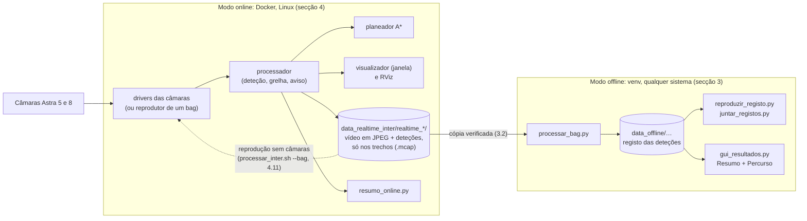

# Aquisição e Processamento de Imagem em ROS 2 (Jazzy)

Sistema para recolher e analisar o vídeo de duas câmaras Orbbec Astra (**5** e **8**) montadas num veículo (grupo G5, câmaras laterais), com ROS 2 Jazzy em Docker. Em cada imagem, a distorção da lente é corrigida e três modelos de deteção (todos em formato ONNX, com o `onnxruntime`, sem `ultralytics` nem PyTorch) identificam:
* **objetos** (YOLOv8n): carros, camiões, autocarros, motas, bicicletas, pessoas, semáforos e sinais STOP;
* **linhas da estrada** (CLRNet);
* **área circulável** (YOLOP), a estrada por onde o veículo pode seguir.

A partir delas, uma **grelha local** à volta do carro alimenta o planeador A\* comum da aula 10 e um **aviso de mudança de faixa** (secção 5.4).

Há **dois modos de trabalho**, com o mesmo código de deteção e o mesmo desenho do ecrã, ligados pelo bag `.mcap` gravado no veículo:
* **Modo online** (secção 4, Docker em Linux): é a **aquisição**. No veículo, as câmaras, o processamento ao vivo e a gravação correm todos no Docker; a deteção corre sempre, e o vídeo (em JPEG) e as deteções são gravados nos **trechos** marcados durante a viagem. O processamento só processa e publica; o ecrã é outro nó (o visualizador), e há também o RViz. O mesmo Docker **reproduz um bag sem câmaras**, com o mesmo processamento.
* **Modo offline** (secção 3, `venv` em qualquer sistema): começa nos **dados já gravados**. Processa todas as imagens do bag com todo o detalhe, regista as deteções, reproduz e exporta vídeos e mostra os resultados numa janela (resumo e percurso no mapa).

## Índice

| Secção | Conteúdo | Onde corre |
|---|---|---|
| [1](#1-visão-geral) | Visão geral: os dois modos, quando usar cada um, relevância para a parte 2, ficheiros, pré-requisitos e preparação do PC Linux (Docker, projeto, disco externo) | — |
| [2](#2-preparação-calibração-das-câmaras) | Preparação: calibração das câmaras (correção da distorção da lente) | Windows (ou Linux), com Python |
| [3](#3-modo-offline-processar-os-bags-gravados-em-qualquer-sistema) | **Modo offline**: bag gravado → processar → registar → reproduzir → janela de resultados | Windows, Linux ou macOS, com `venv` (sem Docker nem câmaras) |
| [4](#4-modo-online-aquisição-e-processamento-no-veículo-docker) | **Modo online**: câmaras → processamento ao vivo → gravação dos trechos (JPEG) → resumo; visualizador e RViz; reprodução de um bag sem câmaras; hora certa (NTP) | Linux com Docker (CPU ou GPU NVIDIA) |
| [5](#5-modelos-de-deteção-comuns-aos-dois-modos) | Modelos de deteção (comuns aos dois modos): linhas (CLRNet), objetos (YOLO) e estrada (YOLOP); decisão local: posição das câmaras, grelha local, aviso de mudança de faixa e planeador A\* | dentro do processamento |
| [6](#6-referência-rápida-comandos-opções-teclas-e-pastas) | Referência rápida: todos os comandos, opções, teclas, variáveis e pastas | — |

---

## 1. Visão geral

### 1.1 Dois modos, ligados pelo bag gravado no veículo



**A aquisição é feita uma vez, no online.** No veículo, os drivers das câmaras publicam `/camara5/image_raw` e `/camara8/image_raw` (e a versão em JPEG, `/camara<N>/image_raw/compressed`); o processamento corre ao vivo e, nos **trechos** marcados (tecla **R**), grava num bag `.mcap` o vídeo original em JPEG, as deteções, a grelha local, o aviso, o planeador e a posição das câmaras (4.9). O instante de cada imagem é o relógio do PC, por isso o PC tem de ter a hora certa (4.12).

**Depois, o mesmo bag serve os dois modos:**
* no **offline** (secção 3), processa-se **todas** as imagens, com os mesmos trechos (3.6, 4.10), e analisa-se com todo o detalhe;
* no **online em reprodução** (4.11), corre o mesmo processamento do veículo sem câmaras: o reprodutor publica as imagens nos mesmos tópicos dos drivers (o enunciado: "o mesmo nó de perceção corre sem alterações com dados do bag real, com o sistema ao vivo ou com o Gazebo").

| | Modo offline (secção 3) | Modo online (secção 4) |
|---|---|---|
| **Entrada** | um bag já gravado | as câmaras (ao vivo) ou um bag (reprodução) |
| **Imagens processadas** | **todas** (30 por segundo por câmara), ao ritmo que o PC conseguir | as que houver tempo de processar, como num sistema real (cada câmara é processada quando o modelo fica livre; 4.7) |
| **O que se grava** | o registo das deteções nos trechos escolhidos (`data_offline/`) | ao vivo: o vídeo em JPEG e as deteções, **só nos trechos** marcados (`data_realtime_inter/`); em reprodução, nada (só o resumo) |
| **Interação** | pausa, ligar/desligar cada modelo e a correção, marcar trechos, limiares e classes por opção | **R** trecho (gravação), **D** câmara da direita, **Espaço** pausa (reprodução), **Q** termina |
| **Ecrã** | a janela do `processar_bag.py` | o visualizador (outro nó ROS, a partir dos tópicos) e, opcionalmente, o RViz |
| **Resultados** | reprodução e exportação em `.mp4`, janela de resultados com Resumo e **Percurso no mapa** | tópicos ROS (para outros grupos e para a parte 2) e um resumo no fim, com filtro por trecho |
| **Onde corre** | Windows, Linux ou macOS (`venv`), sem câmaras nem Docker | Linux com Docker (CPU ou GPU NVIDIA, escolhida sozinha) |

O que **não** muda entre os dois modos (o mesmo código, os mesmos ficheiros):
* a **correção da distorção** com `config/camera_astra_<N>.yaml` (secção 2) e os **três modelos**, com as mesmas classes e limiares por omissão (secção 5);
* a **grelha local e o aviso de mudança de faixa**, com o `config/montagem_camaras.yaml` (5.4);
* o **formato das deteções**: um tópico por câmara, `/camara<N>/processamento/dados_deteccoes`, com o mesmo JSON (3.7 e 4.9);
* o **desenho do ecrã** (`painel.py` e `visual.py`: cores fixas por modelo e por classe, câmaras lado a lado, 5 à esquerda e 8 à direita, vista de cima com o aviso) e o **resumo das deteções** (mesmos cálculos e cartões: `registo.py` e `gui_comum.py`).

### 1.2 Quando usar cada modo

**O online é sempre o que corre no veículo** (é a aquisição). Escolha como:
* **ao vivo, com processamento** (`bash processar_inter.sh 5 8`): vê as deteções, a grelha e o aviso durante a viagem e grava os trechos que interessam (tecla **R**); `--registar-tudo` grava a viagem toda;
* **só gravação** (`--sem-processamento`): num PC fraco, sem os modelos, só as câmaras e a gravação dos trechos; processa-se depois, no offline;
* **em reprodução** (`--bag <bag.mcap>`, sem câmaras): para ver de novo o que o online fez numa viagem, testar alterações ao processamento ou ao planeador com dados reais, ou para outros grupos (e os docentes) correrem o vosso nó sem câmaras.

**Use o offline quando:**
* precisar de **todas as imagens** processadas (o online, com as duas câmaras, só consegue processar uma parte, sobretudo em CPU);
* quiser **afinar** a deteção: experimentar limiares, classes, com e sem correção da distorção (opções e teclas em 3.4), ou afinar a posição das câmaras com a vista de cima (5.4.6);
* quiser analisar **trechos**, **reproduzir** ou **exportar vídeos** com as deteções desenhadas (3.6 a 3.9);
* quiser o **percurso no mapa**, com as cores do trânsito por intervalo (3.10.2);
* estiver em **Windows** ou noutro PC sem Docker nem câmaras.

### 1.3 Relevância do modo online para a parte 2
O offline serve para desenvolver e validar a deteção (todas as imagens, parâmetros ajustáveis, vídeos e percurso); o **online é o que os outros grupos vão usar** e é a base para a parte 2:
* **Segue a arquitetura pedida:** tudo dentro do Docker, a partir da imagem ROS 2 Jazzy; drivers das câmaras e nó de processamento em serviços do mesmo `compose`; tópicos e tipos standard (`sensor_msgs/Image` e `CompressedImage`, `nav_msgs/OccupancyGrid`, `tf2_msgs/TFMessage`); gravação em MCAP com as imagens comprimidas e o `/tf_static`.
* **Separa o processamento da visualização**, como recomenda o guião da avaliação: o processador só processa e publica; o visualizador e o RViz só subscrevem e mostram (4.2, 4.7).
* **Corre com ou sem câmaras**, sem mudar o nó de processamento (4.11): é o que permite usar os bags reais na parte 2 e, mais tarde, o simulador.
* **Mostra os limites do tempo real:** a frequência de deteção de cada câmara (no painel e no resumo), o peso de cada modelo e a diferença entre CPU e GPU; a tecla **D** troca cobertura (duas câmaras) por frequência (uma câmara).
* **Grava no mesmo bag, com o mesmo relógio:** vídeo, deteções, grelha, aviso, planeador, estado das câmaras e trechos, só nas partes marcadas, o que torna viável gravar em viagens longas. Outros sensores (por exemplo, o **GPS**) entram como mais um tópico nesse bag.

### 1.4 Ficheiros do repositório

| Ficheiro | Para quê | Modo |
|---|---|---|
| `calibrar_astra.py` | calibração de cada câmara (secção 2) | preparação |
| `config/camera_astra_5.yaml`, `config/camera_astra_8.yaml` | calibração de cada câmara (K e D) | ambos |
| `processar_bag.py` | processamento de um bag: correção, deteções, vídeo, registo (3.4) | offline |
| `reproduzir_registo.py`, `reproducao.py` | refazer o vídeo de um registo, no ecrã ou em `.mp4` (3.8) | offline |
| `juntar_registos.py` | juntar registos das câmaras 5 e 8 feitos em sessões diferentes (3.9) | offline |
| `gui_resultados.py` | janela de resultados: Resumo e Percurso (3.10) | offline |
| `teclado.py` | teclas lidas no terminal, sem janela (`--sem-interface`) | offline |
| `Dockerfile_realtime_inter`, `compose_realtime_inter.yaml`, `compose_realtime_gpu.yaml`, `processar_inter.sh` | Docker do online: drivers, processamento, planeador, visualizador, RViz e reprodutor; deteção de CPU/GPU (4.2) | online |
| `processar_tempo_real.py` | nó de processamento: deteções, grelha, aviso, TF, gravação dos trechos (4.2) | online |
| `visualizador.py` | nó de visualização: a janela, a partir dos tópicos (4.7) | online |
| `reprodutor.py` | reprodução de um bag nos tópicos das câmaras, trecho a trecho (4.11) | online |
| `gravacao_online.py` | gravação do bag do online, só nos trechos, com as imagens em JPEG (4.9) | online |
| `relogio.py` | verificação da hora do PC (NTP) no arranque (4.12) | online |
| `config/g05.rviz` | configuração do RViz: câmaras, TF, grelha local e caminho do A\* (4.13) | online |
| `trecho.sh` | começar/terminar um trecho sem janela (4.7) | online |
| `alternar_camara.sh` | desligar/ligar a câmara da direita sem janela (4.7) | online |
| `resumo_online.py` | janela do resumo no fim do online (4.8) | online |
| `objetos.py`, `linhas.py`, `estrada.py` | os três modelos (secção 5) | ambos |
| `gpu.py` | escolha da GPU ou do CPU para os três modelos e confirmação no arranque (3.5) | ambos |
| `config/montagem_camaras.yaml` | posição e orientação de cada câmara no carro, e limites da grelha local (5.4.2) | ambos |
| `geometria.py` | passagem imagem ↔ chão e TF das câmaras (5.4) | ambos |
| `grelha_local.py` | grelha de ocupação local (`nav_msgs/OccupancyGrid`) e vista de cima (5.4) | ambos |
| `aviso_faixa.py` | aviso de mudança de faixa, a partir da grelha (5.4.3) | ambos |
| `src/va_planeamento/` | planeador A\* comum da aula 10, copiado sem alterações (5.4.4) | online |
| `config/planeador.yaml` | parâmetros do planeador A\* (5.4.4) | online |
| `modelos/` | `objetos.onnx`, `linhas.onnx` + `linhas.json`, `estrada.onnx` (secção 5) | ambos |
| `painel.py` | o desenho do ecrã, comum ao visualizador do online, ao `processar_bag.py` e à reprodução dos registos | ambos |
| `visual.py` | desenho das deteções, painel e câmaras lado a lado | ambos |
| `leitura_bag.py` | leitura dos bags (imagens com e sem compressão) e correção da distorção | ambos |
| `registo.py` | formato das deteções, registo e estatísticas do resumo | ambos |
| `gui_comum.py` | cores e cartões do resumo (janela do offline e do online) | ambos |
| `exportar_linhas.py` | só para gerar de novo o modelo das linhas (5.1.4) | — |
| `requirements.txt` | bibliotecas Python (`venv` do offline e Docker do online) | ambos |

### 1.5 Pré-requisitos
* **Modo online (secção 4):** Linux (Ubuntu 24.04 nativo, como pede o enunciado para a aquisição) com Docker e Docker Compose (instalação em 1.6); nada mais é instalado no PC. Para usar a GPU: placa NVIDIA e NVIDIA Container Toolkit (4.3).
* **Modo offline (secção 3):** Python 3 (com `venv`), em Windows, Linux ou macOS. GPU NVIDIA opcional (3.5).
* **Calibração (secção 2):** Python 3 com `opencv-python` e `numpy`, a câmara ligada por USB e um xadrez impresso.
* **Percurso no mapa (3.10.2):** ligação à internet (mapa do OpenStreetMap).

### 1.6 Preparar o PC Linux do Docker (uma vez)
O Docker do online (secção 4) corre no PC Linux do veículo. Nesse PC, uma única vez:
1. **Instalar o Docker e o Docker Compose:** siga o guia oficial ([docs.docker.com/engine/install/ubuntu](https://docs.docker.com/engine/install/ubuntu/)), que instala o Docker Engine e o plugin `docker compose`.
2. **Usar o Docker sem `sudo`:** junte o seu utilizador ao grupo `docker` e volte a entrar na sessão (ou reinicie o PC):
   ```bash
   sudo usermod -aG docker $USER
   ```
3. **Confirmar:**
   ```bash
   docker compose version
   docker run --rm hello-world
   ```
   Se aparecer `permission denied ... docker.sock`, falta o passo 2 (ou voltar a entrar na sessão).
4. **Obter o projeto** (a pasta onde se corre tudo; as gravações ficam dentro dela):
   ```bash
   git clone https://github.com/afv2003/aquisi-o_astra_orbec
   cd aquisi-o_astra_orbec
   ```
   Para atualizar mais tarde: `git pull` nessa pasta. Os modelos de `modelos/` vêm com o repositório.
5. **GPU NVIDIA (opcional):** 4.3.
6. **Hora certa (NTP):** confirme que `timedatectl` diz `System clock synchronized: yes` (4.12).

**Gravar num disco externo:** as gravações ficam numa pasta dentro do projeto (`data_realtime_inter/`); com as imagens em JPEG, conte com cerca de **0,3 a 0,6 GB por minuto de trecho** com as duas câmaras (o valor exato depende da cena). Para irem para um disco externo, **clone o projeto no próprio disco** (passo 4, dentro da pasta do disco) e corra os comandos a partir daí; não use um atalho (*symlink*) para a pasta de dados, porque o Docker monta a pasta do projeto e não segue atalhos para fora dela. Use um disco **USB 3**, de preferência formatado em **ext4** (ou exFAT, se também tiver de ser lido no Windows), numa porta USB de outro lado das câmaras. Para **reproduzir** um bag (4.11), ele pode estar em qualquer pasta (também no disco externo).

---

## 2. Preparação: calibração das câmaras

A lente da Astra curva ligeiramente as linhas retas, sobretudo nos cantos da imagem. A calibração mede essa distorção **uma única vez por câmara**; depois, **nos dois modos**, cada imagem é corrigida antes das deteções (o `processar_bag.py` no offline e o `processar_tempo_real.py` no online usam os mesmos ficheiros e o mesmo código). Os modelos de deteção já estão incluídos no repositório (secção 5): não é preciso preparar mais nada.

### 2.1 Gerar a calibração (uma vez por câmara)
Há duas câmaras Astra, identificadas como **5** e **8**. Cada uma tem a sua calibração, porque duas unidades do mesmo modelo nunca são exatamente iguais.

Num PC (testado em Windows, sem ROS), com a câmara ligada por USB e um xadrez impresso:
```bash
pip install opencv-python numpy
python calibrar_astra.py --listar                                                   # ver o número de cada câmara
python calibrar_astra.py --camara 5 --cam 1 --colunas 9 --linhas 7 --quadrado 25 --auto
```
* `--camara` é a designação da câmara física (**5** ou **8**), obrigatória.
* `--cam` é o número da câmara no PC (`--listar` mostra as disponíveis).
* `--colunas`/`--linhas` são os **cantos internos** do xadrez (10x8 quadrados → 9x7 cantos).
* `--quadrado` é o lado de um quadrado, medido com régua (em mm).
* `--auto` tira as fotos sozinho, quando o xadrez está parado numa posição nova. As outras opções (resolução, critérios das fotos, coeficientes) estão na secção 6.1.
* Mostre o xadrez em várias posições: centro, cantos, perto, longe, inclinado, até as 4 barras (X, Y, Tam, Incl) ficarem verdes ou haver 40 fotos. É o mesmo critério da ferramenta `camera_calibration` do ROS; antes disso, R, C e Q não ficam disponíveis.
* Tal como no ROS, só são estimados k1 e k2 (k3 = 0) e o xadrez é ignorado quando algum canto fica a menos de 8 px da borda da imagem.
* Depois, por esta ordem:
  1. **R**: desliga a captura automática e abre a revisão com o erro de cada foto.
  2. **O**: remove os outliers. **ENTER** volta à câmara.
  3. **C**: calibra com as fotos que ficaram.
  4. **U** (opcional): mostra a imagem corrigida para verificar. O valor `lin.` mostra quanto as linhas do xadrez se afastam de uma reta, em px; quanto mais perto de 0, melhor.
  5. **Q**: grava e sai.
* Se carregar em **Q** sem ter feito R → O → C, aparece um aviso. Um segundo **Q** grava assim mesmo; outra tecla cancela. **ESC** sai sem gravar.
* Todas as teclas (incluindo as da revisão) estão na secção 6.2.
* O resultado fica em `calibracoes/camara5_<data_hora>/camera_astra_5.yaml` (ou `camara8_...` / `camera_astra_8.yaml`).

**Como funciona o `calibrar_astra.py`:** em cada imagem procura os cantos do xadrez (`findChessboardCornersSB`, refinados com `cornerSubPix`) e, com `--auto`, guarda a foto quando a posição do xadrez é suficientemente diferente das anteriores (critério do ROS). Na calibração (`calibrateCameraExtended`, modelo `plumb_bob`) calcula a matriz da câmara K e os coeficientes de distorção D, com o erro de cada foto. Grava:
* `camera_astra_<N>.yaml`: K e D no formato `camera_info` do ROS (o mesmo da ferramenta `camera_calibration`), lido pelos dois modos;
* `calibracao.json`: os mesmos valores mais o relatório (erro RMS, erro por foto, fotos rejeitadas);
* `imagens/`: as fotos usadas, para repetir ou verificar a calibração.

### 2.2 Copiar a calibração para o projeto
Copie o ficheiro gerado de cada câmara para a pasta `config/` deste repositório (e faça commit, para ficar disponível em todos os PCs, incluindo o do veículo):
```
config/camera_astra_5.yaml
config/camera_astra_8.yaml
```

### 2.3 Como a calibração é usada
* **Offline** (`processar_bag.py`, 3.4): usa automaticamente o `config/camera_astra_<N>.yaml` de cada câmara processada. Se não existir, tenta o `/camera_info` gravado no bag; se também não houver, processa sem correção e avisa. Opções: `--calib <ficheiro>` (outro ficheiro, só com uma câmara) e `--sem-correcao`; a tecla **C** liga/desliga a correção durante o vídeo, para comparar.
* **Online** (`processar_tempo_real.py`, 4.6): usa o mesmo `config/camera_astra_<N>.yaml`; se não existir, avisa e essa câmara não é corrigida. Opção `--sem-correcao` no `processar_inter.sh`.
* Nos dois modos, as deteções são feitas na imagem **corrigida**, e as suas coordenadas são as dessa imagem (campo `corrigida` no JSON das deteções). O vídeo gravado no bag é sempre o **original** (em JPEG), sem correção.
* A correção é rápida: os mapas de correção são calculados uma vez (`initUndistortRectifyMap`) e aplicados a cada imagem (`remap`).
* Corra os scripts a partir da pasta do repositório (o caminho `config/` é relativo a essa pasta).

> **Importante:** a calibração só é válida para a resolução usada (640x480, a resolução por omissão do `usb_cam`). Se mudar a resolução, a focagem ou a lente, repita a calibração.

---

## 3. Modo offline: processar os bags gravados (em qualquer sistema)

O offline **começa nos dados já gravados**: não adquire nada, não precisa das câmaras nem do Docker, e corre num `venv` em Windows, Linux ou macOS (o enunciado: "o processamento off-line e a visualização dos dados já gravados podem ser feitos em qualquer sistema operativo"). A aquisição é sempre feita no veículo, pelo Docker do online (secção 4). O fluxo de trabalho segue o caminho dos dados:

```
 no veículo (Linux + Docker, secção 4)                      em qualquer PC (venv)
 ─────────────────────────────────────                      ──────────────────────────────────────────────────────
 processar_inter.sh ──▶ data_realtime_inter/realtime_*/ ──3.2──▶ 3.4 processar_bag.py ──▶ vídeo com as deteções (janela)
 (câmaras 5 e 8: vídeo em JPEG e        .mcap            cópia          │
  deteções, só nos trechos)                              verificada     └── 3.6 registo ──▶ data_offline/<sessão>/<ensaio>/
                                                                                              │
                                                               3.8 reproduzir_registo.py ◀──┤  (rever / exportar .mp4)
                                                               3.9 juntar_registos.py    ◀──┤  (sessões de cada câmara)
                                                               3.10 gui_resultados.py    ◀──┘  (Resumo + Percurso no mapa)
```

### 3.1 De onde vêm os bags
O `processar_bag.py` lê qualquer bag `.mcap` com as imagens das câmaras num tópico por câmara:
* **Bags do online** (secção 4, `data_realtime_inter/realtime_<data_hora>/`): o caso normal. Têm o vídeo original de cada câmara **comprimido em JPEG** (`/camara<N>/image_raw/compressed`, `sensor_msgs/CompressedImage`, como pede o enunciado), só nos **trechos** marcados durante a viagem, e os trechos são usados sozinhos no registo (4.10). Para guardar a viagem toda, grave no online com `--registar-tudo`; num PC fraco, sem processar, com `--sem-processamento` (4.6).
* **Bags antigos**, do Docker de aquisição que este projeto tinha antes (`data/viagem_<data_hora>/`, imagens sem compressão em `/camara<N>/image_raw`, a viagem inteira): continuam a ler-se da mesma forma.
* Um bag cortado (gravação interrompida, sem índice) ou com blocos estragados também se lê (3.4).

O mesmo bag pode também ser **reproduzido no Docker do online**, sem câmaras, com o processamento do online (4.11). A diferença: o online processa como ao vivo (as imagens que houver tempo de processar, resultados em tópicos ROS); o offline processa **todas** as imagens e faz o registo, a reprodução, os vídeos e a janela de resultados.

### 3.2 Copiar os bags para o PC de processamento (com verificação)
Os bags são ficheiros grandes (com as imagens em JPEG, cerca de 0,3 a 0,6 GB por minuto de trecho com as duas câmaras) e estragam-se facilmente numa cópia, sem aviso: o ficheiro fica com o tamanho certo, mas com blocos danificados (pontos coloridos na imagem, ou erros a ler o bag). Já aconteceu neste projeto: os bags passaram do Ubuntu para uma pen, depois para o Windows e foram enviados pelo browser do Windows; chegaram estragados, embora o original estivesse bom.
1. **No PC da gravação, logo depois de gravar**, guarde a "impressão digital" de cada bag:
   ```bash
   sha256sum data_realtime_inter/realtime_<data_hora>/*.mcap > data_realtime_inter/realtime_<data_hora>/sha256.txt
   ```
2. **Envie diretamente a partir do Linux** onde foi gravado (zip e WeTransfer no browser do Ubuntu, `scp`, disco de rede), com o `sha256.txt` dentro da pasta. Evite passos intermédios:
   * **Pen ou disco USB:** ejete sempre antes de tirar (no Linux, `sync` antes de ejetar); se não, parte dos dados pode não ter sido escrita.
   * **Dual boot:** não passe os bags por uma partição NTFS partilhada nem leia a partição do Ubuntu no Windows com programas extra; com o Arranque Rápido do Windows ligado, os ficheiros podem ficar corrompidos.
3. **No PC de destino, antes de processar**, confirme que o código é igual ao do `sha256.txt`:
   ```bash
   sha256sum -c data/realtime_<data_hora>/sha256.txt                               # Linux
   certutil -hashfile data\realtime_<data_hora>\realtime_<data_hora>_0.mcap SHA256   # Windows (comparar à mão)
   ```
   * O "Testar arquivo" do 7-Zip só confirma que o zip chegou igual ao que foi criado; não deteta um ficheiro que já estava estragado antes de entrar no zip. Por isso, a comparação com o `sha256.txt` do PC da gravação é a que conta.
4. Coloque a pasta da sessão dentro de `data/` na pasta do projeto (`data/realtime_<data_hora>/`; os bags antigos, `data/viagem_<data_hora>/`). É aí que o `reproduzir_registo.py` e a janela de resultados procuram o bag original, se ele tiver mudado de sítio.

### 3.3 Preparar o ambiente Python (`venv`, apenas na 1.ª vez)
O processamento é feito diretamente no computador, num ambiente virtual Python (`venv`), sem precisar das câmaras nem do Docker. Funciona em **Linux, Windows e macOS**; cada sistema precisa do seu próprio `venv` (um `venv` criado num sistema não funciona no outro).

Abra o terminal na pasta do projeto e crie o ambiente com as bibliotecas do `requirements.txt` (`opencv-python`, `numpy`, `mcap-ros2-support`, `pyyaml`, `pillow`, `customtkinter` e `tkintermapview` para a janela de resultados, e o motor `onnxruntime`):

**Linux / macOS:**
```bash
python3 -m venv venv
source venv/bin/activate
pip install --upgrade pip
pip install -r requirements.txt
```
**Windows** (Linha de Comandos):
```
python -m venv venv
venv\Scripts\activate
python -m pip install --upgrade pip
pip install -r requirements.txt
```
* Por omissão, o `requirements.txt` vem configurado para **CPU** (`onnxruntime`), que funciona em qualquer PC. Para usar uma **GPU NVIDIA**, veja a secção 3.5 antes de instalar.
* **Nunca deixe `onnxruntime` e `onnxruntime-gpu` instalados ao mesmo tempo**: os dois pacotes entram em conflito e o processamento cai silenciosamente para CPU (3.5).
* **Sempre que abrir um terminal novo**, ative o ambiente antes de correr os scripts (`(venv)` aparece no início da linha):
  ```bash
  source venv/bin/activate      # Linux / macOS
  venv\Scripts\activate         # Windows
  ```
  Para sair: `deactivate`.
* Quando o `requirements.txt` ganhar uma biblioteca nova (depois de um `git pull`), num `venv` que já existe, instale só essa (`pip install <nome>`), sobretudo num `venv` de GPU.

### 3.4 Processar um bag (`processar_bag.py`)
> **Antes:** o `venv` criado e ativado (3.3) e o bag copiado e verificado (3.2). Corra na pasta do projeto (os caminhos `config/` e `modelos/` são relativos a ela).

1. **Encontrar o bag** (opcional):
   ```bash
   find data/ -name "*.mcap"      # Linux / macOS
   dir /s /b data\*.mcap          # Windows
   ```
2. **Confirmar que o bag tem as duas câmaras** (opcional; só em bags completos, com o índice no fim):
   ```bash
   python -c "from mcap.reader import make_reader; s=make_reader(open('data/<pasta>/<ficheiro>.mcap','rb')).get_summary(); [print(c.topic, s.statistics.channel_message_counts.get(i,0), 'mensagens') for i,c in s.channels.items()]"
   ```
   Deve aparecer `/camara5/image_raw/compressed` e `/camara8/image_raw/compressed` (bags do online; nos antigos, `/camara5/image_raw` e `/camara8/image_raw`) com números de mensagens parecidos (cerca de 1800 por minuto de trecho, a 30 imagens por segundo).
3. **Processar:**
   ```bash
   python processar_bag.py data/<pasta>/<ficheiro>.mcap
   ```
   *(Exemplo: `python processar_bag.py data/realtime_20261124_101500/realtime_20261124_101500_0.mcap`)*

**O que o script faz em cada imagem, por esta ordem:**
1. lê a imagem do tópico da câmara e converte-a para cores (BGR; as imagens em JPEG dos bags do online são descodificadas);
2. corrige a distorção da lente com a calibração dessa câmara (secção 2);
3. deteta as linhas da estrada (CLRNet, 5.1), a área circulável (YOLOP, 5.3) e os objetos (YOLO, 5.2), na imagem corrigida e ainda sem desenhos;
4. se estiver a registar, guarda as deteções dessa imagem (3.6);
5. desenha os resultados (estrada, linhas e objetos, por esta ordem) e o painel de informação, e mostra tudo na janela. O desenho é o do `painel.py`, o mesmo do visualizador do online (4.7) e da reprodução dos registos (3.8): o ecrã tem o mesmo aspeto nos dois modos.

**Câmaras:** por omissão processam-se **todas as câmaras do bag**. Com as duas, o vídeo mostra-as **lado a lado, a 5 à esquerda e a 8 à direita**, cada uma com o seu painel.

| Opção | Processa |
|---|---|
| (nenhuma) | todas as câmaras do bag (as duas, lado a lado, ou a única que tiver) |
| `--camara 5` / `--camara 8` | só essa câmara |
| `--camara 5,8` (ou `todas`) | as duas (o mesmo que sem a opção, num bag com as duas) |

* Cada câmara usa a sua calibração (`config/camera_astra_5.yaml` e `config/camera_astra_8.yaml`); `--calib` só se usa com uma câmara.
* As imagens das duas câmaras vêm intercaladas no bag e são processadas pela ordem de gravação, cada uma com os mesmos modelos: **com as duas câmaras, o processamento demora o dobro** (passam o dobro das imagens). Para ir mais depressa, use `--sem-interface` (abaixo), desligue os modelos de que não precisa, ou processe uma câmara de cada vez e junte os registos depois (3.9).
* A janela é larga (1284 px com as Astra) e pode ser redimensionada com o rato, mantendo a proporção. Antes de chegar a primeira imagem de uma câmara, o lado dela aparece escuro, com `à espera da primeira imagem`.
* Os bags antigos, de uma só câmara (tópico `/image_raw`), continuam a funcionar: a câmara lê-se do nome da pasta (`viagem_camara5_...`) ou de `--camara`.
* Os bags do **modo online** são processados com os trechos do online (4.10).

**Ligar e desligar cada deteção** (as opções podem juntar-se, por exemplo `--sem-objetos --sem-estrada`):

| Deteção | Desligar ao arrancar | Tecla no vídeo | Confiança mínima (por omissão) | Mais opções |
|---|---|---|---|---|
| Objetos (YOLO) | `--sem-objetos` | **O** | `--conf-objetos` (0.25) | `--classes-objetos` (5.2.1) |
| Linhas (CLRNet) | `--sem-linhas` | **L** | `--conf-linhas` (0.4) | `--corte-linhas` (5.1.1) |
| Estrada (YOLOP) | `--sem-estrada` | **E** | `--conf-estrada` (classe mais provável) | — |
| Todas | `-v` (só vídeo) | **V** (desliga todas / volta a ligá-las) | — | — |

* **Confiança mínima:** um número de 0 a 1. Mais alto mostra menos deteções, mas mais seguras; mais baixo mostra mais, incluindo erradas.
* Uma deteção desligada com a tecla deixa também de ser calculada, por isso o vídeo fica mais rápido; no painel, o marcador fica vazio e aparece `desligado`.
* Uma deteção desligada na linha de comandos nem é carregada (arranque mais rápido), e a sua tecla não faz nada.

**Teclas no vídeo:** **Espaço** pausa/retoma, **C** liga/desliga a correção da distorção (para comparar), **O**/**L**/**E**/**V** ligam/desligam as deteções, **R** começa/termina um trecho do registo (3.6), **G** mostra/esconde a grelha local (vista de cima, à direita do vídeo; 5.4), **Q** ou **Esc** termina. No fim do vídeo aparece `Fim do vídeo`; **Q** fecha a janela. Com as duas câmaras, as teclas atuam nas duas ao mesmo tempo.

**Sem janela (`--sem-interface`):** processa sem mostrar o vídeo, o mais depressa possível (não espera pelo ritmo da gravação e não desenha nada), e mostra o progresso no terminal (tempo, imagens por segundo, imagens de cada câmara e estado do registo). As teclas **R**, **Espaço** e **Q** são lidas no terminal. Serve sobretudo para registar (3.6).

**Informação no vídeo:**
* **Painel** (canto superior esquerdo de cada câmara): tempo decorrido e total, com barra de progresso; câmara e estado da correção (a laranja quando a imagem não está corrigida); uma linha por modelo, identificado pelo nome (`YOLOv8n`, `CLRNet`, `YOLOP`) e por um marcador da sua cor, com o resultado (número de objetos, número de linhas, percentagem da imagem que é área circulável) e o tempo da etapa; no fim, as imagens processadas por segundo e o ritmo da gravação.
* **Indicador de registo** (canto superior direito, a vermelho): `REGISTO · trecho N · tempo`, enquanto um trecho está a ser registado.
* **Grelha local** (à direita do vídeo, com o `config/montagem_camaras.yaml`): a vista de cima à volta do carro, com o que as câmaras veem livre, ocupado ou desconhecido e as linhas da faixa projetadas no chão; é a mesma grelha que o online publica para o planeador (5.4). Serve também para afinar a posição das câmaras (5.4.6). **G** mostra/esconde; `--sem-grelha` desliga (o terminal diz `Grelha local (vista de cima, à direita): câmaras 5 e 8, ...`).
* **Cores fixas**, as mesmas em todas as imagens e nos dois modos (definidas no `visual.py`):

  | Modelo (nome no painel) | Deteta | Desenho | Cor |
  |---|---|---|---|
  | `YOLOP` | área circulável | área semitransparente com o contorno a cheio | verde |
  | `CLRNet` | linhas da estrada | todas as linhas, com um contorno escuro fino | amarelo |
  | `YOLOv8n` | objetos | caixa fina com os cantos reforçados e etiqueta `classe confiança%` | uma cor por classe: `car` azul, `truck` índigo, `bus` roxo, `motorcycle` rosa, `bicycle` rosa-claro, `person` vermelho, `traffic light` laranja, `stop sign` laranja-claro |

  As classes de objetos não usam o verde nem o amarelo, para não se confundirem com a estrada e as linhas. Outras classes (com `--classes-objetos todas`) têm também uma cor fixa, escolhida pelo nome.
* Quando há muitos objetos juntos, as etiquetas que se sobreporiam a outras (ou ao painel) não são escritas; a caixa é sempre desenhada.
* O texto usa uma fonte do sistema (Segoe UI no Windows; Ubuntu ou DejaVu Sans no Linux), através do `pillow`.

**Bags com problemas:**
* Se o `.mcap` estiver vazio (por exemplo, uma cópia que falhou), o script avisa: `não é um ficheiro MCAP válido (0 bytes)`.
* Se a gravação foi interrompida (Docker parado à força, falta de energia, disco cheio) ou a cópia ficou incompleta, falta o índice que o MCAP guarda no fim do ficheiro. O script avisa (`o bag não tem o índice no fim`), lê as imagens sequencialmente desde o início e para no ponto onde o ficheiro foi cortado; o tempo total aparece como desconhecido.
* Se parte do ficheiro estiver estragada (por exemplo, numa cópia ou transferência), o script verifica cada bloco de dados do MCAP, salta os blocos estragados (avisa `bloco estragado no bag`) e continua; no fim indica quantos segundos de vídeo faltam. Se isto acontecer, copie de novo o ficheiro original e verifique-o (3.2).

Todas as opções do `processar_bag.py` estão também na secção 6.1.

### 3.5 Desempenho e GPU (no `venv`)
No painel do vídeo aparece o tempo de cada etapa (à direita de cada deteção) e, em baixo, as imagens processadas por segundo, por exemplo `1.2 img/s · gravado a 30 img/s`; no fim, o terminal mostra a média.
* **Em CPU, o processamento é bastante mais lento do que a gravação** (30 imagens por segundo = 33 ms por imagem). As etapas mais pesadas são a deteção de linhas e a da estrada (cada uma, algumas centenas de ms por imagem, conforme o processador), seguidas do YOLO (cerca de 100 ms). O vídeo não perde imagens: só passa mais devagar.
* **Com GPU** (referência medida numa NVIDIA RTX 3050 Ti Laptop, imagens de 640 px de largura, antes da passagem do YOLO para ONNX): objetos cerca de 20 ms, linhas cerca de 37 ms e estrada cerca de 62 ms por imagem; com as três deteções, cerca de 7 a 8 imagens por segundo. Para ir mais depressa, desligue as deteções de que não precisa (3.4).
* Com janela, o script espera apenas o que falta para acompanhar o ritmo da gravação; quando o processamento já é mais lento, não acrescenta espera. Sem janela (`--sem-interface`), nunca espera.
* **Para usar a GPU NVIDIA** (opcional; o `requirements.txt` vem em CPU por omissão, com as opções de GPU já preparadas em comentário):
  1. Confirme a versão CUDA suportada pelo driver da sua placa gráfica:
     ```bash
     nvidia-smi
     ```
     Veja o valor de `CUDA Version` no canto superior direito da tabela.
  2. Abra o `requirements.txt`, comente a linha de CPU (`# onnxruntime`) e descomente **apenas uma** das linhas de GPU:
     * **CUDA 13.0 ou superior:** `onnxruntime-gpu[cuda,cudnn]`
     * **CUDA 12.x (drivers mais antigos):** `onnxruntime-gpu[cuda,cudnn]==1.26.0`
     *(O extra `[cuda,cudnn]` instala automaticamente as bibliotecas CUDA e cuDNN via `pip`, sem ser preciso instalar o CUDA no sistema.)*
  3. Se o `venv` ainda não existir, crie-o (3.3). Se já tinha instalado a versão CPU no mesmo `venv`, desinstale-a primeiro:
     ```bash
     pip uninstall -y onnxruntime onnxruntime-directml
     pip install -r requirements.txt
     ```
  4. Confirme no terminal, ao arrancar o `processar_bag.py`: `Deteção de objetos: ATIVADA (YOLOv8n, GPU (CUDA), ...)`, `Deteção de linhas: ATIVADA (..., GPU (CUDA), ...)` e `Deteção da estrada: ATIVADA (..., GPU (CUDA), ...)`.
  > **Atenção:** não deixe `onnxruntime` e `onnxruntime-gpu` ativos ao mesmo tempo no `requirements.txt`, nem corra `pip install -r requirements.txt` num `venv` de GPU depois de um `git pull` que volte a ativar o `onnxruntime`. O `pip` instala a versão de CPU ao lado da versão GPU, os dois partilham os mesmos ficheiros e os modelos passam a correr no CPU sem dar erro (só ficam várias vezes mais lentos). Para não mexer no ficheiro partilhado, pode instalar a versão GPU à mão: `pip install "onnxruntime-gpu[cuda,cudnn]==1.26.0"` (ou sem `==1.26.0` para CUDA 13).
* **Se ficar lento de repente** (por exemplo, linhas e estrada a mais de 150 ms por imagem com GPU):
  1. Veja no terminal, no arranque, se as três deteções dizem `GPU (CUDA)` ou `CPU`.
  2. Veja que versões do `onnxruntime` estão instaladas: `pip list | findstr onnxruntime` (Windows) ou `pip list | grep onnxruntime` (Linux).
  3. Se aparecerem as duas (`onnxruntime` e `onnxruntime-gpu`), desinstale ambas e reinstale só a versão GPU (desinstalar só a de CPU pode estragar a outra, porque partilham ficheiros):
     ```bash
     pip uninstall -y onnxruntime onnxruntime-gpu
     pip install "onnxruntime-gpu[cuda,cudnn]"          # ou ==1.26.0 se o driver for CUDA 12.x
     ```
  4. Num portátil, ligue o carregador: só com bateria, a GPU fica muito mais lenta.
* Não use o `onnxruntime-directml`: foi testado e falhou com o modelo de linhas na RTX 3050 Ti (a GPU deixou de responder).
* **Bibliotecas do cuDNN no Windows:** com o `onnxruntime-gpu[cuda,cudnn]`, as bibliotecas da NVIDIA ficam dentro do `venv` (`venv\Lib\site-packages\nvidia\<biblioteca>\bin`). O cuDNN carrega algumas só ao correr o modelo (por exemplo o `cudnn_engines_tensor_ir64_9.dll`, nas versões recentes) e, sem essas pastas no `PATH`, falhava com `Could not locate cudnn_..._9.dll` e passava sozinho para o CPU. O `gpu.py` acrescenta essas pastas ao `PATH` (só do próprio processo): não é preciso fazer nada.
* **No arranque, cada modelo corre uma vez numa imagem neutra** (`gpu.py`). Se a GPU só falhar ao correr, o `onnxruntime` passa para o CPU e aparece `Aviso: a GPU (CUDA) falhou ao correr o modelo de ...; a usar o CPU`. O dispositivo indicado no arranque, e guardado no registo, é sempre o que fica de facto em uso.
* Se a GPU falhar mais tarde numa deteção, o script avisa e continua em CPU. Para voltar ao CPU de forma permanente: `pip uninstall -y onnxruntime-gpu` e `pip install onnxruntime`.

### 3.6 Registar as deteções (trechos)
O `processar_bag.py` pode guardar as deteções de cada imagem num ficheiro, para serem usadas depois sem voltar a correr os modelos. O formato das deteções é **o mesmo do modo online** (4.9), para as duas gravações se lerem da mesma forma.

O registo é feito por **trechos**: só se guardam as imagens entre o início e o fim de cada trecho. Pode haver vários trechos na mesma execução; ficam todos no mesmo registo (o mesmo "ensaio").
```bash
python processar_bag.py <bag>.mcap                                   # tecla R: começa/termina cada trecho (as duas câmaras)
python processar_bag.py <bag>.mcap --sem-interface                   # sem janela; tecla R no terminal
python processar_bag.py <bag>.mcap --sem-interface --registar-tudo   # o vídeo todo, sem teclas
python processar_bag.py <bag>.mcap --sem-interface --trechos "10-20,35.5-50,60-"
python processar_bag.py <bag>.mcap --camara 5 --registar-tudo        # só a câmara 5
python processar_bag.py <bag>.mcap --registar-tudo --pasta-registo outra_pasta   # registos noutra pasta
```
* **Tecla R** (com ou sem janela): a primeira vez começa um trecho, a seguinte termina-o, e assim sucessivamente. Com janela, aparece no canto superior direito o indicador vermelho `REGISTO · trecho N · tempo`; sem janela, o estado aparece na linha de progresso do terminal. Se o vídeo acabar (ou carregar em Q) com um trecho aberto, o trecho termina na última imagem processada.
* **`--trechos`**: os trechos em segundos desde o início do bag (`60-` = do segundo 60 até ao fim). Dá sempre os mesmos trechos, ao contrário da tecla; com esta opção a tecla R não é usada. **`--registar-tudo`** é o mesmo que `--trechos 0-`.
* **Bag do modo online** (já gravado só nos trechos, 4.9): sem `--trechos`, os trechos do registo são **os do online**, automaticamente (mesmos números e instantes; a tecla R não é usada). Com `--trechos`, registam-se os pedidos, em segundos desde o início da sessão online (4.10).
* **`--sem-interface`** é a forma mais rápida de registar. Se a entrada não for um terminal (por exemplo, num contentor sem `-it`), as teclas não funcionam e o script avisa: use `--trechos` ou `--registar-tudo`.
* **Duas câmaras:** um só ensaio para as duas; os trechos são **comuns** (a tecla R ou `--trechos` marcam o mesmo intervalo de tempo nas duas câmaras) e cada câmara tem o seu tópico no `deteccoes.mcap`, como no modo online.
* O que fica registado é o que foi calculado em cada imagem: se desligar um modelo com O/L/E, ou a correção com C, durante um trecho, o registo indica-o imagem a imagem.
* No fim, o terminal mostra a pasta do registo, os trechos (com as imagens de cada câmara) e os comandos para os ver (3.8 e 3.10).

### 3.7 Onde fica o registo e formato
Cada execução com pelo menos um trecho cria uma pasta (um **ensaio**):
```
data_offline/<viagem>/camaras5e8_<data_hora>/     (duas câmaras; com uma: camara5_<data_hora>/ ou camara8_...)
    deteccoes.mcap    as deteções de todas as imagens de todos os trechos (de todas as câmaras)
    ensaio.json       bag de origem, câmaras, calibração de cada câmara, modelos e limiares, e a lista de trechos
    trecho_<N>.mp4    (só depois de exportar com o reproduzir_registo.py, 3.8)
```
* **`deteccoes.mcap`**: um ROS bag (MCAP), como o do modo online, com uma mensagem por imagem no tópico da sua câmara, `/camara5/processamento/dados_deteccoes` ou `/camara8/processamento/dados_deteccoes`, do tipo `std_msgs/msg/String`, com um JSON:

  | Campo | Conteúdo | Também no online (4.9) |
  |---|---|---|
  | `objetos` | `[{"classe": "car", "confianca": 0.84, "caixa": [x1, y1, x2, y2]}, ...]` | sim |
  | `linhas` | pontos de cada linha, `[[[x, y], ...], ...]` | sim |
  | `estrada_percentagem` | fração da imagem que é área circulável (0 a 1) | sim |
  | `stamp_ns` | instante da imagem no bag original (ns): é o que liga a deteção à imagem | sim (o `header.stamp` da imagem) |
  | `camara` | câmara da imagem (`"5"` ou `"8"`; também está no tópico) | sim |
  | `corrigida` | se a imagem estava corrigida da distorção (as coordenadas são dessa imagem) | sim |
  | `trecho` | número do trecho | não (o trecho sabe-se pelo tópico `/processamento/trechos`) |
  | `modelos_ativos` | que modelos correram nessa imagem | não (correm sempre os três) |
  | `estrada_contornos`, `estrada_buracos` | contorno da área circulável, para a voltar a desenhar | sim (o visualizador desenha-a) |

  Quem só lê os três primeiros campos não é afetado pelos outros. No offline, o instante de cada mensagem no MCAP é também o da imagem original; no online, o instante da mensagem é o do processamento, e o da imagem é o `stamp_ns`.
* **`ensaio.json`**: texto legível, com tudo o que é preciso para refazer os vídeos: caminho do bag; a lista `camaras`, com o tópico da imagem, o tópico das deteções, a calibração usada (K, D) e o tamanho da imagem de cada câmara; nomes e limiares dos modelos; o tempo médio de cada modelo; e para cada trecho o início e o fim (em ns e em segundos desde o início do bag) e o número de imagens (total e `imagens_por_camara`). É atualizado sempre que um trecho termina, por isso não se perde se o programa parar. Os registos antigos, de uma câmara (sem a lista `camaras`), continuam a ser lidos.
* **Tamanho:** cerca de 3 KB por imagem (cerca de 300 MB por hora de vídeo a 30 imagens por segundo, com os três modelos ligados; o dobro com as duas câmaras).
* A pasta `data_offline/` não vai para o git (está no `.gitignore`), tal como `data/`.

### 3.8 Rever ou exportar um trecho (`reproduzir_registo.py`)
> **Antes:** um registo feito com o `processar_bag.py` (3.6) e o bag original acessível (no sítio onde foi processado, em `data/`, ou indicado com `--bag`); o `venv` ativado.

Refaz o vídeo de um registo **sem voltar a correr os modelos**: lê do bag original só as imagens de cada trecho e junta a cada uma as deteções com o mesmo instante (`stamp_ns`), com a mesma correção da distorção (a calibração guardada no `ensaio.json`) e o mesmo aspeto do `processar_bag.py`.
```bash
python reproduzir_registo.py                                     # lista os registos e os seus trechos
python reproduzir_registo.py data_offline/<viagem>/<ensaio>             # mostra todos os trechos, por ordem
python reproduzir_registo.py data_offline/<viagem>/<ensaio> --trecho 2  # só o trecho 2 (pode repetir: --trecho 1 --trecho 3)
python reproduzir_registo.py data_offline/<viagem>/<ensaio> --exportar  # grava trecho_<N>.mp4 na pasta do ensaio
python reproduzir_registo.py data_offline/<viagem>/<ensaio> --exportar --sem-interface   # só grava, sem janela
python reproduzir_registo.py data_offline/<viagem>/<ensaio> --camara 8  # registo de duas câmaras: só a câmara 8
python reproduzir_registo.py data_offline/<viagem>/<ensaio> --bag <caminho do .mcap>     # bag mudado de sítio
```
* **Teclas:** **Espaço** pausa, **N** passa ao trecho seguinte, **Q** ou **Esc** sai.
* **Velocidade (só na janela):** **1** tempo real, **2** duas vezes mais lento, **3** três vezes mais lento; **-** e **+** abrandam ou aceleram em passos de 0.5x, entre 1x e 3x. A velocidade aparece no canto inferior direito. O vídeo exportado (`--exportar`) fica sempre em tempo real, qualquer que seja a velocidade escolhida.
* **Duas câmaras:** por omissão, as imagens aparecem lado a lado (5 à esquerda, 8 à direita), e o `.mp4` exportado também (`trecho_<N>.mp4`). Com `--camara 5` ou `--camara 8` mostra-se e exporta-se só essa câmara (`trecho_<N>_camara8.mp4`). O ritmo do vídeo é o da câmara com mais imagens no trecho; a outra câmara mostra sempre a sua imagem mais recente.
* **Bag original:** é procurado onde estava no processamento e em `data/<viagem>/`. Se o mudou de sítio, use `--bag`. O script avisa se o tamanho não for o do bag processado.
* Os vídeos `.mp4` têm o ritmo da gravação (por exemplo, 30 imagens por segundo), qualquer que tenha sido a velocidade do processamento.
* Se algumas imagens de um trecho não tiverem deteções no registo (por exemplo, blocos do bag que estavam estragados), o script avisa no fim.
* **Gravações do modo online:** primeiro processam-se no offline (4.10), que cria o registo com os mesmos trechos do online; depois reproduzem-se como qualquer registo. Se a câmara da direita esteve desligada no online (tecla **D**) durante parte de um trecho, o lado dela aparece escuro nesse intervalo, com `Câmara 8: desligada no online` (não há vídeo dela aí).

### 3.9 Juntar dois registos de uma câmara (`juntar_registos.py`)
> **Antes:** os dois registos feitos (3.6), um de cada câmara, do mesmo bag; o `venv` ativado.

Se as duas câmaras de um bag forem processadas em sessões diferentes (`--camara 5` numa, `--camara 8` noutra), ficam dois registos separados. O `juntar_registos.py` junta-os num registo de duas câmaras, igual ao que sairia de as processar juntas, para se verem lado a lado no `reproduzir_registo.py` e na janela de resultados:
```bash
python juntar_registos.py data_offline/<viagem>/camara5_<data_hora> data_offline/<viagem>/camara8_<data_hora>
python juntar_registos.py <registo da 5> <registo da 8> --pasta-registo outra_pasta   # criar noutra pasta
```
* Cria `data_offline/<viagem>/camaras5e8_juntado_<data_hora>/` (com `deteccoes.mcap` e `ensaio.json`, como em 3.7). Os dois registos originais não são alterados.
* Confirma que os dois registos são do mesmo bag (nome e tamanho) e de câmaras diferentes; se não forem, dá erro e não cria nada. Se os modelos ou limiares forem diferentes, avisa (ficam os dois no `ensaio.json`, em `modelos_por_camara`).
* **Trechos: a união.** Os trechos das duas câmaras que se sobrepõem passam a ser um só trecho, do início mais cedo ao fim mais tarde; um trecho que só uma câmara registou fica como trecho dessa câmara. Cada trecho guarda em que intervalos cada câmara foi registada (`intervalos_por_camara`), e o script mostra-os no fim.
  * Nas partes em que só uma câmara foi registada, o lado da outra aparece **escuro, com a mensagem `Câmara N: sem registo neste intervalo`** (no `reproduzir_registo.py`, no vídeo exportado e na janela de resultados).
  * Nessas partes, os veículos por instante (resumo e cores do percurso) contam só a câmara registada.
* Com `--registar-tudo`, ou o mesmo `--trechos` nas duas sessões, os trechos coincidem e o registo juntado fica igual ao de uma só execução com as duas câmaras. Com a tecla R, os trechos de cada câmara ficam ligeiramente diferentes, e as pontas aparecem só com uma câmara.
* Na listagem do `reproduzir_registo.py` (sem argumentos) e no Resumo da janela («Juntado de»), um registo juntado indica os registos de origem e onde cada câmara foi registada.

### 3.10 Janela de resultados (`gui_resultados.py`)
> **Antes:** pelo menos um registo (3.6); o `venv` ativado. Para o vídeo, o bag original acessível (como em 3.8).

Uma janela, à parte do processamento, para ver os registos (3.6 a 3.9):
```bash
python gui_resultados.py                                      # registos em data_offline (abre o mais recente)
python gui_resultados.py data_offline/<viagem>/<ensaio>       # abre logo este registo no Resumo
python gui_resultados.py --pasta-registo outra_pasta          # registos noutra pasta
```
* **Bibliotecas:** `customtkinter` (aspeto da janela) e `tkintermapview` (mapa), no `requirements.txt`. Num `venv` que já existia (sobretudo com a versão GPU, 3.5), instale só estas: `pip install customtkinter tkintermapview`.
* Se a pasta não existir ou não tiver registos, a janela avisa e a tab **Percurso** fica indisponível.
* **Registos de uma ou de duas câmaras:** a janela adapta-se ao registo escolhido. Com duas, aparece a escolha da câmara e, ao escolher as duas, o aspeto muda: tabelas com um valor por câmara, vídeo lado a lado com mais espaço, e veículos contados por **instante** (soma das duas câmaras). Na lista, os registos de duas câmaras dizem `câmaras 5 e 8`.

#### 3.10.1 Tab Resumo
É o mesmo resumo que o modo online mostra no fim (4.8), com os mesmos cálculos e cartões (`registo.py` e `gui_comum.py`) e o mesmo filtro por trecho.
* Escolhe-se o registo (por omissão, o mais recente), o **trecho** (todos, ou um só) e, nos registos de duas câmaras, a **câmara** (**Ambas**, **Câmara 5** ou **Câmara 8**); tudo o que é mostrado se refere à escolha.
* **Vídeo e registo:** bag (num registo feito a partir de um bag do online, também a **Origem**: `online · trechos do online`, e a duração da sessão), câmara(s), duração, correção da distorção, data do processamento, registos de origem (registos juntados), trechos, e o número de imagens e a duração do que está selecionado.
* **Modelos:** limiar de cada modelo, tempo médio por imagem, classes do YOLO e velocidade do processamento.
* **Linhas e área circulável:** linhas por imagem e % de imagens sem linhas (CLRNet); área circulável média, mínima e máxima (YOLOP). Com **Ambas**, um valor por câmara (`5: … · 8: …`).
* **Deteções por categoria (YOLO):** para cada classe, deteções, média por imagem, máximo numa imagem, % de imagens com a classe e confiança média; com **Ambas**, também as deteções de cada câmara. As deteções são somadas imagem a imagem (o mesmo veículo visto em 30 imagens conta 30 vezes): sem seguimento dos objetos, não se sabe quantos veículos diferentes passaram.
* **Veículos por imagem** (com **Ambas**, **por instante**, somando as duas câmaras, e a média de cada câmara): média, máximo e a % de imagens (instantes) em cada gama de cores do mapa. Cada imagem de uma câmara junta-se à imagem da outra mais próxima no tempo (até 0,1 s no offline; no online, até 60% do intervalo entre as imagens processadas de cada câmara).

#### 3.10.2 Tab Percurso
Sem GPS, a ligação entre o vídeo e o mapa faz-se à mão, em três passos por trecho.

0. **Registo, trecho, câmaras e intervalo:** escolhe-se o registo (da lista, ou noutra pasta com «Outra pasta…»), um trecho ou «Todos os trechos», e o intervalo entre referências (5 s por omissão). Num registo de duas câmaras escolhe-se também as **câmaras**: as duas (vídeo lado a lado e cor pela soma dos veículos das duas) ou só uma.
1. **Trajeto** (a forma do caminho): escrevem-se as coordenadas de início (`latitude, longitude`, por exemplo `40.6405, -8.6538`, como o Google Maps as copia) e carrega-se em **Ir** (ou **Enter**); depois clica-se no mapa ponto a ponto, pela ordem em que foi feito, com pontos suficientes para seguir as curvas. «Desfazer ponto» e «Limpar» corrigem. Arrastar move o mapa; a roda do rato aproxima.
2. **Pontos de referência** (onde estava o carro em instantes fixos): a janela mostra a imagem do vídeo (com as duas câmaras, as duas lado a lado, o que ajuda a reconhecer o sítio) em cada instante múltiplo do intervalo, contado desde o início da gravação (5, 10, 15 s…; num trecho de 12,3 a 31,0 s: 15, 20, 25 e 30 s), e clica-se no mapa onde o carro está. O ponto é encostado ao trajeto e fica marcado com um pequeno círculo branco.
   * **Saltar:** se não reconhecer o sítio nesse instante; os dois intervalos vizinhos juntam-se. **Desfazer** apaga a última referência.
   * **Pontos de curva:** se o trajeto cortar uma esquina, escolha **«Acrescentar curva»** (em cima, ao lado de «Marcar referência») e clique no mapa por onde a rua passa; o ponto entra no troço do trajeto mais perto e as referências são reencostadas. Volte a «Marcar referência» para continuar. O botão direito no mapa («Acrescentar ponto de curva ao trajeto aqui») faz o mesmo.
   * Se o trecho for mais curto do que o intervalo, não há referências a marcar: aparece a primeira imagem do trecho e pode passar ao passo seguinte.
   * Uma referência não pode ficar antes da anterior no trajeto; o início e o fim do trecho ficam ligados ao início e ao fim do trajeto.
3. **Mapa, vídeo e intervalos lado a lado:** à esquerda o trajeto, ao meio o vídeo do trecho (com as deteções registadas; com as duas câmaras, lado a lado, com mais largura), à direita a tabela de **intervalos** (entre referências): tempo, coordenadas da referência de início, média de veículos e drift, cada linha com o fundo da cor do intervalo e o intervalo em curso a negrito; em baixo, o resumo do trecho (distância, duração, velocidade média, veículos por imagem, referências e drift). **Run** começa e **Parar** pára; com vários trechos, passam seguidos; no fim, **Repetir**.

**Cores:** cada intervalo é pintado com a cor da **média de veículos por imagem** nesse intervalo (`car`, `motorcycle`, `bicycle`, `bus`, `truck`; pessoas e sinais não contam); com as duas câmaras, da média de veículos **por instante, somando as duas câmaras** (os veículos à volta do carro, dos dois lados). A cor só aparece quando o vídeo passa por esse intervalo.

| Média de veículos (arredondada) | 0 | 1–2 | 3–5 | 6 ou mais |
|---|---|---|---|---|
| Cor | verde | amarelo | laranja | vermelho |

As gamas estão em `GAMAS_VEICULOS`, no `registo.py`, e as cores em `CORES_GAMAS`, no `gui_comum.py` (as mesmas no resumo do online); o intervalo por omissão em `INTERVALO_REFERENCIAS_S`, no `gui_resultados.py`.

**Posição e drift:** dentro de cada intervalo, a posição parte da referência de início e avança à velocidade média do trecho (comprimento do trajeto a dividir pela duração), sem nunca passar a referência seguinte. No início do intervalo seguinte, salta para a referência seguinte. O **drift** de cada intervalo é a diferença entre onde a estimativa chegou e a referência seguinte: negativo, a estimativa ficou aquém e o troço que faltava fica **cinzento** no mapa (é o drift visível); positivo, a estimativa chegaria à referência antes do tempo (o carro foi mais devagar do que a média). Não há marcador de posição: só o trajeto pintado.

**Guardar e carregar:** o trajeto e as referências guardam-se em ficheiros separados, cada um no seu passo («Guardar trajeto…» / «Carregar trajeto…» no passo 1; «Guardar referências…» / «Carregar referências…» no passo 2). Por omissão ficam na pasta do ensaio, com os nomes `trajeto_trecho<N>.json` e `referencias_trecho<N>.json`. As referências só se carregam com o mesmo intervalo com que foram marcadas; ao carregar ficheiros de outro trecho ou registo, a janela avisa.

* **Internet:** o mapa (OpenStreetMap) é descarregado da internet. Sem ligação, aparece um aviso em vez do mapa, com um botão para tentar de novo.
* **Sair da tab:** pode-se ir para o Resumo a qualquer momento; ao voltar, tudo recomeça (os ficheiros guardados servem para não repetir os cliques).
* **Com GPS** (por exemplo, gravado no bag do modo online na parte 2, 1.3), os passos 1 e 2 deixariam de ser precisos.

---

## 4. Modo online: aquisição e processamento no veículo (Docker)

É o modo que corre no veículo: **a aquisição** (as câmaras e a gravação) e o **processamento ao vivo**, tudo dentro do Docker, sem nada instalado no PC além do Docker (como pede o enunciado). O mesmo Docker também **reproduz um bag gravado, sem câmaras** (4.11). Os dados seguem este caminho, ao mesmo tempo:

```
 no veículo (Linux + Docker), durante a viagem
 ────────────────────────────────────────────────────────────────────────────────────────────────────────────────
 4.6 processar_inter.sh 5 8 ─▶ drivers das câmaras ─▶ /camara<N>/image_raw  +  /camara<N>/image_raw/compressed (JPEG)
     (ou --bag <bag.mcap>: o reprodutor publica as imagens do bag, 4.11)  │                           │
                                                                          ▼                           │
                          processador (processar_tempo_real.py): SÓ PROCESSA E PUBLICA                 │
                            ├─ deteção SEMPRE: correção → 3 modelos → /camara<N>/processamento/dados_deteccoes
                            ├─ grelha local → /g05/grelha_local ─▶ planeador A* → /g05/estado, caminho_local
                            ├─ aviso de mudança de faixa → /g05/aviso_faixa;  posição das câmaras → /tf_static
                            └─ gravação SÓ NOS TRECHOS (R / trecho.sh / --registar-tudo) ◀────────────────┘
                               vídeo em JPEG + deteções + grelha + aviso + planeador ─────────────────────────┐
                                                                                                              ▼
 4.7 visualizador (visualizador.py): a janela, a partir dos tópicos   4.9 data_realtime_inter/realtime_<data_hora>/
     (teclas R, D, Espaço, Q) ;  4.13 RViz (--rviz)                        .mcap (só os trechos) + resumo_online.json
 4.8 fim (Q / Ctrl+C / fim do bag) ─▶ resumo_online.py               4.10 ──▶ o bag vai para o offline (3.4)
```

### 4.1 O que faz e o que muda em relação ao offline
* **É a aquisição:** os drivers das câmaras publicam as imagens e o processamento grava-as, **comprimidas em JPEG** (`/camara<N>/image_raw/compressed`), num bag `.mcap`, com as deteções. O bag segue depois para o offline (4.10) ou volta a ser reproduzido aqui (4.11).
* **A deteção corre sempre; a gravação só nos trechos.** Os trechos são os mesmos do registo offline (3.6), mas marcados **durante a viagem** (tecla **R**, `trecho.sh` sem janela, ou `--registar-tudo`) e escolhem **o que fica gravado**: o vídeo original e as deteções. Fora dos trechos nada é gravado (só o resumo no fim conta tudo o que foi detetado).
* **Processamento e visualização são nós diferentes**, como recomenda o guião da avaliação: o **processador** só processa e publica em tópicos ROS; o **visualizador** (a janela) e o **RViz** só subscrevem esses tópicos e mostram. A janela tem o mesmo desenho do offline (`painel.py`).
* **Não se processam todas as imagens:** o modelo processa sempre a imagem **mais recente** de cada câmara, à vez; nos trechos, as imagens que chegam enquanto o modelo está ocupado ficam só gravadas. A tecla **D** desliga temporariamente a câmara da direita, para a outra ser processada o dobro das vezes (o vídeo da câmara desligada também deixa de ser gravado).
* **Não há limiares por opção nem teclas O/L/E/C:** correm sempre os três modelos, com as classes e os limiares por omissão (os mesmos do offline: `CLASSES_ESTRADA` no `objetos.py`, confiança 0.25 nos objetos, 0.4 nas linhas, classe mais provável na estrada).
* **No fim**, aparece um **resumo** (o mesmo da tab Resumo do offline, 3.10.1, com filtro por trecho), sem percurso nem reprodução do vídeo; para isso, o bag é processado no offline (4.10).
* **Num PC fraco**, `--sem-processamento` deixa só as câmaras e a gravação dos trechos (sem os modelos), e o processamento faz-se depois, no offline (4.6).

### 4.2 Ficheiros, serviços e tópicos
* `Dockerfile_realtime_inter`: imagem Docker com ROS 2 Jazzy, o driver `usb_cam`, o `compressed_image_transport` (o driver publica também a imagem em JPEG), o `rviz2`, as bibliotecas do sistema para o OpenCV e para a janela do resumo (`python3-tk`) e um ambiente Python (`/opt/venv`) instalado a partir do `requirements.txt` (sem `ultralytics` nem PyTorch; o `tkintermapview`, só do mapa do offline, também não é instalado). Recebe o argumento `ONNX_PKG` (por omissão `onnxruntime`, em CPU) para instalar apenas a versão certa para o computador (CPU ou GPU).
* `compose_realtime_inter.yaml`: os serviços (nós ROS), todos na mesma rede (`network_mode: host`), com a pasta do projeto montada em `/workspace` (editar um `.py` não obriga a reconstruir a imagem):

  | Serviço | O que faz | Quando arranca |
  |---|---|---|
  | `driver_camara5`, `driver_camara8` | drivers `usb_cam`: publicam `/camara<N>/image_raw` e `/camara<N>/image_raw/compressed` | ao vivo |
  | `reprodutor` | publica as imagens de um bag nos mesmos tópicos dos drivers (`reprodutor.py`, perfil `reproduzir`) | em reprodução (`--bag`) |
  | `processador` | o `processar_tempo_real.py`: deteções, grelha, aviso, TF e, ao vivo, a gravação dos trechos | sempre |
  | `planeador` | o planeador A\* comum da aula 10 (`src/va_planeamento`, sem alterações), 5.4.4 | sempre (exceto `--sem-processamento`) |
  | `visualizador` | a janela (`visualizador.py`) e, no fim, o resumo | sempre (exceto `-i`) |
  | `rviz` | o RViz com o `config/g05.rviz` (perfil `rviz`) | com `--rviz` |

* `compose_realtime_gpu.yaml`: ficheiro complementar que dá acesso da placa gráfica NVIDIA ao contentor `processador`. **Não precisa de o editar**: é carregado automaticamente pelo `processar_inter.sh` quando o PC tem GPU NVIDIA pronta para Docker.
* `processar_inter.sh`: o script que deve usar sempre para arrancar. Ao vivo, associa as câmaras (5 e/ou 8) aos `/dev/video` e verifica a hora do PC (4.12); em reprodução, lê as câmaras e os trechos do bag. **Deteta sozinho se deve usar GPU NVIDIA ou CPU** (ficheiros do Docker a usar), lança os serviços e, no fim, abre a janela do resumo. **Não constrói a imagem**: isso faz-se antes, uma vez (4.6, passo 1). Corre na pasta do terminal: lance-o sempre a partir da pasta do projeto.
* `processar_tempo_real.py` (serviço `processador`): nó ROS 2 que recebe todas as imagens das câmaras, corrige a distorção, corre os três modelos (na imagem mais recente de cada câmara) e publica:
  * `/camara<N>/processamento/dados_deteccoes` (`std_msgs/String`, o JSON das deteções, com os contornos da estrada);
  * `/processamento/painel` (o que o painel da janela mostra: tempos dos modelos, deteções por segundo, correção, indicador de gravação) e `/processamento/estado_camaras` (que câmaras estão a ser processadas; muda com a tecla **D**);
  * `/g05/grelha_local` (`nav_msgs/OccupancyGrid`, a grelha local para o planeador, 5.4), `/g05/aviso_faixa` (aviso de mudança de faixa, 5.4.3) e, no arranque, `/tf_static` (posição das câmaras no carro: `base_link` → `camara<N>_link` → `camara<N>`), a partir do `config/montagem_camaras.yaml`.

  Recebe os comandos em `/processamento/comando` (`trecho`, `alternar_direita`, `terminar`). Ao vivo, passa a imagem comprimida de cada câmara e cada deteção ao `gravacao_online.py` (só nos trechos); no fim fecha o bag e grava o `resumo_online.json` na pasta da sessão.
* `visualizador.py` (serviço `visualizador`): nó ROS 2 que **não processa nada**: subscreve as imagens, as deteções, o painel, a grelha, o aviso e o estado do planeador, junta cada deteção à sua imagem (pelo instante, `header.stamp`), corrige a imagem com a mesma calibração e desenha com o `painel.py` (o mesmo desenho do `processar_bag.py`). As teclas da janela publicam os comandos em `/processamento/comando`. Se alguém o subscrever (RViz, Foxglove), publica também `/camara<N>/processamento/imagem_anotada`.
* `gravacao_online.py`: grava o bag, **só nos trechos**: as imagens em JPEG tal como o driver as publica (`sensor_msgs/CompressedImage`, sem voltar a codificar; se o driver não as publicar, comprime-as aqui, com a mesma qualidade), as deteções, a grelha, o aviso, as saídas do planeador, o `/tf_static`, o estado das câmaras e o início e o fim de cada trecho, num `.mcap` igual ao do `ros2 bag record` (os mesmos tópicos e tipos). Escreve no disco numa thread à parte, para não atrasar a deteção.
* `reprodutor.py` (serviço `reprodutor`): reprodução de um bag (4.11).
* `relogio.py`: verificação da hora do PC no arranque (4.12).
* `resumo_online.py`: janela do resumo, aberta pelo `processar_inter.sh` no fim (usa o `gui_comum.py`, o mesmo da tab Resumo do offline).
* `trecho.sh`: começa ou termina um trecho sem janela (modo `-i`), a partir de outro terminal (como a tecla **R**).
* `alternar_camara.sh`: desliga ou volta a ligar a câmara da direita sem janela (modo `-i`), a partir de outro terminal (como a tecla **D**).

### 4.3 Preparar a GPU NVIDIA no Docker (opcional, uma vez)
O sistema funciona **em CPU por omissão** em qualquer PC com Linux e Docker — se não tiver placa NVIDIA, salte para 4.4. Com GPU, o processamento fica várias vezes mais rápido (mais deteções por segundo). O Docker precisa do **NVIDIA Container Toolkit** (faz-se apenas uma vez no computador):

1. **Verifique se o PC tem driver NVIDIA e se o Docker já o reconhece:**
   ```bash
   nvidia-smi
   docker info | grep -i nvidia
   ```
   * Se o segundo comando já mostrar `Runtimes: ... nvidia`, está pronto — avance para 4.4.
   * Se `nvidia-smi` funcionar mas `docker info | grep -i nvidia` não mostrar nada, siga os passos 2 a 4.

2. **Adicione o repositório oficial da NVIDIA (Ubuntu/Debian):**
   ```bash
   sudo apt-get update && sudo apt-get install -y --no-install-recommends ca-certificates curl gnupg2
   curl -fsSL https://nvidia.github.io/libnvidia-container/gpgkey | sudo gpg --dearmor -o /usr/share/keyrings/nvidia-container-toolkit-keyring.gpg
   curl -s -L https://nvidia.github.io/libnvidia-container/stable/deb/nvidia-container-toolkit.list | \
     sed 's#deb https://#deb [signed-by=/usr/share/keyrings/nvidia-container-toolkit-keyring.gpg] https://#g' | \
     sudo tee /etc/apt/sources.list.d/nvidia-container-toolkit.list
   ```

3. **Instale o toolkit e ative o runtime no Docker:**
   ```bash
   sudo apt-get update
   sudo apt-get install -y nvidia-container-toolkit
   sudo nvidia-ctk runtime configure --runtime=docker
   sudo systemctl restart docker
   ```

4. **Confirme que ficou ativo:**
   ```bash
   docker info | grep -i nvidia
   ```
   Deve aparecer `nvidia` na linha `Runtimes:`. A partir daqui, o `processar_inter.sh` deteta a placa NVIDIA e a versão CUDA sozinho (CUDA 13+ usa `onnxruntime-gpu[cuda,cudnn]`; CUDA 12.x usa `onnxruntime-gpu[cuda,cudnn]<1.27`). Ao contrário do `venv` do offline (3.5), não é preciso mexer no `requirements.txt`.

### 4.4 Ligar as câmaras e confirmar os `/dev/video`
1. Ligue as câmaras Astra ao computador **antes** de arrancar o script. As duas câmaras juntas usam muita largura de banda USB: ligue-as em portas USB de lados diferentes do portátil (se uma não arrancar com `No space left on device`, é esse o problema).
2. Veja os dispositivos:
   ```bash
   ls /dev/video*
   ```
   Normalmente `/dev/video0` e `/dev/video1` são a webcam do portátil, e as duas Astra ficam em **`/dev/video2`** e **`/dev/video4`** (cada câmara cria dois dispositivos; usa-se o primeiro de cada). O script usa `/dev/video2` para a 1.ª câmara indicada e `/dev/video4` para a 2.ª.
3. O Linux numera as câmaras pela ordem em que as deteta, por isso a mesma câmara pode ficar no `video2` num dia e no `video4` noutro. Para saber qual é qual, desligue uma câmara e veja qual dos dois desaparece. Se ficarem noutros números, indique-os ao arrancar com `DEVS_VIDEO` (4.6).

### 4.5 Autorizar o Docker a abrir janelas no ecrã (uma vez por arranque do PC)
Dê permissão para que as janelas (visualizador, RViz e resumo) abram no ecrã *(com `-i`, sem janelas, não é necessário)*:
```bash
xhost +local:root
```

### 4.6 Iniciar (ao vivo, com as câmaras)
> **Antes:** o Docker instalado (1.6), a imagem construída (passo 1, abaixo), as câmaras ligadas (4.4) e o ecrã autorizado (4.5; não é preciso com `-i`). Todos os comandos correm **na pasta do projeto** (o terminal tem de estar nela: `cd <pasta do projeto>`).

**1. Construir a imagem Docker** (na 1.ª vez, e de novo sempre que mudar o `Dockerfile_realtime_inter` ou o `requirements.txt`, ou trocar entre CPU e GPU). O `processar_inter.sh` não a constrói: usa a que existir. Escolha a linha do seu PC (o `processar_inter.sh` mostra qual é, em `Hardware detetado: ...`):
```bash
docker compose -f compose_realtime_inter.yaml build                                            # CPU
ONNX_PKG="onnxruntime-gpu[cuda,cudnn]" docker compose -f compose_realtime_inter.yaml build      # GPU NVIDIA, CUDA 13 ou mais recente
ONNX_PKG="onnxruntime-gpu[cuda,cudnn]<1.27" docker compose -f compose_realtime_inter.yaml build # GPU NVIDIA, CUDA 12.x
```
Demora alguns minutos na 1.ª vez (sobretudo com `onnxruntime-gpu[cuda,cudnn]`); depois, só refaz o que mudou. Se a imagem não existir de todo, o Docker constrói-a sozinho no primeiro arranque, com o pacote que o `processar_inter.sh` detetar.

**2. Iniciar.** Lance o `processar_inter.sh` indicando as câmaras **pela ordem dos dispositivos** `/dev/video`:
```bash
bash processar_inter.sh 5 8                      # câmara 5 em /dev/video2, câmara 8 em /dev/video4
bash processar_inter.sh 8 5                      # se estiverem ao contrário
bash processar_inter.sh 5                        # apenas a câmara 5, em /dev/video2
bash processar_inter.sh 5 8 --rviz               # também o RViz (4.13)
bash processar_inter.sh 5 8 -i                   # sem janelas (corre só no terminal); --sem-interface é o mesmo
bash processar_inter.sh 5 8 --sem-correcao       # sem corrigir a distorção da lente
bash processar_inter.sh 5 8 --registar-tudo      # gravar desde o início (um trecho aberto logo no arranque)
bash processar_inter.sh 5 8 --sem-processamento  # só as câmaras e a gravação dos trechos, sem os modelos
USAR_GPU=0 bash processar_inter.sh 5 8           # forçar CPU, mesmo num PC com GPU NVIDIA
DEVS_VIDEO="/dev/video4 /dev/video6" bash processar_inter.sh 5 8   # outros dispositivos
bash processar_inter.sh -h                       # ajuda
```
As opções podem juntar-se (por exemplo, `bash processar_inter.sh 5 8 -i --registar-tudo`). O terminal mostra, por esta ordem:
* **As câmaras e os dispositivos** (`Câmara 5  ->  /dev/video2   (tópicos /camara5/image_raw e /camara5/image_raw/compressed)`). Se um `/dev/video` não existir, o script para e avisa.
* **O hardware escolhido:** `Hardware detetado: GPU NVIDIA (CUDA 13) -> onnxruntime-gpu[cuda,cudnn]`, `Hardware detetado: CPU -> onnxruntime`, ou `Hardware: GPU NVIDIA encontrada, mas falta o NVIDIA Container Toolkit no Docker -> a usar CPU` (veja 4.3).
* **A hora do PC** (4.12): `Relógio do PC: sincronizado por NTP (...)`; se não estiver, um aviso e a pergunta `Continuar mesmo assim? [s/N]`.
* **Como marcar os trechos e se a gravação começa já** (`Gravação: só nos trechos (nada é gravado até começar o primeiro)`, ou `desde o início (--registar-tudo)`) e a pasta da gravação (`data_realtime_inter/realtime_<data_hora>/`).
* **Com GPU**, a linha `(a imagem tem de ter sido construída com: ONNX_PKG="..."; ...)` lembra com que pacote a imagem tem de ter sido construída (passo 1). Se foi construída para CPU, os modelos aparecem em `CPU`.
* **Os modelos, a correção, a grelha local, a medição do relógio e o TF das câmaras** (do serviço `processador`):
  ```text
  Objetos (YOLOv8n): GPU (CUDA)
  Linhas  (CLRNet):  GPU (CUDA)
  Estrada (YOLOP):   GPU (CUDA)
  Câmara 5: correção da distorção com config/camera_astra_5.yaml
  Câmara 8: correção da distorção com config/camera_astra_8.yaml
  Grelha local: /g05/grelha_local (nav_msgs/OccupancyGrid, base_link, 0.2 m, x -30 a 10 m, y -10 a 10 m)
  Relógio do PC: sincronizado (desvio de +4 ms face a pool.ntp.org)
  TF estático: base_link -> camara5_link, camara5_link -> camara5, base_link -> camara8_link, camara8_link -> camara8
  ```
  *(ou `CPU`; sem o ficheiro de calibração de uma câmara, aparece um aviso e essa câmara não é corrigida).*
* **Os controlos** (teclas **R**, **D** e **Q** na janela do visualizador; sem janela, `trecho.sh`, `alternar_camara.sh` e `Ctrl + C`) e `A deteção já está a correr; nada é gravado até começar um trecho.` (com `--registar-tudo`, logo `Trecho 1 iniciado`).

A deteção começa assim que chegam as primeiras imagens; a gravação, só no primeiro trecho. Use sempre o `processar_inter.sh` (o `docker compose up` sozinho não sabe que câmaras usar nem em que `/dev/video` estão).

**Só gravação (`--sem-processamento`):** sem os modelos, nem a grelha, nem o planeador; ficam as câmaras, os trechos (tecla **R**) e a gravação (o mesmo bag, com o vídeo em JPEG, sem deteções). A janela mostra as imagens das câmaras, sem desenhos. Serve para um PC que não aguenta o processamento: os trechos são processados depois, no offline (4.10).

### 4.7 Durante a viagem: a janela do visualizador, os trechos e a câmara da direita
* **Janela (`Online - G5`):** as câmaras **lado a lado, a 5 à esquerda e a 8 à direita** (qualquer que seja a ordem dos `/dev/video`), com a estrada, as linhas e os objetos desenhados, com as cores e o painel do offline (3.4), e, à direita, a **grelha local** (vista de cima, a que é publicada para o planeador, com o aviso de cada lado e o estado do A\*, 5.4). Pode ser redimensionada com o rato. É desenhada pelo visualizador a partir dos tópicos do processador (4.2): cada câmara mostra a última imagem processada, com as suas deteções.
* **Painel de cada câmara:** tempo desde o arranque, câmara, modo (`tempo real`, `reprodução`) e estado da correção (`corrigida`; a laranja `sem correção` ou `sem calibração`), resultado e tempo médio (ms) de cada modelo e **deteções por segundo** dessa câmara.
* **Frequência de deteção:** os modelos processam uma câmara de cada vez, sempre a imagem mais recente. Com as duas câmaras, cada uma é processada metade das vezes. Em CPU, isso significa menos de uma deteção por segundo em cada câmara; com GPU, várias por segundo (o painel e o resumo mostram o valor real). Nos trechos, as imagens que não são processadas ficam gravadas na mesma (o vídeo do trecho fica completo).
* **Sem janela (`-i`):** o visualizador não arranca (fica mais leve); o processamento, os tópicos ROS, os trechos e a gravação funcionam igual. O RViz (`--rviz`) pode na mesma ser usado.
* **Fechar a janela** (ou **Q** / **Esc**) termina a sessão, como o `Ctrl + C`.

**Trechos (o que fica gravado):**
* **Com janela:** tecla **R**: a primeira vez começa um trecho, a seguinte termina-o, e assim sucessivamente. Enquanto um trecho está a ser gravado, aparece no canto superior direito `REGISTO · trecho N · tempo` (como no offline, 3.4).
* **Sem janela (`-i`):** noutro terminal, na pasta do projeto, **com o `processar_inter.sh` a correr**: `bash trecho.sh` (cada vez que corre, começa ou termina um trecho).
* **`--registar-tudo`** (4.6): o trecho 1 começa no arranque; **R** termina-o e começa outros, como sempre.
* O terminal do processamento mostra cada trecho, com o instante desde o arranque e as imagens gravadas de cada câmara:
  ```text
  [01:12.4] Trecho 1 iniciado: a gravar o vídeo original e as deteções
  [01:58.0] Trecho 1 terminado: 01:12.4 a 01:58.0, câmara 5: 1366 imagens, câmara 8: 1368 imagens
  ```
* **Num trecho, grava-se tudo o que chega das câmaras** (30 imagens por segundo cada, em JPEG) e as deteções das imagens processadas; **fora dos trechos não se grava nada** (a deteção, a janela e os tópicos continuam). O início do trecho apanha também as imagens dos últimos instantes já captados.
* Ao terminar (**Q** / `Ctrl + C`) com um trecho aberto, esse trecho termina aí e fica gravado.

**Desligar temporariamente a câmara da direita (mais deteções por segundo na outra):**
* **Com janela:** tecla **D** (a mesma tecla volta a ligá-la). O lado direito fica escuro, com `Câmara 8: deteção desligada`.
* **Sem janela (`-i`):** noutro terminal, na pasta do projeto, **com o `processar_inter.sh` a correr**: `bash alternar_camara.sh` (cada vez que corre, desliga ou volta a ligar).
* O terminal do processamento mostra cada mudança, com o instante (`[00:27.9] Câmara 8: deteção DESLIGADA`).
* **O vídeo da câmara desligada também deixa de ser gravado** nos trechos (poupa espaço; não há vídeo nem deteções dela nesses períodos). Cada mudança fica gravada no tópico `/processamento/estado_camaras` e os períodos desligados aparecem no resumo (na sessão e em cada trecho); no offline, a reprodução mostra esse lado escuro, com `Câmara 8: desligada no online` (4.10).
* A câmara da esquerda nunca se desliga (há sempre pelo menos uma câmara a ser processada). Com uma só câmara, a tecla não faz nada.

### 4.8 Terminar e ver o resumo
1. Para terminar, prima **`Q`** (ou **`Esc`**) na janela do visualizador, feche-a, ou prima **`Ctrl + C`** (apenas uma vez) no terminal *(sem janela, use `Ctrl + C`)*. Em reprodução, termina também sozinho no fim do bag.
2. **O processamento e a gravação terminam juntos** (o bag acaba quando o processamento acaba). Aguarde alguns segundos para o Docker encerrar os contentores e gravar o índice final do `.mcap`.
3. **Resumo:** com janela, abre-se a seguir a janela **«Resumo do processamento em tempo real»** (em reprodução, **«Resumo da reprodução no online»**), com o mesmo conteúdo da tab Resumo do offline (3.10.1), incluindo o filtro por trecho:
   * **Registo:** **Sessão inteira** (tudo o que foi detetado, dentro e fora dos trechos), **Todos os trechos** (só as deteções gravadas; é o que aparece primeiro, se houver trechos) ou **Trecho N**; as estatísticas referem-se à escolha;
   * **Sessão:** câmaras, início, modo, duração, correção, imagens processadas e **deteções por segundo** de cada câmara, os períodos em que a câmara da direita esteve desligada, a gravação (ficheiro e tamanho, número de trechos e tempo gravado, formato das imagens), o **relógio do PC** (4.12) e o que está selecionado; em reprodução, o bag reproduzido;
   * **Modelos:** limiar, dispositivo (CPU/GPU) e tempo médio de cada modelo, a grelha local, a percentagem de tempo em cada estado do aviso (por lado) e do planeador, e o tempo total por imagem;
   * **Linhas e área circulável**, **deteções por categoria** e **veículos** (por instante, somando as duas câmaras), iguais aos do offline;
   * **Trechos gravados:** cada trecho, com o início, o fim e a duração (desde o arranque da sessão) e, por câmara, as imagens gravadas, as imagens com deteções e os períodos em que esteve desligada;
   * com duas câmaras, escolhe-se **Ambas**, **Câmara 5** ou **Câmara 8**. Enquanto a câmara 8 esteve desligada, os veículos por instante contam só a câmara 5.

   Feche a janela (ou carregue em **Fechar**) para terminar.
4. **Sem janela (`-i`)**, o resumo não é mostrado, mas é gravado na mesma (`resumo_online.json`), tal como os trechos. Para o abrir depois (antes: a sessão terminada, a imagem construída e o `xhost +local:root`; na pasta do projeto):
   ```bash
   docker compose -f compose_realtime_inter.yaml run --rm --no-deps visualizador python3 resumo_online.py data_realtime_inter/realtime_<data_hora>
   ```
   Num PC com o `venv` do offline (3.3) também funciona: `python resumo_online.py data_realtime_inter/realtime_<data_hora>`.
5. O terminal mostra no fim a gravação (ficheiro, tamanho e trechos); sem nenhum trecho, diz `Nenhum trecho gravado` e não fica bag (só o resumo das deteções).

### 4.9 O que é gravado (`data_realtime_inter/realtime_<data_hora>/`)
```
data_realtime_inter/realtime_<data_hora>/
    realtime_<data_hora>_0.mcap   o bag, só com os trechos: vídeo em JPEG e deteções de cada câmara, grelha, aviso, planeador, TF, estado das câmaras e trechos
    resumo_online.json            os trechos, o relógio e as estatísticas da sessão (o que a janela do resumo mostra)
```
O bag só existe se houver pelo menos um trecho com imagens. Começa no arranque da sessão: os instantes "desde o início do bag" (no offline e na reprodução) são os da sessão online, os mesmos do terminal e do resumo.
* **Tópicos do bag:**

  | Tópico | Conteúdo |
  |---|---|
  | `/camara<N>/image_raw/compressed` | o vídeo original de cada câmara em JPEG (`sensor_msgs/CompressedImage`, qualidade 95), **só nos trechos** e só enquanto a câmara está ligada |
  | `/camara<N>/processamento/dados_deteccoes` | uma mensagem JSON por imagem processada, só nos trechos |
  | `/processamento/estado_camaras` | que câmaras estavam a ser processadas, a cada mudança (tecla **D**) |
  | `/processamento/trechos` | início e fim de cada trecho (e da sessão, com o estado do relógio do PC, 4.12), em JSON, com as imagens gravadas e os intervalos em que cada câmara esteve ligada |
  | `/g05/grelha_local` | a grelha local (`nav_msgs/OccupancyGrid`, 5.4), uma por imagem processada, só nos trechos |
  | `/tf_static` | posição das câmaras no carro (`tf2_msgs/TFMessage`), uma vez no início da sessão |
  | `/g05/aviso_faixa` | aviso de mudança de faixa (JSON, 5.4.3), um por imagem processada, só nos trechos |
  | `/g05/estado`, `/g05/caminho_local`, `/g05/zona_proibida` | saídas do planeador A\* (5.4.4), só nos trechos |

  **Espaço:** as imagens em JPEG ocupam cerca de 4 a 8 vezes menos do que sem compressão (que eram cerca de 1 GB por minuto por câmara); conte com **0,3 a 0,6 GB por minuto de trecho** com as duas câmaras (depende da cena). Se o disco não acompanhar (ou encher), a gravação avisa e a deteção continua.
* **As imagens em JPEG** são as que o driver publica (`compressed_image_transport`), gravadas tal como chegam, sem voltar a codificar. Se o driver não as publicar (por exemplo, sem o plugin), o processamento comprime-as ele próprio, com a mesma qualidade; o resumo diz quantas (`comprimidas pelo processamento`).
* **Cada imagem** fica gravada com o instante da imagem (`header.stamp`, posto pelo driver da câmara com o relógio do PC) como instante no bag; é esse instante que liga cada deteção à sua imagem (`stamp_ns`).
* **Cada mensagem de deteções** tem os campos do registo offline (3.7):
  ```json
  {
    "objetos": [
      {"classe": "car", "confianca": 0.87, "caixa": [120, 210, 290, 340]}
    ],
    "linhas": [
      [[180.5, 479.0], [215.2, 420.0]]
    ],
    "estrada_percentagem": 0.34,
    "stamp_ns": 1795227005801337824,
    "camara": "5",
    "corrigida": true,
    "estrada_contornos": [[[0, 479], [120, 300], [639, 310], [639, 479]]],
    "estrada_buracos": []
  }
  ```
  * `stamp_ns` é o instante da imagem (o `header.stamp` posto pelo driver da câmara): **é o que liga cada deteção à imagem gravada no bag** (a mensagem de `/camara<N>/image_raw/compressed` com o mesmo `header.stamp`).
  * `corrigida` diz se as coordenadas (caixas, linhas e contornos) são as da imagem corrigida da distorção ou as da original.
  * `estrada_contornos` e `estrada_buracos` são a área circulável (o que o visualizador desenha a verde); não se guarda `modelos_ativos` (correm sempre os três); o trecho de cada deteção sabe-se pelo tópico `/processamento/trechos`.
* **`resumo_online.json`:** modo, câmaras (imagens processadas, deteções por segundo, correção, períodos desligada), modelos (dispositivo, limiares, tempos médios), a gravação (ficheiro, tamanho, formato das imagens), o **relógio do PC**, os **trechos** (início, fim e duração em segundos desde o arranque, imagens gravadas e com deteções, e períodos desligada de cada câmara), a grelha, o aviso e o planeador, e as estatísticas para **Ambas**, **5** e **8** (as mesmas do resumo do offline) na sessão inteira (`resumos`) e por filtro (`resumos_por_filtro`: `sessao`, `trechos`, `1`, `2`, ...).
* A pasta `data_realtime_inter/` não vai para o git (está no `.gitignore`).

### 4.10 Do online para o offline: usar a mesma gravação
O bag do online é o ponto de partida do offline (secção 3): os trechos podem ser analisados depois com todo o detalhe.
* **Processar o bag no offline** (3.4): processa **todas** as imagens gravadas, com limiares, registo, reprodução, exportação e percurso no mapa:
  ```bash
  python processar_bag.py data/realtime_<data_hora>/realtime_<data_hora>_0.mcap
  ```
  * **Os trechos são os do online, automaticamente:** o `processar_bag.py` reconhece o bag do online (`Bag do online: só tem os trechos gravados no online (os trechos do registo são esses).`) e cria um registo com os mesmos trechos, com os mesmos números e instantes (`Registo: trecho 1 iniciado (trecho do online).`); a tecla **R** não é usada. Com `--trechos`, registam-se os pedidos (em segundos desde o início da sessão online).
  * Os tempos (no painel, nos trechos e na janela de resultados) são os da sessão online; o vídeo salta de um trecho para o seguinte (entre eles não há imagens).
  * Se a câmara da direita esteve desligada no online durante parte de um trecho, não há vídeo dela nesse intervalo: o processamento, a reprodução (3.8) e a janela de resultados mostram esse lado escuro, com `Câmara 8: desligada no online`, e o trecho guarda os intervalos de cada câmara (`intervalos_por_camara`, como num registo juntado, 3.9).
  * O registo vai para `data_offline/realtime_<data_hora>/<ensaio>/` e reproduz-se (3.8) e vê-se na janela de resultados (3.10) como qualquer outro; no Resumo aparece a **Origem** `online · trechos do online` e o **Relógio do PC** no momento da gravação (4.12).
  * O `processar_bag.py` lê as imagens em JPEG (`/camara<N>/image_raw/compressed`) e os trechos e o estado das câmaras; volta a calcular as deteções e ignora as do online. Copie a pasta com verificação (3.2). Um bag cortado (sem índice) também se lê (3.4).
* **Usar as deteções do online diretamente**, sem voltar a processar: leia o bag (por exemplo, com `registo.ler_deteccoes(<.mcap>)`, que devolve `{câmara: {stamp_ns: dados}}`) e junte cada deteção à imagem de `/camara<N>/image_raw/compressed` com o mesmo `header.stamp` (`leitura_bag.imagem_bgr` descodifica o JPEG). As coordenadas são as da imagem corrigida (`corrigida: true`): para desenhar sobre a imagem do bag, corrija-a primeiro com a mesma calibração (`leitura_bag.CorretorDistorcao`), como faz o visualizador.
* **Comparar os dois modos** nos mesmos trechos: o offline processa todas as imagens; o online, só as que houve tempo de processar. A diferença mostra o que se perde em tempo real com aquele PC.

### 4.11 Reproduzir um bag no Docker, sem câmaras
> **Antes:** a imagem construída (4.6, passo 1), o ecrã autorizado (4.5; não é preciso com `-i`) e um bag gravado pelo online (4.9) ou um bag antigo. O comando corre na pasta do projeto; o caminho do bag é relativo à pasta do terminal (ou absoluto).

O mesmo Docker corre **sem câmaras**, com as imagens de um bag gravado: em vez dos drivers, o serviço `reprodutor` publica as imagens do bag **nos mesmos tópicos** (`/camara<N>/image_raw`), e o processamento, o planeador, o visualizador e o RViz correm **sem alterações**, como no veículo. É o que o enunciado pede para a parte 2 ("o mesmo nó de perceção corre sem alterações com dados do bag real, com o sistema ao vivo ou com o Gazebo") e o que permite a outros grupos (e aos docentes) correrem o vosso nó sem as câmaras.
```bash
bash processar_inter.sh --bag data_realtime_inter/realtime_<data_hora>/realtime_<data_hora>_0.mcap
bash processar_inter.sh --bag /media/<disco>/realtime_<data_hora>_0.mcap --rviz   # bag noutro sítio, com o RViz
bash processar_inter.sh --bag <bag.mcap> --taxa 0.5                            # a metade da velocidade
bash processar_inter.sh --bag <bag.mcap> --camara 5                            # só uma das câmaras
bash processar_inter.sh --bag <bag.mcap> -i                                    # sem janela
```
* **Coerente com o offline:** o bag é lido com o `leitura_bag.py`, o mesmo do `processar_bag.py`: imagens em JPEG ou sem compressão (os bags antigos também servem), bags sem índice ou com blocos estragados. Num bag do online, reproduz **trecho a trecho**, os mesmos trechos do offline, sem esperar pelos intervalos entre eles (no bag não há nada lá); num bag sem trechos, reproduz o bag todo.
* **Tempos do bag:** o instante de cada imagem é o do bag, por isso a grelha local e o aviso funcionam como ao vivo, e os tempos no terminal, no painel e no resumo são os mesmos do offline e da sessão original.
* **Como ao vivo:** o processamento trata as imagens à medida que chegam, ao ritmo da gravação (ou de `--taxa`): processa as que houver tempo de processar, como no veículo. Para processar todas, use o offline.
* **Nada é gravado** (os dados já estão no bag); a tecla **R** não faz nada. No fim do bag, a sessão termina sozinha e aparece o resumo (`Resumo da reprodução no online`), guardado em `data_realtime_inter/reproducao_<bag>_<data_hora>/resumo_online.json`.
* **Teclas:** **Espaço** pausa / retoma a reprodução (no painel aparece `PAUSA`), **D** desliga / liga a câmara da direita, **Q** termina.
* O terminal mostra o bag, as câmaras e os trechos antes de começar:
  ```text
  Bag: realtime_20261124_101500_0.mcap  ·  45.0 s  ·  câmaras: 5, 8  ·  imagens: /camara5/image_raw/compressed, /camara8/image_raw/compressed
    trecho 1: 9.0 s a 20.7 s
    trecho 2: 23.5 s a 38.5 s
  ```
* O bag pode estar em qualquer pasta (o `processar_inter.sh` monta a pasta dele, só para leitura, no Docker). Antes de lançar os serviços, o script lê as câmaras e os trechos do bag com um contentor rápido do reprodutor (`--info`), porque o processamento precisa de saber que câmaras subscrever; é uma leitura, não uma construção. O reprodutor espera que os modelos estejam carregados antes de começar.
* Com `docker compose` diretamente (sem o script): `BAG=<ficheiro> PASTA_BAG=<pasta> CAMARAS_ATIVAS="5 8" REPRODUCAO=<ficheiro> docker compose -f compose_realtime_inter.yaml --profile reproduzir up --no-deps reprodutor processador planeador visualizador`.

**Testar só a imagem e os modelos** (sem câmaras nem bag), por exemplo depois de preparar a GPU:
```bash
docker compose -f compose_realtime_inter.yaml build processador        # CPU; para GPU: ONNX_PKG="onnxruntime-gpu[cuda,cudnn]" antes do comando
docker compose -f compose_realtime_inter.yaml run --rm --no-deps processador python3 -c "
import numpy as np, rclpy, objetos, linhas, estrada
img = np.zeros((480, 640, 3), dtype=np.uint8)
for nome, det in [('Objetos', objetos.DetetorObjetos()), ('Linhas', linhas.DetetorLinhas()), ('Estrada', estrada.DetetorEstrada())]:
    det.detetar(img)
    print(f'{nome}: {det.dispositivo}')
"
```
Deve imprimir `Objetos`, `Linhas` e `Estrada` com `GPU (CUDA)` (com `-f compose_realtime_gpu.yaml` a seguir ao primeiro `-f`) ou `CPU`, sem erros. Os avisos `The "CAMARAS_ATIVAS" variable is not set` são normais quando se corre o `docker compose` diretamente.

### 4.12 Hora certa do PC (NTP)
O enunciado: "A gravação é feita com o relógio do portátil. (...) o portátil deve ter a hora certa (NTP) para os bags serem comparáveis mais tarde." O instante de cada imagem (`header.stamp`) é posto pelo driver da câmara com o relógio do PC; se esse relógio estiver adiantado ou atrasado, os bags deste PC não coincidem com os de outros grupos (parte 2: fusão de sensores, outros bags).
* **Uma vez, no PC do veículo** (o Ubuntu já traz o `systemd-timesyncd`; não é preciso instalar nada):
  ```bash
  sudo timedatectl set-ntp true
  timedatectl                      # deve dizer: System clock synchronized: yes  e  NTP service: active
  ```
* **Antes de sair**, com internet (por exemplo, a partilha de rede do telemóvel), confirme com `timedatectl`. No carro, sem internet, o relógio vai-se afastando devagar (numa viagem de algumas horas, tipicamente bem menos de um segundo); por isso, sincronize pouco antes de sair.
* **Verificação automática a cada arranque (ao vivo):**
  * o `processar_inter.sh` pergunta ao sistema (`timedatectl`) se o relógio está sincronizado; se não estiver, avisa e pergunta `Continuar mesmo assim? [s/N]` (para não perguntar: `IGNORAR_RELOGIO=1 bash processar_inter.sh 5 8`);
  * dentro do Docker, o `relogio.py` mede o desvio do relógio face a um servidor NTP (`pool.ntp.org`, ou outro em `SERVIDOR_NTP`), se houver rede: `Relógio do PC: sincronizado (desvio de +4 ms face a pool.ntp.org)`. Acima de 100 ms, avisa (`ATENÇÃO - relógio do PC NÃO sincronizado (desvio de +3.2 s ...)`).
* **O resultado fica guardado:** no bag (evento `sessao_inicio` de `/processamento/trechos`), no `resumo_online.json` e no resumo (linha **Relógio do PC**), e o offline copia-o para o registo (`ensaio.json`, linha **Relógio do PC** no Resumo da janela de resultados). Assim, sabe-se sempre se os instantes de um bag são de confiança.

### 4.13 RViz e outras formas de ver os dados
* **RViz (dentro do Docker):** `bash processar_inter.sh 5 8 --rviz` (ou com `--bag`) abre também o RViz com o `config/g05.rviz`: as imagens das duas câmaras (`/camara<N>/image_raw`, para confirmar a taxa e o `frame_id`, como pede o passo 3 do enunciado), o **TF** das câmaras (`base_link` → `camara<N>_link` → `camara<N>`), a **grelha local** (`/g05/grelha_local`) e o **caminho do A\*** (`/g05/caminho_local`), vistos de cima no `base_link`. Fechar o RViz não termina a sessão. Para ver as imagens com os desenhos, troque o tópico de uma imagem para `/camara<N>/processamento/imagem_anotada` (o visualizador publica-o quando alguém o subscreve).
* **Confirmar que as câmaras não estão trocadas:** tape a lente da câmara 5 e veja que a imagem que fica preta é a do `/camara5/image_raw` (no RViz ou na janela do visualizador, à esquerda). Se não for, termine e lance com a ordem contrária (`bash processar_inter.sh 8 5`).
* **Foxglove Studio** (recomendado pelo enunciado para ver os dados gravados, em qualquer sistema e sem ROS): abre o `.mcap` do online diretamente, com as imagens em JPEG, a grelha, o TF e os outros tópicos. Ao vivo também funciona com o `foxglove_bridge` (ainda não está no Docker).
* **A partir de outro PC na mesma rede** (Linux, com ROS 2 Jazzy ou com este Docker): com o mesmo `ROS_DOMAIN_ID`, os tópicos do online aparecem sozinhos (`ros2 topic list`), como pede a arquitetura da parte 2.

### 4.14 Problemas comuns
* **`cannot open display` ou erro de janela gráfica:** falta o `xhost +local:root` (4.5); ou use `-i` se não precisar de janelas.
* **`could not select device driver "nvidia"`:** tentou usar o `compose_realtime_gpu.yaml` sem o NVIDIA Container Toolkit (4.3). Com o `processar_inter.sh`, isto é detetado sozinho e arranca em CPU.
* **Os modelos arrancam em `CPU` num PC com GPU:** a imagem foi construída para CPU: construa-a de novo com o `ONNX_PKG` da GPU (4.6, passo 1). Confirme também o `nvidia-smi` e o `docker info | grep -i nvidia` (4.3) e que não passou `USAR_GPU=0`.
* **`open compose_realtime_inter.yaml: no such file or directory`:** o terminal não está na pasta do projeto (`cd <pasta do projeto>`).
* **`FileNotFoundError` ao carregar os modelos:** confirme que a pasta `modelos/` tem `objetos.onnx`, `linhas.onnx`, `linhas.json` e `estrada.onnx`.
* **Aviso `config/camera_astra_<N>.yaml não existe`:** falta a calibração dessa câmara (secção 2); as deteções dessa câmara são feitas na imagem original (`"corrigida": false`).
* **A janela fica em `à espera da primeira imagem`:** confirme no terminal que o `processador` arrancou (modelos carregados) e que as câmaras publicam (`--rviz`, 4.13). Em reprodução, o reprodutor só começa quando os modelos estão carregados.
* **`Não foi gravado o resumo` no fim:** o processamento não chegou a arrancar (veja os erros do `processador` mais acima no terminal).
* **`trecho.sh` ou `alternar_camara.sh` dizem que o processamento não está a correr:** corra-os na pasta do projeto, noutro terminal, enquanto o `processar_inter.sh` está a decorrer.
* **`Nenhum trecho gravado` no fim:** não se marcou nenhum trecho (tecla **R**, `trecho.sh` ou `--registar-tudo`); só fica o resumo das deteções.
* **O resumo diz `comprimidas pelo processamento`:** o driver não publicou `/camara<N>/image_raw/compressed` (falta o `ros-jazzy-compressed-image-transport` na imagem: reconstrua-a); a gravação funcionou na mesma, mas gasta mais CPU no processamento.
* **`Aviso: a gravação falhou`:** o disco encheu ou não acompanhou; a deteção continua, mas o resto do trecho não fica gravado. Liberte espaço.
* **Aviso do relógio (`NÃO sincronizado`):** 4.12.
* **Uma câmara não arranca com `No space left on device`:** falta de largura de banda USB; ligue as câmaras em portas de lados diferentes (4.4).
* **Poucas deteções por segundo:** use a GPU (4.3), desligue a câmara da direita num trecho (**D**) ou corra sem janela (`-i`). Num PC que não aguenta, grave com `--sem-processamento` e processe no offline.

## 5. Modelos de deteção (comuns aos dois modos)

Os três modelos são **os mesmos nos dois modos** (os mesmos ficheiros em `modelos/` e o mesmo código em `objetos.py`, `linhas.py` e `estrada.py`) e correm todos em ONNX, com o `onnxruntime` (CPU) ou o `onnxruntime-gpu` (GPU NVIDIA), sem `ultralytics` nem PyTorch. Em cada imagem, pela mesma ordem nos dois modos:

```
imagem da câmara ──▶ correção da distorção (secção 2) ──┬──▶ linhas (CLRNet, 5.1)  ──┐
                                                        ├──▶ estrada (YOLOP, 5.3) ──┼──▶ desenho (visual.py) e JSON das deteções
                                                        └──▶ objetos (YOLO, 5.2)  ──┘
```
Os modelos correm sobre a imagem corrigida e **antes** de se desenhar qualquer coisa, para os desenhos não os confundirem.

| | Offline (`processar_bag.py`) | Online (`processar_tempo_real.py`) |
|---|---|---|
| Ligar/desligar cada modelo | opções `--sem-objetos`, `--sem-linhas`, `--sem-estrada`, `-v` e teclas **O**, **L**, **E**, **V** | correm sempre os três |
| Confiança mínima | `--conf-objetos` (0.25), `--conf-linhas` (0.4), `--conf-estrada` (classe mais provável) | os mesmos valores por omissão |
| Classes do YOLO | `--classes-objetos` (por omissão, `CLASSES_ESTRADA` do `objetos.py`) | `CLASSES_ESTRADA` do `objetos.py` |
| Corte do topo nas linhas | `--corte-linhas` (por omissão, o do `modelos/linhas.json`) | o do `modelos/linhas.json` |
| CPU ou GPU | `onnxruntime` ou `onnxruntime-gpu` no `venv` (3.5) | escolhido pelo `processar_inter.sh` (4.3, 4.6) |

Os exemplos abaixo usam o `processar_bag.py` (offline), onde se podem mudar os parâmetros; para mudar um valor por omissão nos dois modos, altere-o no módulo do modelo (`CLASSES_ESTRADA` no `objetos.py`, `modelos/linhas.json` para as linhas).

### 5.1 Linhas da estrada (CLRNet)

O `processar_bag.py` deteta as linhas da estrada em cada imagem, **sempre** (exceto com `-v` ou `--sem-linhas`), tal como o `processar_tempo_real.py` (secção 4), com o modelo **CLRNet ResNet34** treinado no conjunto de dados CULane, tal como disponibilizado pelo [UnLanedet](https://github.com/zkyntu/UnLanedet). O modelo está guardado em formato ONNX em `modelos/linhas.onnx` e corre com a biblioteca `onnxruntime` (incluída no `requirements.txt`).

> **Para usar a deteção de linhas basta a secção 5.1.1.** As secções 5.1.2 e 5.1.3 explicam como funciona e como o modelo foi gerado (registo do que foi feito, **não é preciso repetir**). A secção 5.1.4 só é precisa para gerar o modelo de novo (por exemplo, depois de o afinar).

#### 5.1.1 Utilização (para todos)
Não é preciso instalar nada além do `requirements.txt` (3.3):
```bash
python processar_bag.py <bag>.mcap --camara 5                       # objetos + linhas
python processar_bag.py <bag>.mcap --camara 5 --corte-linhas 0.5    # ignorar a metade de cima da imagem
python processar_bag.py <bag>.mcap --camara 5 --conf-linhas 0.2     # mostrar linhas com menos confiança
python processar_bag.py <bag>.mcap --camara 5 --sem-linhas          # sem as linhas (tecla L no vídeo)
```
* No terminal aparece `Deteção de linhas: ATIVADA (CLRNet ResNet34, ..., CPU, corte do topo 46%, confiança mínima 0.4)` (ou `GPU (CUDA)`); no vídeo, as linhas aparecem a amarelo e o painel mostra quantas foram detetadas.
* Funciona em **Windows, Linux e macOS**, com ou sem GPU. Não precisa do UnLanedet, de PyTorch, nem de máquinas virtuais.
* **`--corte-linhas`**: o modelo só analisa a parte de baixo da imagem (no CULane corta-se 46 % em cima). Se as linhas saírem mal posicionadas, experimente valores entre 0.3 e 0.6.
* **`--conf-linhas`**: confiança mínima para mostrar uma linha (0.4 por omissão, o valor usado na avaliação do modelo). Com valores mais baixos (0.2 a 0.3) aparecem linhas que o modelo vê com dúvida, por exemplo em imagens fora das condições da secção 5.1.5, mas também mais linhas falsas. Abaixo de 0.1 não é útil.
* Velocidade e uso da GPU: 3.5. Se a GPU falhar, a deteção continua em CPU.
* Se o `modelos/linhas.onnx` não existir ou o `onnxruntime` não estiver instalado, o script avisa e continua sem a deteção de linhas.

#### 5.1.2 Como funciona
```
processar_bag.py  ──(cada imagem, já sem distorção)──▶  linhas.py  ──▶  modelos/linhas.onnx (onnxruntime)
                                                          │               + modelos/linhas.json (parâmetros)
                                                          └──▶  linhas desenhadas na imagem
```
O `linhas.py` reproduz o processamento do UnLanedet em cada imagem:
1. **Pré-processamento:** corta o topo da imagem (`corte_topo`), redimensiona para 800×320 e divide por 255 (igual ao treino no CULane).
2. **Rede (ONNX):** devolve 192 propostas de linha, cada uma com 78 valores (confiança, início, ângulo, comprimento e 72 posições x).
3. **Pós-processamento:** fica com as propostas com confiança ≥ 0.4, remove duplicados (NMS: duas linhas a menos de 50 px de distância média são a mesma) e guarda no máximo 4 linhas, convertidas em pontos da imagem original.

No UnLanedet, o NMS é código CUDA compilado (só corre em Linux com GPU). No `linhas.py` foi reescrito em Python/numpy, seguindo o mesmo algoritmo (`unlanedet/layers/ops/csrc/nms_kernel.cu`); foi verificado que dá o mesmo resultado em 300 casos de teste.

#### 5.1.3 Como o modelo foi gerado (registo; não é preciso repetir)
**Porquê ONNX.** O UnLanedet só funciona em Linux, com versões antigas de Python e PyTorch e com código CUDA compilado. Para que qualquer pessoa (incluindo outros grupos, na parte 2) possa processar os bags em qualquer PC, sem máquinas virtuais, o modelo foi **exportado uma única vez** para ONNX, que corre em qualquer sistema só com o `onnxruntime`. Só quem gera o modelo precisa do UnLanedet.

**Que modelo.** CLRNet ResNet34 treinado no CULane (F1 78.99 no UnLanedet), pesos `clrnet_model_best_culane.pth` do [Model Zoo do UnLanedet](https://github.com/zkyntu/UnLanedet). Nota: na tabela do Model Zoo, os links do ResNet34 e do ResNet50 estão trocados; o ficheiro certo foi confirmado pelos parâmetros dentro de cada um. O CLRerNet também pode ser exportado (`--modelo clrernet_r34`); o DiffusionLane não foi usado.

**Ambiente de exportação (`.venv-exportar`).** A exportação foi feita num ambiente Python **separado** do `venv` normal, chamado `.venv-exportar`, que **não vai para o git** (está no `.gitignore`; ocupa vários GB e só funciona no PC onde foi criado). Foi criado com:
* **Python 3.10** (obtido com o `uv`, sem alterar o Python do sistema), porque o UnLanedet exige `numpy==1.23.1`, que não existe para versões de Python mais recentes;
* **PyTorch 2.3.1 para CPU** (a versão do UnLanedet; não é preciso GPU para exportar);
* as bibliotecas do UnLanedet **com versões fixas**, porque o `requirements.txt` dele não fixa versões e as mais recentes já não funcionam com o Python 3.10 nem com o `numpy` 1.23.1;
* o `albumentations==0.4.6` instalado à parte (é antigo: precisa de `setuptools<70`, que ainda tem o `pkg_resources`, e de `--no-build-isolation` e `--no-deps`);
* sem o `albucore` (está no `requirements.txt` do UnLanedet, mas o código não o usa).

**Exportação sem GPU nem compilação.** As partes do UnLanedet escritas em CUDA (o NMS e o DCN) não fazem parte da rede do CLRNet, só do pós-processamento ou de outros modelos. O `exportar_linhas.py` substitui-as por módulos vazios, o que permite carregar o modelo e exportá-lo em qualquer sistema, sem compilar nada.

**Verificação.** O `exportar_linhas.py` confirmou que (1) o ONNX é válido, (2) dá a mesma saída que o PyTorch e (3) dá as mesmas linhas, terminando com `EXPORTAÇÃO VERIFICADA COM SUCESSO`. A exportação foi feita em Windows, sem máquina virtual, em 10/11/2026. O `modelos/linhas.json` regista o modelo, os pesos, a origem e a data da exportação.

#### 5.1.4 Gerar o modelo de novo (só se necessário)
Só é preciso para trocar de modelo, para exportar uma versão afinada com imagens próprias, ou se o `linhas.onnx` se perder. Cada novo `linhas.onnx` acrescenta cerca de 88 MB ao histórico do git, por isso não o regenere sem necessidade.

O código do UnLanedet é clonado **fora** da pasta do repositório (para não ir para o git), e o `.venv-exportar` é criado dentro dela (já está no `.gitignore`).

**Linux (Ubuntu):**
```bash
curl -LsSf https://astral.sh/uv/install.sh | sh                 # instalar o uv (uma vez); abrir um terminal novo
cd <pasta que contém o repositório> && git clone https://github.com/zkyntu/UnLanedet
cd <pasta do repositório>
uv venv --seed --python 3.10 .venv-exportar
source .venv-exportar/bin/activate
pip install torch==2.3.1 torchvision==0.18.1 --index-url https://download.pytorch.org/whl/cpu
pip install "setuptools<70" wheel
pip install "numpy==1.23.1" "scipy==1.10.1" "protobuf==4.25.5"
pip install fvcore cloudpickle omegaconf hydra-core "shapely==2.0.6" "scikit-image==0.21.0" "scikit-learn==1.3.2" "imgaug==0.4.0" p_tqdm tensorboard "timm==1.0.9" einops "opencv-python==4.8.1.78" "onnx==1.16.2" "onnxruntime==1.18.1" "numpy==1.23.1" "scipy==1.10.1" "protobuf==4.25.5"
pip install --no-build-isolation --no-deps "albumentations==0.4.6"
python -c "import numpy, scipy, cv2, imgaug, albumentations, torch, onnx, onnxruntime; print('numpy', numpy.__version__, '| torch', torch.__version__, '| tudo ok')"
python exportar_linhas.py --unlanedet ../UnLanedet
deactivate
```

**Windows** (Linha de Comandos; foi o caso testado):
```
pip install uv
cd <pasta que contém o repositório>
git clone https://github.com/zkyntu/UnLanedet
cd <pasta do repositório>
uv venv --seed --python 3.10 .venv-exportar
.venv-exportar\Scripts\activate
pip install torch==2.3.1 torchvision==0.18.1 --index-url https://download.pytorch.org/whl/cpu
pip install "setuptools<70" wheel
pip install "numpy==1.23.1" "scipy==1.10.1" "protobuf==4.25.5"
pip install fvcore cloudpickle omegaconf hydra-core "shapely==2.0.6" "scikit-image==0.21.0" "scikit-learn==1.3.2" "imgaug==0.4.0" p_tqdm tensorboard "timm==1.0.9" einops "opencv-python==4.8.1.78" "onnx==1.16.2" "onnxruntime==1.18.1" "numpy==1.23.1" "scipy==1.10.1" "protobuf==4.25.5"
pip install --no-build-isolation --no-deps "albumentations==0.4.6"
python -c "import numpy, scipy, cv2, imgaug, albumentations, torch, onnx, onnxruntime; print('numpy', numpy.__version__, '| torch', torch.__version__, '| tudo ok')"
python exportar_linhas.py --unlanedet ..\UnLanedet
deactivate
```
* Escreva cada comando **numa só linha** (ao copiar, as quebras de linha podem cortar os comandos).
* O comando `python -c ...` deve mostrar `numpy 1.23.1 | torch 2.3.1+cpu | tudo ok`.
* **Não atualize** as bibliotecas do `.venv-exportar` (`pip install --upgrade`): as versões são antigas de propósito.
* Se a instalação falhar num PC, use o WSL2 (`wsl --install` no PowerShell como administrador) e siga os passos de Linux lá dentro.

**O que o `exportar_linhas.py` faz:**
1. descarrega os pesos para `pesos/` (não vão para o git; se já lá estiverem, não volta a descarregar);
2. carrega o UnLanedet com as partes CUDA substituídas por módulos vazios, monta a rede e carrega os pesos;
3. exporta a rede para `modelos/linhas.onnx` e grava os parâmetros em `modelos/linhas.json`;
4. verifica a exportação (ONNX válido, mesma saída que o PyTorch, mesmas linhas);
5. com `--imagem <ficheiro.png>`, grava `modelos/teste_linhas.png` com as linhas desenhadas (opcional).

Outros modelos: `--modelo clrernet_r34` (CLRerNet) ou `--modelo clrnet_r50`. No fim deve aparecer **`EXPORTAÇÃO VERIFICADA COM SUCESSO`**; depois, fazer commit do `modelos/linhas.onnx` e do `modelos/linhas.json`.

O `.venv-exportar` pode ser mantido para exportações futuras ou apagado (para libertar espaço): os comandos acima voltam a criá-lo.

#### 5.1.5 Condições de utilização e limitações
O modelo foi treinado no CULane: imagens de uma câmara no carro, virada para a frente, a circular em estrada. Só funciona bem em imagens parecidas:
* **Câmara no veículo, virada para a frente** (no sentido da marcha), à altura aproximada de um carro e alinhada com a estrada (não virada para o lado nem muito inclinada).
* **Horizonte a meio da imagem, ou acima:** o modelo ignora a parte de cima da imagem (46% por omissão), onde no CULane está o céu. Se a câmara estiver montada de outra forma, ajuste com `--corte-linhas` (por exemplo, `--corte-linhas 0.35` se o horizonte estiver mais acima).
* **O que deteta:** linhas pintadas **no sentido da estrada** (contínuas ou tracejadas), até 4 por imagem (as faixas junto ao veículo), com confiança de pelo menos 0.4. Quando faltam linhas pintadas, prevê a sua posição provável, mas com menos confiança.
* **O que não deteta:** linhas **atravessadas** (passadeiras, linhas de paragem), setas e outras marcas no chão. Lancis e bermas só aparecem às vezes, com confiança baixa.
* **Exemplo:** num vídeo de teste com a câmara num passeio, baixa e virada na diagonal para uma passadeira, o resultado foi `LINHAS: 0` (a confiança máxima foi 0.27, no lancil). O programa funciona; a imagem é que não corresponde ao treino do modelo.
* A deteção é feita sobre a imagem já corrigida da distorção (secção 2); uma calibração errada também prejudica as linhas.
* Fora destas condições (outra posição da câmara, pistas, pouca luz), é preciso afinar o modelo com imagens próprias e voltar a exportá-lo (5.1.4).


### 5.2 Objetos (YOLO)

O `processar_bag.py` deteta objetos em cada imagem, **sempre** (exceto com `-v` ou `--sem-objetos`), tal como o `processar_tempo_real.py` (secção 4), com o modelo **YOLOv8n** exportado para ONNX (`modelos/objetos.onnx`). Corre com o mesmo `onnxruntime` usado nas linhas e na estrada — não precisa do `ultralytics` nem de PyTorch no `venv` nem no Docker.

#### 5.2.1 Utilização
Não é preciso instalar nada além do `requirements.txt` (3.3): o modelo `modelos/objetos.onnx` (cerca de 12,3 MB) já está incluído no repositório.
```bash
python processar_bag.py <bag>.mcap --camara 5                       # com objetos (e linhas e estrada)
python processar_bag.py <bag>.mcap --camara 5 --conf-objetos 0.5    # só objetos com confiança >= 0.5
python processar_bag.py <bag>.mcap --camara 5 --sem-objetos         # sem objetos (tecla O no vídeo)
python processar_bag.py <bag>.mcap --camara 5 --classes-objetos "car,truck,traffic light"   # só estas classes
python processar_bag.py <bag>.mcap --camara 5 --classes-objetos todas                       # as 80 classes
```
* No terminal aparece `Deteção de objetos: ATIVADA (YOLOv8n, GPU (CUDA), confiança mínima 0.25)` (ou `CPU`); no vídeo, cada objeto detetado aparece numa caixa da cor da sua classe, com o nome da classe e a confiança, e o painel mostra quantos foram detetados.
* **Classes detetadas:** por omissão, só **elementos de estrada**: `person`, `bicycle`, `car`, `motorcycle`, `bus`, `truck`, `traffic light` e `stop sign`. O terminal mostra a lista usada (`Classes: ...`).
  * Para mudar a lista de forma permanente, altere `CLASSES_ESTRADA` no `objetos.py` (vale para o offline e para o tempo real, secção 4).
  * Para uma só execução, use `--classes-objetos` com os nomes em inglês do COCO, separados por vírgulas e entre aspas se algum tiver espaços (`"traffic light"`). Um nome errado dá erro e mostra a lista de nomes possíveis.
  * O filtro é aplicado no `objetos.py` antes do NMS: as outras classes são descartadas de imediato e não são desenhadas.
* **`--conf-objetos`**: confiança mínima de um objeto (0.25 por omissão, padrão do YOLOv8). Por exemplo, 0.5 esconde as deteções duvidosas (como `car 0.32` em carros distantes).
* Se o `modelos/objetos.onnx` não existir ou o `onnxruntime` não estiver instalado, o script avisa e continua sem a deteção de objetos.

#### 5.2.2 Como funciona
* **Modelo:** YOLOv8n ("nano"), a versão mais pequena e rápida do YOLOv8, pré-treinada no conjunto de dados COCO. Deteta as **80 classes do COCO**, entre elas `person`, `bicycle`, `car`, `motorcycle`, `bus`, `truck`, `traffic light` e `stop sign`. Foi escolhida a versão mais leve para o vídeo não ficar demasiado lento.
* **Formato e código:** tal como as linhas (`linhas.py`) e a estrada (`estrada.py`), o YOLO corre em formato ONNX (`modelos/objetos.onnx`) através do módulo `objetos.py`, usando apenas `onnxruntime`, `numpy` e `opencv-python`. Isto permite manter o `venv` e o Docker leves, sem precisar de `ultralytics` nem de PyTorch.
* **Pipeline no `objetos.py`:**
  1. **Pré-processamento:** redimensiona mantendo a proporção e completa com cinzento até 640×640 (*letterbox*), converte BGR → RGB e divide por 255.
  2. **Rede (ONNX):** devolve 8400 propostas, cada uma com 84 valores (4 coordenadas da caixa e a pontuação das 80 classes do COCO).
  3. **Pós-processamento:** filtra pela confiança mínima e pelas classes escolhidas, aplica NMS separado por classe (`cv2.dnn.NMSBoxes`) e converte as coordenadas para o tamanho da imagem original. Os nomes das classes são lidos dos metadados gravados no próprio ficheiro ONNX.
* **Onde entra:** corre sobre a imagem **já corrigida** da distorção (secção 2), depois da deteção de linhas e da estrada e ainda antes de se desenhar qualquer coisa na imagem.
* **Desenho:** as caixas e as etiquetas são desenhadas pelo `visual.py`, com uma cor fixa por classe, por cima da estrada e das linhas.
* **CPU ou GPU:** usa o mesmo `onnxruntime` / `onnxruntime-gpu` dos outros modelos (3.5), com passagem automática para CPU caso a GPU falhe. O terminal mostra `Deteção de objetos: ATIVADA (YOLOv8n, GPU (CUDA), ...)` ou `CPU`.

#### 5.2.3 Trocar de modelo
Para mais precisão (e menos velocidade), pode exportar outra variante do YOLOv8 (`yolov8s.pt`, `yolov8m.pt`, etc.) para ONNX num ambiente temporário (ou separado do `venv` principal) com `ultralytics`, `onnx` e `onnxslim`:
```bash
pip install ultralytics onnx onnxslim
python -c "from ultralytics import YOLO; YOLO('yolov8s.pt').export(format='onnx', imgsz=640, opset=17, simplify=True)"
```
Depois, mova o ficheiro `.onnx` gerado para `modelos/objetos.onnx` (substituindo o anterior). Não é preciso alterar código no `objetos.py`, no `processar_bag.py` nem no `processar_tempo_real.py`.

#### 5.2.4 Condições de utilização e limitações
* **Posição da câmara:** qualquer. O COCO tem fotografias tiradas de todos os ângulos, por isso o YOLO não exige a câmara virada para a frente (ao contrário da deteção de linhas).
* **Parâmetros:** confiança mínima 0.25 (ajustável com `--conf-objetos`) e imagem reduzida para 640 px de lado maior (a das Astra, 640x480, entra sem perda); são os valores por omissão do YOLOv8.
* **Tamanho dos objetos:** objetos pequenos ou distantes (menos de cerca de 30 px de altura) ou muito tapados são detetados pior, ou não são detetados.
* **Classes parecidas** podem ser confundidas: por exemplo, uma carrinha pode aparecer como `truck` em vez de `car`.
* **Luz:** pouca luz, contraluz e reflexos pioram a deteção.
* O modelo é usado tal como vem pré-treinado: não foi treinado nem afinado com imagens das câmaras Astra.
* Só conhece as 80 classes do COCO, e por omissão mostra apenas as de estrada (5.2.1). Não deteta, por exemplo, sinais de trânsito além do `stop sign`, nem marcas no chão (essas são tratadas pela deteção de linhas, 5.1). Para outros sinais seria preciso outro modelo, treinado com eles.
* Os resultados podem ser gravados: no offline, nos trechos registados (3.6); no tempo real, nos trechos marcados durante a viagem (secção 4).


### 5.3 Estrada / área circulável (YOLOP)

O `processar_bag.py` deteta em cada imagem a **área circulável** (a estrada por onde o veículo pode seguir) e pinta-a de verde, **sempre** (exceto com `-v` ou `--sem-estrada`), tal como o `processar_tempo_real.py` (secção 4). Usa o **YOLOP** em ONNX (`modelos/estrada.onnx`), com o mesmo `onnxruntime` usado nos objetos e nas linhas: não é preciso instalar nada além do `requirements.txt`.

#### 5.3.1 Utilização
```bash
python processar_bag.py <bag>.mcap --camara 5                  # objetos + linhas + estrada
python processar_bag.py <bag>.mcap --camara 5 --conf-estrada 0.9   # só a estrada de que o modelo tem mais certeza
python processar_bag.py <bag>.mcap --camara 5 --sem-estrada         # sem a estrada (tecla E no vídeo)
```
* No terminal aparece `Deteção da estrada: ATIVADA (YOLOP, área circulável, CPU, classe mais provável)` (ou `GPU (CUDA)`); no vídeo, a estrada fica pintada de verde (com o contorno a cheio) e o painel mostra a percentagem da imagem que é estrada.
* **`--conf-estrada`**: o modelo dá a cada píxel uma pontuação de "estrada" de 0 a 1. Por omissão, um píxel é estrada quando essa pontuação é maior do que a de "não estrada" (como no YOLOP); com `--conf-estrada 0.9`, só quando é pelo menos 0.9. Valores mais altos limpam bordas duvidosas. O modelo dá pontuações muito extremas (quase sempre perto de 0 ou de 1), por isso o efeito é pequeno: num frame de teste, a área passou de 23% (omissão) para 16% da imagem com 0.99, e parte do passeio continuou marcada, porque o modelo "tem a certeza" de que é estrada. Estes erros resolvem-se com a câmara na posição certa (5.3.3), não com o limiar.
* Na linha de desempenho do vídeo aparece o tempo da etapa (`estrada X ms`). Em CPU, o vídeo fica cerca de duas vezes mais lento; com GPU, a estrada demora cerca de 60 ms por imagem (3.5). Se não precisar dela, desligue-a com `--sem-estrada` ou a tecla **E**.

#### 5.3.2 Como funciona
* **Modelo:** [YOLOP](https://github.com/hustvl/YOLOP) (licença MIT), treinado no BDD100K (vídeos de condução em cidade e estrada, de dia e de noite). É uma rede com três saídas: objetos, área circulável e linhas. Aqui usa-se **só a área circulável**: os objetos já são detetados pelo YOLOv8 (5.2) e as linhas pelo CLRNet (5.1), que é mais preciso nas linhas.
* **Ficheiro:** `modelos/estrada.onnx` é o `weights/yolop-640-640.onnx` publicado pelos autores do YOLOP, copiado sem alterações (entrada 640x640). Não foi preciso exportar nada.
* **Pré-processamento** (igual ao `test_onnx.py` do YOLOP): a imagem é reduzida mantendo a proporção (640x480 fica igual) e completada com cinzento até 640x640; depois, RGB, divide por 255 e normaliza com a média e o desvio do ImageNet.
* **Pós-processamento:** em cada píxel fica a classe mais provável (estrada ou não), retira-se a parte cinzenta e a máscara volta ao tamanho da imagem.
* **Ordem:** corre sobre a imagem já corrigida da distorção e **antes** de se desenhar qualquer coisa (caixas do YOLO, linhas), para os desenhos não confundirem o modelo.
* **Saída usada:** `drive_area_seg`, 2 canais (não estrada, estrada) de 640x640, cada um com uma pontuação de 0 a 1 por píxel.
* **Código:** `estrada.py`, com a mesma estrutura do `linhas.py` e do `objetos.py` (os três modelos partilham o mesmo motor `onnxruntime`: GPU se houver, CPU se não houver ou se a GPU falhar).

#### 5.3.3 Condições de utilização e limitações
* **Câmara no veículo, virada para a frente**, como no BDD100K (câmara no tabliê). Noutras posições o resultado piora: num vídeo de teste, com a câmara num passeio virada na diagonal para uma passadeira, o modelo marcou parte do passeio como estrada.
* **"Área circulável" não é "todo o asfalto":** no BDD100K, é sobretudo a faixa onde o veículo vai e as faixas para onde pode mudar; a faixa do sentido contrário e os lugares de estacionamento normalmente não são marcados.
* Funciona sem linhas pintadas, em cruzamentos e de noite, ao contrário da deteção de linhas; mas não diz em que faixa o veículo vai (isso é a deteção de linhas, 5.1).
* As bordas da área são aproximadas (alguns píxeis), e a máscara pode "falhar" em sombras fortes ou em pisos muito diferentes do habitual (empedrado, terra).
* O modelo é usado tal como vem pré-treinado: não foi treinado nem afinado com imagens das câmaras Astra.

### 5.4 Decisão local (aula 10): posição das câmaras, grelha local, planeador e aviso de mudança de faixa

Os três modelos dizem **o que** está na imagem; para o carro decidir (parte 2: seguir um veículo, ultrapassar, mudar de faixa, estacionar), é preciso saber **onde** isso está à volta do carro. Por isso, todos os grupos publicam o mesmo resultado comum, a **grelha de ocupação local**, que um **planeador A\*** comum a todos usa para decidir. As câmaras do G5 (laterais, viradas para trás, projeto 3) servem para decidir se **a mudança de faixa para a esquerda ou para a direita é segura**; isso é o **aviso de mudança de faixa**, calculado a partir da mesma grelha. É a primeira ligação à parte 2; o aviso de saída de faixa (*Lane Departure Warning*, com as linhas) e o aviso de colisão (*Collision Warning*, com os veículos e peões) podem seguir o mesmo caminho.

```
 imagem (5 | 8) ──▶ YOLOP, YOLO, CLRNet ──▶ projeção no chão (geometria.py) ──▶ grelha local (grelha_local.py)
                                              ▲ posição da câmara no carro            │ /g05/grelha_local
                                              │ config/montagem_camaras.yaml          │ (nav_msgs/OccupancyGrid)
                                              └── /tf_static                          ├──▶ aviso de mudança de faixa (aviso_faixa.py)
                                                                                      │     /g05/aviso_faixa: esquerda e direita
                                                                                      │     LIVRE / OCUPADA / SEM_FAIXA / SEM_INFORMACAO
                                                                                      └──▶ planeador A* comum (src/va_planeamento)
                                                                                            /g05/estado, /g05/caminho_local, /g05/zona_proibida
```

#### 5.4.1 O que é a grelha local (e o que muda com câmaras)
* É uma **vista de cima** à volta do carro, dividida em quadrados de **0,2 m**, no referencial do carro (`base_link`: x para a frente, y para a esquerda, origem no chão, ao centro do eixo traseiro). Cada quadrado vale **-1** (desconhecido), **0** (livre) ou **100** (ocupado). É o formato comum da aula 10, igual para todos os sensores, por isso o planeador é o mesmo para todos.
* Com um LiDAR, os pontos já estão em metros. Com uma **câmara**, cada píxel é só uma direção: para saber onde fica no chão, é preciso a **posição e a orientação da câmara no carro** (altura, inclinação, rotação) e a **calibração da lente** (secção 2). Com essas duas coisas, e supondo o **chão plano**, cada píxel abaixo do horizonte corresponde a um ponto do chão (`geometria.py`). É isto que é específico das câmaras e que não existe no exemplo do LiDAR da aula.
* **Como as câmaras enchem a grelha** (`grelha_local.py`):

  | Valor | De onde vem |
  |---|---|
  | **0 livre** | chão visto que o **YOLOP** marca como área circulável (cada quadrado da grelha é projetado na imagem e lê-se a máscara nesse píxel) |
  | **100 ocupado** | chão visto que **não** é área circulável (passeio, berma, obstáculos) e a "pegada" de cada **veículo ou peão** do YOLO: a base da caixa projetada no chão, estendida para trás com o comprimento típico (carro 4,5 m, camião 8 m, autocarro 10 m, mota 2 m, bicicleta 1,8 m, peão 0,6 m) |
  | **-1 desconhecido** | o que nenhuma câmara vê: fora do campo de visão, acima do horizonte, mais longe do que `distancia_maxima` (25 m) ou mais perto do que `distancia_minima` (2,5 m, onde a câmara vê o próprio carro), o chão escondido atrás de um veículo, e a parte de uma câmara desligada (tecla **D**) ou sem imagem há mais de 1 s |

  O contorno do próprio carro fica livre (é onde o planeador começa). As **linhas da faixa** (CLRNet) **não** entram na grelha, porque numa mudança de faixa a linha é atravessada; são projetadas no chão à parte e aparecem na vista de cima (amarelo), para validar a montagem. Com as duas câmaras, a grelha junta as duas camadas (ocupado ganha a livre, livre ganha a desconhecido).
* **`header.stamp` da grelha = instante da imagem** que lhe deu origem (não o instante em que é publicada), como pede o contrato: o planeador sabe a idade da informação.

#### 5.4.2 Posição das câmaras: `config/montagem_camaras.yaml`
Um só ficheiro, lido pelo online (TF e grelha) e pelo offline (vista de cima). Os valores por omissão são os do G5 e **devem ser medidos no carro e corrigidos**:

| Campo (por câmara: `"5"` esquerda, `"8"` direita) | Valor | Significado |
|---|---|---|
| `lado` | `esquerda` / `direita` | de que lado do carro está |
| `sentido` | `tras` | para onde olha antes de rodar (`tras` como um retrovisor, ou `frente`) |
| `x`, `y`, `z` | 1.55, ±0.60, 1.75 m | posição no `base_link`: à frente do eixo traseiro (~10 cm atrás dos retrovisores), para o lado (+ esquerda) e altura ao chão (tejadilho + suporte) |
| `rotacao_para_fora_graus` | 12 | quanto roda para fora do carro, a partir de "olhar para trás" (yaw) |
| `inclinacao_baixo_graus` | 15 | quanto aponta para baixo (pitch) |
| `rotacao_eixo_graus` | 0 | rotação em torno do eixo ótico (roll; 0 = horizonte nivelado) |

Outros campos: `grupo` (`g05`, namespace do tópico), `frame_carro` (`base_link`), `carro` (frente 3,0 m, trás -0,6 m e largura 1,5 m, para o contorno do carro) e `grelha` (resolução 0,2 m; **x de -30 a 10 m**, porque as câmaras olham para trás; y de -10 a 10 m; `distancia_maxima`, `distancia_minima`, `comprimento_veiculo`, `validade_s`).

**Referenciais publicados** (`/tf_static`, convenções do ROS REP-103/105), para o planeador, o RViz e o Foxglove saberem onde está cada câmara:
```
base_link ──▶ camara5_link ──▶ camara5      (camara<N>_link: x ao longo do eixo ótico, y à esquerda, z para cima)
          └─▶ camara8_link ──▶ camara8      (camara<N>: referencial ótico, o frame_id das imagens do usb_cam:
                                             z ao longo do eixo ótico, x para a direita, y para baixo na imagem)
```
Confirma-se no Docker com `ros2 run tf2_ros tf2_echo base_link camara5`.

#### 5.4.3 Aviso de mudança de faixa (`aviso_faixa.py`)
**Porque não é o planeador a decidir.** O planeador A\* da aula procura um caminho do carro até um objetivo **à frente** (por omissão 25 m; para mudar de faixa, a ±3,5 m para o lado). As câmaras do G5 olham **para trás**: a zona à frente do carro, onde o A\* procura o caminho, fica desconhecida, e um veículo atrás, na faixa ao lado, nunca está no caminho. Testado numa cena sintética com estas câmaras (faixa livre, carro 10 m atrás na faixa da esquerda, carro no ângulo morto): o estado do planeador foi **o mesmo nos três casos**. A pergunta que estas câmaras respondem é a dos sistemas de **ângulo morto** dos carros: há algum veículo na faixa ao lado, junto ao carro ou a aproximar-se por trás?

**Como funciona.** Para cada lado, olha-se para uma zona da grelha: a **faixa ao lado** (y de 1,75 a 5,25 m à esquerda, e o simétrico à direita, supondo o carro no centro da sua faixa de 3,5 m), **do ângulo morto até 20 m para trás** (x de -20 a 2 m). Em cada imagem processada, cada lado fica num de quatro estados:

| Estado | Quando | Significado para a mudança de faixa |
|---|---|---|
| **LIVRE** | a zona é bem vista (mais de metade, e parte do ângulo morto), é circulável e não tem veículos | pode mudar |
| **OCUPADA** | há um veículo ou peão (pegada do YOLO) na zona; diz a que distância está o mais próximo (ex. `OCUPADA (a 10 m atrás)`) ou `no ângulo morto` (a menos de 6 m atrás) | **não** mudar |
| **SEM_FAIXA** | a zona vista é sobretudo não circulável (mais de 60%: passeio, berma) | não há faixa desse lado |
| **SEM_INFORMACAO** | as câmaras veem pouco da zona ou do ângulo morto (câmara desligada com **D**, sem imagem recente, ou fora do campo de visão) | não se sabe: **não** mudar |

Os limites estão no `config/montagem_camaras.yaml`, secção `aviso_faixa` (`largura_faixa`, `x_tras`, `x_frente`, `x_angulo_morto`, `min_vista`, `min_vista_angulo_morto`, `max_nao_circulavel`, `min_celulas_veiculo`). Testado na cena sintética: faixas livres (LIVRE / LIVRE), carro 10 m atrás à esquerda (OCUPADA a 10 m / LIVRE), carro no ângulo morto à esquerda (OCUPADA no ângulo morto / LIVRE), carro 11 m atrás à direita (LIVRE / OCUPADA a 11 m), sem faixa à esquerda (SEM FAIXA / LIVRE) e câmara 8 desligada (LIVRE / SEM INFORMAÇÃO).

**Saída.** `/g05/aviso_faixa` (`std_msgs/String`, JSON, um por imagem processada):
```json
{"stamp_ns": 1795522251000000000,
 "esquerda": {"estado": "OCUPADA", "distancia_m": -8.3, "angulo_morto": false, "vista": 0.73, "vista_angulo_morto": 0.52},
 "direita":  {"estado": "LIVRE", "vista": 0.83, "vista_angulo_morto": 0.52}}
```
`distancia_m` é o x do ponto do veículo mais próximo (negativo = atrás do eixo traseiro); `vista` e `vista_angulo_morto` são as frações da zona e do ângulo morto que as câmaras veem.

#### 5.4.4 Planeador A\* comum (`src/va_planeamento`)
* O pacote `va_planeamento` do modelo da aula (`va-projeto-g00`) está em `src/va_planeamento/`, **copiado sem alterações** (grelha `LocalGrid`, A\* e o nó `local_astar`, com os testes da aula). Os testes correm sem ROS: `python3 -m pytest src/va_planeamento`.
* No online, corre no serviço **`planeador`** do `compose_realtime_inter.yaml`, ao lado do processamento (o `processar_inter.sh` lança-o sozinho), com o namespace `/g05` e os parâmetros do `config/planeador.yaml` (os da aula: objetivo 25 m à frente, inflação 1 m, desconhecido livre). Lê `/g05/grelha_local` e publica `/g05/estado` (`LIVRE`, `DESVIO <m>` ou `BLOQUEADO`), `/g05/caminho_local` (`nav_msgs/Path`) e `/g05/zona_proibida`.
* O código é o mesmo do `ros2 run va_planeamento local_astar`, mas corre diretamente a partir de `src/` (sem `colcon`), porque o Docker do online ainda não é um workspace ROS; isso muda quando o repositório for reorganizado na estrutura do modelo da aula.
* Com estas câmaras, o estado do planeador não decide a mudança de faixa (ver 5.4.3); fica a correr para cumprir o contrato comum (as mesmas entradas e saídas de todos os grupos), para a parte 2, e para quando houver informação à frente do carro (outro grupo ou outro sensor).

#### 5.4.5 Onde aparece
* **Online** (secção 4): o `processar_tempo_real.py` publica o TF estático no arranque e, a cada imagem processada, a grelha em **`/g05/grelha_local`** (`nav_msgs/OccupancyGrid`, `base_link`) e o aviso em **`/g05/aviso_faixa`**; o terminal mostra cada mudança do aviso (`[01:12.4] Faixa da esquerda: OCUPADA (a 10 m atrás)`). O visualizador (4.7) mostra a grelha à direita das câmaras (vista de cima), com as duas zonas na cor do estado (verde LIVRE, vermelho OCUPADA, laranja SEM FAIXA, cinzento SEM INFORMAÇÃO), o texto de cada lado (`E:` e `D:`) e, em baixo, o estado do planeador (`A*: ...`); o RViz (4.13) mostra a grelha, o TF das câmaras e o caminho do A\*. Nos trechos ficam gravados no bag a grelha, o aviso, as saídas do planeador e o `/tf_static` (4.9). O resumo mostra o tópico e o tempo da grelha e a percentagem de tempo em cada estado do aviso (por lado) e do planeador.
* **Offline** (3.4): o `processar_bag.py` calcula a mesma grelha e o mesmo aviso a partir das deteções de cada imagem e mostra-os à direita do vídeo, com o mesmo desenho do visualizador do online (sem o planeador); **G** mostra/esconde, `--sem-grelha` desliga. Não é gravada no registo (calcula-se de novo sempre que for precisa).
* **Vista de cima:** frente do carro para cima, esquerda à esquerda; cinzento = desconhecido, claro = livre, vermelho escuro = ocupado; o carro a verde, as câmaras a laranja, as linhas da faixa a amarelo, e a distância em x (m) à esquerda.

#### 5.4.6 Afinar a montagem com a vista de cima
Numa estrada reta, as **linhas da faixa projetadas** (amarelo) devem sair **paralelas ao carro** e a cerca de **3,5 m** umas das outras:
* linhas que **abrem ou fecham** com a distância: a inclinação (`inclinacao_baixo_graus`) ou a altura (`z`) estão erradas;
* linhas **paralelas entre si, mas tortas** em relação ao carro: a rotação para fora (`rotacao_para_fora_graus`) está errada;
* linhas com a **distância entre elas errada**: a altura (`z`) está errada (a escala é proporcional à altura).

Corrija o `config/montagem_camaras.yaml` e volte a correr o `processar_bag.py` no mesmo bag (não é preciso mais nada).

#### 5.4.7 Limitações
* **Chão plano:** em subidas, descidas ou lombas, as distâncias ficam erradas (mais ao longe).
* **Modelos treinados com câmaras viradas para a frente** (CULane, BDD100K, COCO): com as câmaras viradas para trás e para o lado, o YOLOP e o CLRNet são menos fiáveis; o YOLO (objetos) é o que menos sofre. A grelha herda esses erros.
* A pegada de um veículo usa um comprimento típico: o modelo não sabe o comprimento real nem a orientação do veículo.
* A precisão da posição piora com a distância (por isso o limite de 25 m) e depende de a montagem estar bem medida (5.4.6).
* **Aviso de faixa:** supõe o carro no centro da sua faixa e faixas de 3,5 m (ainda não usa as linhas detetadas para saber onde está a faixa ao lado); não mede a velocidade dos veículos (um carro rápido a 20 m pode ser mais perigoso do que um lento a 8 m); e herda os erros da deteção (pontos acima). Um veículo muito perto, abaixo da `distancia_minima` (2,5 m da câmara), pode não ser visto.

---

## 6. Referência rápida: comandos, opções, teclas e pastas

### 6.1 Comandos e opções

**Preparação**

| Comando | Opção | O que faz (valor por omissão) |
|---|---|---|
| `python calibrar_astra.py` (2.1) | `--camara 5` / `--camara 8` | câmara física a calibrar (obrigatório) |
| | `--listar` | lista as câmaras ligadas ao PC e sai |
| | `--cam N` | número da câmara no PC (0) |
| | `--largura`, `--altura`, `--fps` | resolução e ritmo da câmara (640, 480, 30); a calibração só vale para esta resolução |
| | `--mjpg` | força MJPG (resoluções altas) |
| | `--colunas`, `--linhas` | cantos **internos** do xadrez (9, 6) |
| | `--quadrado`, `--unidade` | lado de um quadrado (25) e unidade, só informativa (mm) |
| | `--auto` | começa já a tirar fotos sozinho |
| | `--frames-estaveis`, `--limiar-movimento` | imagens parado (8) e movimento máximo em px (1.5) para considerar o xadrez parado |
| | `--novidade` | diferença mínima para aceitar uma posição nova (0.2, como no ROS) |
| | `--intervalo` | segundos mínimos entre fotos (1.0) |
| | `--nitidez-min` | nitidez mínima de uma foto (30) |
| | `--k-coeficientes` | coeficientes radiais estimados: 1, 2 ou 3 (2 = k1, k2, como no ROS) |
| | `--zero-tangente` | não estima a distorção tangencial (p1 = p2 = 0) |
| | `--alpha` | 0 recorta as bordas pretas da imagem corrigida, 1 mantém todos os píxeis (0) |
| | `--erro-max` | erro (px) a partir do qual uma foto é destacada na revisão (1.0) |
| | `--preview-largura` | largura máxima da janela (960) |
| | `--saida` | pasta dos resultados (`calibracoes`) |
| `python exportar_linhas.py` (5.1.4, só no `.venv-exportar`) | `--unlanedet <pasta>` | pasta do UnLanedet (obrigatório) |
| | `--modelo` | `clrnet_r34` (omissão), `clrnet_r50` ou `clrernet_r34` |
| | `--pesos <ficheiro.pth>` | pesos (por omissão, descarregados do UnLanedet) |
| | `--imagem <png>` | grava `modelos/teste_linhas.png` com as linhas desenhadas |
| | `--saida`, `--opset` | pasta do `linhas.onnx`/`.json` (`modelos`) e opset ONNX (17) |

**Modo offline: processamento (`venv`)**

Antes: o `venv` ativado (3.3), na pasta do projeto; o `processar_bag.py` precisa do bag (3.2); os outros, de um registo (3.6).

| Comando | Opção | O que faz (valor por omissão) |
|---|---|---|
| `python processar_bag.py <bag>.mcap` (3.4) | `--camara 5`, `--camara 8`, `--camara 5,8` (ou `todas`) | câmaras a processar (todas as do bag) |
| | `--calib <ficheiro.yaml>` | outra calibração (só com uma câmara) |
| | `--sem-correcao` | não corrige a distorção |
| | `--sem-objetos`, `--sem-linhas`, `--sem-estrada` | não carrega esse modelo |
| | `-v` | só vídeo (os três modelos desligados) |
| | `--conf-objetos X` | confiança mínima dos objetos, 0 a 1 (0.25) |
| | `--classes-objetos "car,truck"` / `todas` | classes do YOLO (`CLASSES_ESTRADA` do `objetos.py`) |
| | `--conf-linhas X` | confiança mínima das linhas, 0 a 1 (0.4) |
| | `--corte-linhas X` | fração da imagem ignorada em cima nas linhas (0.46, do `linhas.json`) |
| | `--conf-estrada X` | confiança mínima da estrada, 0.5 a 1 (classe mais provável) |
| | `--sem-interface` | sem janela, o mais depressa possível; teclas no terminal |
| | `--trechos "10-20,35.5-50,60-"` | regista estes trechos (s desde o início do bag) |
| | `--registar-tudo` | regista o vídeo todo (= `--trechos 0-`) |
| | `--sem-grelha` | sem a grelha local (vista de cima) ao lado do vídeo (5.4) |
| | `--pasta-registo <pasta>` | onde guardar os registos (`data_offline`) |
| `python reproduzir_registo.py` (3.8) | (sem argumentos) | lista os registos |
| | `<pasta do ensaio>` | mostra todos os trechos do registo |
| | `--trecho N` (repetível) | só esse(s) trecho(s) |
| | `--camara 5` / `--camara 8` | num registo de duas câmaras, só essa |
| | `--exportar` | grava `trecho_<N>.mp4` na pasta do ensaio |
| | `--sem-interface` | só com `--exportar`: grava sem mostrar |
| | `--bag <.mcap>` | bag original, se mudou de sítio |
| | `--pasta-registo <pasta>` | pasta dos registos, para a listagem (`data_offline`) |
| `python juntar_registos.py <registo 5> <registo 8>` (3.9) | `--pasta-registo <pasta>` | onde criar o registo juntado (ao lado dos originais) |
| `python gui_resultados.py` (3.10) | `[<pasta do ensaio>]` | registo a abrir primeiro no Resumo (o mais recente) |
| | `--pasta-registo <pasta>` | pasta dos registos (`data_offline`) |

**Modo online (Linux, Docker)**

Antes: a imagem construída (4.6, passo 1: `docker compose -f compose_realtime_inter.yaml build`, com o `ONNX_PKG` certo para GPU), na pasta do projeto; com janelas, o `xhost +local:root` (4.5). O `trecho.sh` e o `alternar_camara.sh` só funcionam com o `processar_inter.sh` a correr.

| Comando | Opção | O que faz |
|---|---|---|
| `bash processar_inter.sh` (4.6) | `5 8`, `8 5`, `5`, `8` | ao vivo: câmaras, pela ordem dos dispositivos |
| | `--bag <ficheiro.mcap>` (4.11) | reprodução de um bag, sem câmaras (em vez das câmaras) |
| | `-i` / `--sem-interface` | sem janelas (nem visualizador nem resumo); deteção, trechos e gravação na mesma |
| | `--rviz` (4.13) | abre também o RViz (`config/g05.rviz`) |
| | `--sem-correcao` | não corrige a distorção |
| | `--registar-tudo` | ao vivo: começa um trecho logo no arranque (grava desde o início) |
| | `--sem-processamento` | ao vivo: só as câmaras e a gravação dos trechos, sem os modelos |
| | `--taxa X` | em reprodução: velocidade (1 = tempo real) |
| | `--camara N` | em reprodução: só essa câmara do bag |
| | `-h` / `--help` | ajuda |
| | `USAR_GPU=0` (antes do comando) | força CPU num PC com GPU |
| | `DEVS_VIDEO="/dev/videoA /dev/videoB"` (antes do comando) | outros dispositivos (por omissão `/dev/video2 /dev/video4`) |
| | `IGNORAR_RELOGIO=1` (antes do comando) | não pergunta se continua com o relógio dessincronizado (4.12) |
| | `SERVIDOR_NTP=<servidor>` (antes do comando) | servidor para medir o desvio do relógio (`pool.ntp.org`) |
| `bash trecho.sh` (4.7) | — | noutro terminal: começa/termina um trecho (sem janela) |
| `bash alternar_camara.sh` (4.7) | — | noutro terminal: desliga/liga a câmara da direita (sem janela) |
| `python3 resumo_online.py <pasta da sessão>` (4.8) | — | abre o resumo de uma sessão (no Docker ou no `venv`) |

### 6.2 Teclas

| Janela | Tecla | O que faz |
|---|---|---|
| **Calibração** (`calibrar_astra.py`) | **Espaço** | tira uma foto (se o xadrez for encontrado) |
| | **A** | liga/desliga a captura automática |
| | **R** | revisão das fotos, com o erro de cada uma |
| | **C** | calibra com as fotos que ficaram |
| | **U** | mostra a imagem corrigida (`lin.`: desvio das linhas do xadrez) |
| | **Q** | grava e sai (sem R → O → C, pede um segundo **Q**) |
| | **Esc** | sai sem gravar |
| **Calibração, revisão** | **←** / **A** e **→** / **D** / **Espaço** | foto anterior / seguinte |
| | **X** / **Delete** | rejeita / volta a aceitar a foto |
| | **O** | rejeita os outliers |
| | **Enter** / **Esc** | volta à câmara |
| **Processamento offline** (`processar_bag.py`) | **Espaço** | pausa / retoma |
| | **R** | começa / termina um trecho do registo (sem `--trechos`) |
| | **C** | liga/desliga a correção da distorção |
| | **O**, **L**, **E** | liga/desliga objetos, linhas, estrada |
| | **V** | desliga todas as deteções / volta a ligá-las |
| | **G** | mostra / esconde a grelha local (vista de cima) |
| | **Q** / **Esc** | termina (no ecrã do fim, fecha a janela) |
| **Processamento offline sem janela** (`--sem-interface`, no terminal) | **R**, **Espaço**, **Q** | trecho, pausa, terminar |
| **Reprodução** (`reproduzir_registo.py`) | **Espaço** | pausa / retoma |
| | **N** | trecho seguinte |
| | **1**, **2**, **3** | tempo real, 2x mais lento, 3x mais lento |
| | **-** / **+** | mais lento / mais rápido (passos de 0.5x, entre 1x e 3x) |
| | **Q** / **Esc** | sai |
| **Janela de resultados** (`gui_resultados.py`, Percurso) | **Enter** (nas coordenadas) | o mesmo que **Ir** |
| | rato: clique / arrastar / roda / botão direito | ponto (ou referência) / mover / aproximar / ponto de curva |
| **Online: visualizador** (`visualizador.py`) | **R** | começa / termina um trecho (gravação do vídeo e das deteções; não faz nada em reprodução) |
| | **D** | desliga / volta a ligar a câmara da direita (e a gravação do vídeo dela) |
| | **Espaço** | em reprodução: pausa / retoma |
| | **Q** / **Esc** (ou fechar a janela) | termina (e abre o resumo) |
| **Online sem janela** (`-i`, no terminal) | **Ctrl + C** | termina (os trechos e a câmara da direita: `trecho.sh` e `alternar_camara.sh`, noutro terminal) |

### 6.3 Pastas e ficheiros gerados

| Pasta | O que tem | Criada por | No git? |
|---|---|---|---|
| `config/` | `camera_astra_5.yaml`, `camera_astra_8.yaml` (calibração) e `montagem_camaras.yaml` (posição das câmaras no carro e grelha local, 5.4.2) | cópia manual (2.2) e edição à mão | sim |
| `modelos/` | `objetos.onnx`, `linhas.onnx` + `linhas.json`, `estrada.onnx` | já incluídos (secção 5) | sim |
| `calibracoes/camara<N>_<data_hora>/` | calibração, relatório e fotos | `calibrar_astra.py` | — |
| `data/` | bags copiados para o PC do offline (`data/realtime_<data_hora>/`; os antigos, `data/viagem_<data_hora>/`) | cópia (3.2) | não |
| `data_offline/<viagem ou sessão online>/<ensaio>/` | registo das deteções (`deteccoes.mcap`, `ensaio.json`, vídeos `.mp4`, trajetos e referências do percurso) | `processar_bag.py`, `juntar_registos.py`, `reproduzir_registo.py`, `gui_resultados.py` | não |
| `data_realtime_inter/realtime_<data_hora>/` | bag do vídeo original (JPEG) + deteções, só nos trechos, e `resumo_online.json` (online) | `processar_inter.sh` | não |
| `data_realtime_inter/reproducao_<bag>_<data_hora>/` | `resumo_online.json` de uma reprodução no Docker (4.11) | `processar_inter.sh --bag` | não |

---

## Créditos
* CLRNet: Zheng et al., *CLRNet: Cross Layer Refinement Network for Lane Detection*, CVPR 2022.
* Implementação e pesos: [UnLanedet](https://github.com/zkyntu/UnLanedet) (licença Apache 2.0).
* Conjunto de dados de treino das linhas: CULane.
* Deteção da estrada: [YOLOP](https://github.com/hustvl/YOLOP), Wu et al., *YOLOP: You Only Look Once for Panoptic Driving Perception* (licença MIT), treinado no BDD100K.
* Deteção de objetos: [Ultralytics YOLOv8](https://github.com/ultralytics/ultralytics) (licença AGPL-3.0), pré-treinado no COCO e utilizado em formato ONNX.
* Mapa da janela de resultados: [OpenStreetMap](https://www.openstreetmap.org/copyright) (© contribuidores do OpenStreetMap), com o [TkinterMapView](https://github.com/TomSchimansky/TkinterMapView); janelas com o [CustomTkinter](https://github.com/TomSchimansky/CustomTkinter).
* Verifique as condições de utilização do CULane, do BDD100K, do UnLanedet, do YOLOP e do Ultralytics antes de usar os modelos fora do contexto académico.
