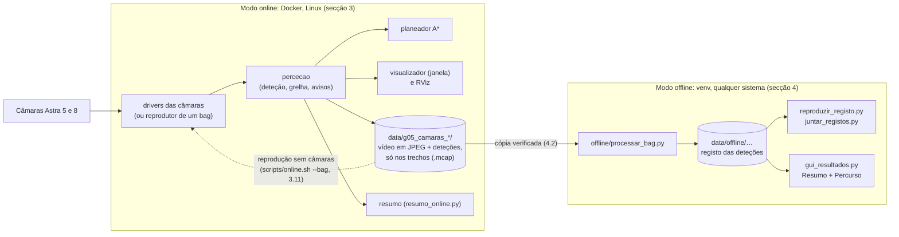

# Aquisição e Processamento de Imagem em ROS 2 (Jazzy)

**G5, projeto 3: câmaras laterais.** Duas câmaras Orbbec Astra no tejadilho, viradas para trás (como retrovisores), dão a grelha local e três avisos: mudança de faixa, saída de faixa e colisão.

> **Ramo `Main-2` (parte 2).** É o `main` (parte 1) com a integração da aula 11 e a preparação para os outros sensores do carro: o pacote comum `va_manobras` e os perfis `manobra` e `planeamento` (3.16); a gravação, a reprodução e o uso do GNSS, da odometria, do TF do carro e da estrada (`/estrada/centro`) de outros grupos (3.15); os avisos em coordenadas de Frenet quando há estrada (5.4.3 a 5.4.5); o GNSS no mapa do offline (4.10.2); e o plano da parte 2 (abaixo). Sem esses tópicos, tudo funciona como no `main`. Recebe o `main` com `git merge main`.

*Demonstração: `docs/img/demo.gif`, gerado a partir de um bag real com o `tools/figura_bag.py` (3.13).*

| Sensor | Posição no carro | Driver ROS 2 | Saídas | Equipa |
|---|---|---|---|---|
| 2 × Orbbec Astra (RGB, 640×480, 30 Hz): **5** esquerda, **8** direita | tejadilho, ~10 cm atrás dos retrovisores (x 1,55 m, y ±0,60 m, z 1,75 m no `base_link`), viradas para trás, 12° para fora e 15° para baixo (`src/va_g05/config/montagem_camaras.yaml`) | `usb_cam` (+ `compressed_image_transport`) | `/camara<N>/image_raw`, `/camara<N>/image_raw/compressed` → `/g05/grelha_local` e os três avisos | G5 |

### Arquitetura

| Nó (serviço do `compose.yaml`) | Ficheiro | Subscreve | Publica |
|---|---|---|---|
| `usb_cam` × 2 (`driver_camara5`, `driver_camara8`, perfil `sensor`) | driver do ROS | — | `/camara<N>/image_raw`, `/camara<N>/image_raw/compressed` |
| `reprodutor` (perfil `reproduzir`, em vez dos drivers) | `src/va_g05/va_g05/reprodutor.py` | `/processamento/estado_camaras`, `/processamento/comando` | `/camara<N>/image_raw` (as imagens de um bag), `/processamento/reproducao` |
| `percecao` (perfis `sensor`, `reproduzir`) | `src/va_g05/va_g05/processar_tempo_real.py` (+ `decisao.py`, `grelha_local.py`, `aviso_*.py`, `objetos.py`, `linhas.py`, `estrada.py`, `estrada_local.py`, `outros_sensores.py`) | `/camara<N>/image_raw` (e `/compressed`, para gravar), `/processamento/comando`, saídas do planeador; parte 2, se existirem: `/estrada/centro` (avisos), `/fix`, `/odom`, `/tf` (gravados) | `/g05/grelha_local`, `/g05/aviso_faixa`, `/g05/aviso_saida_faixa`, `/g05/aviso_colisao`, `/tf_static`, `/camara<N>/processamento/dados_deteccoes`, `/processamento/painel`, `/processamento/estado_camaras`; grava os trechos em `data/` |
| `planeador` (comum, sem alterações; perfis `sensor`, `reproduzir`, `planeamento`) | `src/va_planeamento/va_planeamento/local_astar.py` | `/g05/grelha_local` | `/g05/caminho_local`, `/g05/estado`, `/g05/zona_proibida` |
| `visualizador` (perfil `visualizador`) | `src/va_g05/va_g05/visualizador.py` | as imagens, as deteções, a grelha, os avisos, o painel, o planeador | a janela; `/processamento/comando` (teclas); `/camara<N>/processamento/imagem_anotada` |
| `gravador`, `foxglove`, `rviz` (perfis `gravar`, `foxglove`, `rviz`) | `ros2 bag record`, `foxglove_bridge`, `rviz2` | os resultados | `data/g05_resultados_<data_hora>/`, `ws://localhost:8765`, a janela do RViz |
| `percecao_simulada` (aula 11, perfil `manobra`) | `src/va_g05/va_g05/grelha_scan.py` (o `scan_to_grid` do modelo) | `/scan` (do simulador), `/tf_static` | `/g05/grelha_local` (no simulador não há imagens das câmaras) |
| `simulador_estrada` (aula 11, perfil `manobra`) | `sim_estrada` (`src/va_manobras`, comum) | `/cmd_vel` | `/scan`, `/odom`, `/tf`, `/sim/veiculos`, `/sim/distancia_real` |
| `estrada` (aula 11, perfil `manobra`) | `estrada_rota` (comum) | `/tf` (odom → base_link) | `/estrada/centro` (`nav_msgs/Path` no `base_link`), `/estrada/rota` |
| `faixa` (aula 11, perfil `manobra`) | `faixa_livre` (comum) | `/g05/grelha_local`, `/estrada/centro` | `/g05/distancia_livre`, `/g05/obstaculo`, `/g05/faixa` |
| `objetivo` (aula 11, perfil `planeamento`) | `objetivo_estrada` (comum) | `/estrada/centro`, `/g05/distancia_livre` | `/g05/objetivo` (objetivo do A\* ao longo da estrada) |
| `manobra` (aula 11, perfil `manobra`) | `seguir` (exemplo comum) | `/g05/distancia_livre`, `/estrada/centro`, `/odom` | `/cmd_vel`, `/g05/estado_manobra` |

```
câmaras 5 e 8 ─▶ usb_cam ─▶ /camara<N>/image_raw ─▶ percecao ─▶ /g05/grelha_local ─▶ planeador A* ─▶ /g05/caminho_local, /g05/estado
 (ou um bag ─▶ reprodutor)                          │  (deteções,   ─▶ /g05/aviso_faixa, /g05/aviso_saida_faixa, /g05/aviso_colisao
                                                    │   avisos, TF) ─▶ /tf_static (base_link → camara<N>_link → camara<N>)
                                                    └─▶ data/g05_camaras_<data_hora>/ (vídeo em JPEG + deteções, só nos trechos)
                                    visualizador, RViz, Foxglove ◀── todos os tópicos
```

### Tópicos (frequências: confirmar num bag real com `ros2 topic hz`, ou no painel e no resumo do online)

| Tópico | Tipo | `frame_id` | Frequência | QoS (publicador) |
|---|---|---|---|---|
| `/camara5/image_raw`, `/camara8/image_raw` | `sensor_msgs/Image` (bgr8, 640×480) | `camara5`, `camara8` | 30 Hz | reliable, volatile, keep last 10 (`usb_cam`); a perceção subscreve em *sensor data* (best effort) |
| `/camara<N>/image_raw/compressed` | `sensor_msgs/CompressedImage` (JPEG, qualidade 95) | `camara<N>` | 30 Hz | reliable, keep last 10 |
| `/camara<N>/processamento/dados_deteccoes` | `std_msgs/String` (JSON, com `stamp_ns` da imagem) | — (coordenadas na imagem da câmara) | uma por imagem processada: < 1 Hz por câmara em CPU, ~3–4 Hz por câmara com GPU (duas câmaras) | reliable, keep last 10 |
| `/g05/grelha_local` | `nav_msgs/OccupancyGrid` (0,2 m; x −30 a 10 m, y −10 a 10 m) | `base_link` | uma por imagem processada (como acima) | reliable, keep last 10 |
| `/g05/aviso_faixa`, `/g05/aviso_saida_faixa`, `/g05/aviso_colisao` | `std_msgs/String` (JSON, com `stamp_ns`) | — (as posições no JSON estão no `base_link`) | uma por imagem processada | reliable, keep last 10 |
| `/tf_static` | `tf2_msgs/TFMessage` | `base_link` → `camara<N>_link` → `camara<N>` | uma vez, no arranque | transient local |
| `/g05/caminho_local`, `/g05/estado`, `/g05/zona_proibida` | `nav_msgs/Path`, `std_msgs/String`, `nav_msgs/OccupancyGrid` | `base_link` | 5 Hz (planeador comum) | reliable, keep last 10 |
| `/processamento/estado_camaras` | `std_msgs/String` (JSON) | — | a cada mudança (tecla **D**) | transient local, keep last 1 |
| `/processamento/painel`, `/processamento/comando` | `std_msgs/String` | — | por imagem processada / a pedido | reliable, keep last 10 |
| **Parte 2 (de outros grupos; subscritos e gravados nos trechos, se existirem, 3.15):** `/estrada/centro`, `/fix`, `/odom`, `/tf` | `nav_msgs/Path`, `sensor_msgs/NavSatFix`, `nav_msgs/Odometry`, `tf2_msgs/TFMessage` | `base_link` (estrada), os do publicador | os do publicador | a perceção subscreve em best effort, keep last 100 |

O bag reproduz-se com o perfil `reproduzir` (`bash scripts/online.sh --bag <bag.mcap>`, 3.11): os mesmos nós correm sem alterações, sem câmaras.

### Grelha local (contrato da aula 10)

| | |
|---|---|
| **Subscreve** | `/camara5/image_raw` e `/camara8/image_raw` (`sensor_msgs/Image`, `frame_id` `camara5` / `camara8`), com a calibração (`src/va_g05/config/camera_astra_<N>.yaml`) e a posição das câmaras no carro (`montagem_camaras.yaml`, também publicada em `/tf_static`) |
| **Ocupado (100)** | o chão visto que **não** é área circulável (YOLOP: passeio, berma, obstáculos) e a "pegada" de cada veículo ou peão do YOLO (o meio da base da caixa projetado no chão plano, com a largura e o comprimento típicos da classe, alinhado com a estrada) |
| **Livre (0)** | o chão visto que o YOLOP marca como área circulável, e o contorno do próprio carro |
| **Desconhecido (−1)** | o que as câmaras não veem: fora do campo de visão, acima do horizonte, a mais de 25 m ou a menos de 2,5 m da câmara, atrás de um veículo, e a parte de uma câmara desligada ou sem imagem há mais de 1 s |
| **Nó** | `percecao` (`src/va_g05/va_g05/processar_tempo_real.py`, com `decisao.py` e `grelha_local.py`; o mesmo código no offline) |
| **Publica também** | os três avisos (`/g05/aviso_faixa`, `/g05/aviso_saida_faixa`, `/g05/aviso_colisao`, 5.4.3 a 5.4.5), `/tf_static`, as deteções de cada câmara e o painel; `header.stamp` da grelha = instante da imagem |

### Como correr

```bash
docker compose build                                    # a imagem (uma vez; ONNX_PKG no .env para a GPU, 3.3)
bash scripts/online.sh 5 8                              # ao vivo: câmaras + perceção + planeador + janela (3.6)
bash scripts/online.sh --bag data/<sessão>/<bag>.mcap   # reprodução de um bag, sem câmaras (3.11)
docker compose run --rm --no-deps planeador python3 -m pytest -q /ws/src   # testes (1.7; o mesmo do CI)
python offline/processar_bag.py data/<sessão>/<bag>.mcap                   # offline, no venv (secção 4)
docker compose --profile manobra --profile foxglove up                    # aula 11: estrada + faixa + manobra simuladas (3.16)
```

### Dados

| Bag | Conteúdo | Onde |
|---|---|---|
| `g05_camaras_<data_hora>[_<percurso>]/g05_camaras_<data_hora>_0.mcap` | vídeo das duas câmaras (JPEG), deteções, grelha, avisos, planeador, `/tf_static`, só nos trechos; `resumo_online.json` | `data/` no PC do carro (ou o disco externo, `DADOS` no `.env`); para o offline, copiado com verificação (4.2) |
| `g05_resultados_<data_hora>/` | só os resultados (`ros2 bag record`: grelha, avisos, caminho, TF, deteções), com `--gravar` | `data/` |

Na parte 2, o bag da sessão leva também o GNSS, a odometria, o TF do carro e a estrada de outros grupos, se existirem na rede (3.15).

Os bags não vão para o GitHub (`data/` está no `.gitignore`).

### Resultados

**Desempenho da deteção** (precisão, recall, F1, IoU) contra uma referência marcada à mão em imagens dos bags reais (4.11): as tabelas de `docs/referencia/<nome>/metricas.md` (`python offline/metricas_referencia.py <nome>`), com exemplos (original | referência | processamento) em `docs/img/`.

*(por preencher: a marcação ainda não foi feita)*

**Funcionamento ao longo do tempo:** figuras, GIF e métricas do online (tempo em cada estado de cada aviso, mensagens por segundo de cada tópico, deteções por segundo), com `python tools/figura_bag.py data/<sessão>` (3.13).

### Parte 2: plano

*(Exercícios 4 a 6 da aula 11; por preencher pela equipa. Figura da manobra: `python tools/figura_manobra.py data/<bag> --grupo g05`, 3.16.)*

**Contributo do grupo para a estrada** (Exercício 4):

| | G5 |
|---|---|
| Produzimos a estrada? Como, e a partir de que tópico? | |
| Frame, frequência e alcance da estrada que publicamos | |
| Consumimos a estrada? Em que nó, para quê? | a `percecao` (`/estrada/centro`): os três avisos em coordenadas de Frenet (5.4.3 a 5.4.5) |
| O que fazem os nós do grupo quando a estrada falha | voltam ao modo da parte 1 (linhas detetadas ou centro), sem a estrada (`idade_max_estrada_s`, 1 s) |

**Afinar e avaliar a manobra** (Exercício 5, `tools/figura_manobra.py`):

| Parâmetro | Valores | Distância mín. (m) | Intervalo de tempo (s) | Desvio lateral máx. (m) | Observação |
|---|---|---|---|---|---|
| `tempo_seguranca` | 1,0 / 1,8 / 2,5 | | | | |
| `ganho_distancia` | 0,1 / 0,3 / 0,8 | | | | |
| `lookahead_ganho` | 0,3 / 0,8 / 1,5 | | | | |
| cenário `parado` | por omissão | | | | |

**Plano da parte 2** (Exercício 6):

| | Manobra 1 | Manobra 2 |
|---|---|---|
| Manobra (seguir, manter distância ao de trás, ultrapassar, estacionar, ...) | | |
| Deteções do grupo usadas (tópico, tipo) | | |
| Deteções de outros grupos (grupo, tópico) | | |
| Fonte da estrada | | |
| Critério de sucesso (métrica e valor) | | |
| Como testar: simulador → bag → Gazebo | | |

### Limitações

Chão plano, modelos treinados com câmaras viradas para a frente, posições aproximadas (a câmara não mede distâncias nem velocidades), tempo até contacto lento em CPU e o planeador A\* sem informação à frente do carro (5.4.3, 5.4.9). Como cada aviso fica melhor com os outros sensores do carro: 5.4.10.

---

Sistema ROS 2 Jazzy (em Docker) para recolher e analisar o vídeo das câmaras Orbbec Astra **5** e **8**. Em cada imagem corrige-se a distorção da lente e três modelos ONNX (`onnxruntime`, sem `ultralytics` nem PyTorch) detetam **objetos** (YOLOv8n: veículos, pessoas, semáforos, sinais STOP), **linhas da estrada** (CLRNet) e **área circulável** (YOLOP). Daí saem a **grelha local** para o planeador A\* comum e três **avisos**: mudança de faixa, saída de faixa e colisão (5.4).

Dois modos, com o mesmo código de deteção e o mesmo ecrã, ligados pelo bag `.mcap` gravado no veículo:
* **Online** (secção 3, Docker em Linux): a **aquisição** e o processamento ao vivo; grava o vídeo (JPEG) e as deteções nos **trechos** marcados durante a viagem. Também **reproduz um bag sem câmaras**.
* **Offline** (secção 4, `venv` em qualquer sistema): processa **todas** as imagens de um bag, regista as deteções, reproduz e exporta vídeos e mostra os resultados numa janela (resumo e percurso no mapa).

## Índice

| Secção | Conteúdo | Onde corre |
|---|---|---|
| [1](#1-visão-geral) | Visão geral: os dois modos, quando usar cada um, relevância para a parte 2, ficheiros e estrutura do repositório, pré-requisitos, preparação do PC Linux (Docker, projeto, disco externo), testes automáticos (CI) e organização do repositório (branches, fluxo de trabalho) | — |
| [2](#2-preparação-calibração-das-câmaras) | Preparação: calibração das câmaras (correção da distorção da lente) | Windows (ou Linux), com Python |
| [3](#3-modo-online-aquisição-e-processamento-no-veículo-docker) | **Modo online**: câmaras → processamento ao vivo → gravação dos trechos (JPEG) → resumo; visualizador e RViz; reprodução de um bag sem câmaras; hora certa (NTP); parte 2: outros sensores e simulador da aula 11 | Linux com Docker (CPU ou GPU NVIDIA) |
| [4](#4-modo-offline-processar-os-bags-gravados-em-qualquer-sistema) | **Modo offline**: bag gravado → processar → registar → reproduzir → janela de resultados; métricas de desempenho contra uma referência marcada à mão | Windows, Linux ou macOS, com `venv` (sem Docker nem câmaras) |
| [5](#5-modelos-de-deteção-comuns-aos-dois-modos) | Modelos de deteção (comuns aos dois modos): linhas (CLRNet), objetos (YOLO) e estrada (YOLOP); decisão local: posição das câmaras, grelha local, avisos de mudança de faixa, saída de faixa e colisão, planeador A\*, e como outros sensores completam cada aviso | dentro do processamento |
| [6](#6-referência-rápida-comandos-opções-teclas-e-pastas) | Referência rápida: todos os comandos, opções, teclas, variáveis e pastas | — |

---

## 1. Visão geral

### 1.1 Dois modos, ligados pelo bag gravado no veículo



**A aquisição faz-se uma vez, no online:** os drivers publicam `/camara<N>/image_raw` (e o JPEG em `/camara<N>/image_raw/compressed`); o processamento corre ao vivo e, nos **trechos** (tecla **R**), grava num `.mcap` o vídeo original em JPEG, as deteções, a grelha, os avisos, o planeador e o TF (3.9). Os instantes vêm do relógio do PC, que tem de estar certo (3.12).

**O mesmo bag serve depois os dois modos:** no **offline** processam-se todas as imagens, com os mesmos trechos (4.6, 3.10); no **online em reprodução** (3.11), o reprodutor publica as imagens nos tópicos dos drivers e o processamento corre sem alterações ("o mesmo nó de perceção corre sem alterações com dados do bag real", como pede o enunciado).

| | Modo offline (secção 4) | Modo online (secção 3) |
|---|---|---|
| **Entrada** | um bag já gravado | as câmaras (ao vivo) ou um bag (reprodução) |
| **Imagens processadas** | **todas** (30 por segundo por câmara), ao ritmo que o PC conseguir | as que houver tempo de processar, como num sistema real (cada câmara é processada quando o modelo fica livre; 3.7) |
| **O que se grava** | o registo das deteções nos trechos do online, ou nos pedidos com `--trechos` (`data/offline/`) | ao vivo: o vídeo em JPEG e as deteções, **só nos trechos** marcados (`data/`); em reprodução, nada (só o resumo) |
| **Interação** | pausa, ligar/desligar cada modelo e a correção, limiares, classes e trechos por opção | **R** trecho (gravação), **D** câmara da direita, **Espaço** pausa (reprodução), **Q** termina |
| **Ecrã** | a janela do `processar_bag.py` | o visualizador (outro nó ROS, a partir dos tópicos) e, opcionalmente, o RViz |
| **Resultados** | reprodução e exportação em `.mp4`, janela de resultados com Resumo e **Percurso no mapa** | tópicos ROS (para outros grupos e para a parte 2) e um resumo no fim, com filtro por trecho |
| **Onde corre** | Windows, Linux ou macOS (`venv`), sem câmaras nem Docker | Linux com Docker (CPU ou GPU NVIDIA, escolhida sozinha) |

**Igual nos dois modos** (mesmo código e ficheiros): a correção da distorção (`camera_astra_<N>.yaml`, secção 2) e os três modelos, com as mesmas classes e limiares (secção 5); a grelha local e os avisos (`montagem_camaras.yaml`, 5.4); o JSON das deteções em `/camara<N>/processamento/dados_deteccoes` (4.7, 3.9); o desenho do ecrã (`painel.py`, `visual.py`: cores fixas, 5 à esquerda e 8 à direita, vista de cima) e o resumo (`registo.py`, `gui_comum.py`).

### 1.2 Quando usar cada modo
**No veículo corre sempre o online:**
* **ao vivo** (`bash scripts/online.sh 5 8`): deteções, grelha e avisos durante a viagem, gravando os trechos (**R**) ou tudo (`--registar-tudo`);
* **só gravação** (`--sem-processamento`): num PC fraco, sem os modelos; processa-se depois no offline;
* **em reprodução** (`--bag <bag.mcap>`, sem câmaras): rever uma viagem, testar alterações com dados reais, ou deixar outros grupos (e os docentes) correr o nó sem câmaras.

**O offline serve para:** processar **todas** as imagens (o online, com as duas câmaras, só processa parte, sobretudo em CPU); **afinar** a deteção (limiares, classes, correção, 4.4) e a montagem das câmaras (5.4.8); analisar, reproduzir ou exportar trechos (4.6 a 4.9); ver o percurso no mapa (4.10.2); trabalhar em Windows ou sem Docker nem câmaras.

### 1.3 Relevância do modo online para a parte 2
O offline desenvolve e valida a deteção; o **online é o que os outros grupos vão usar** e a base da parte 2:
* **segue a arquitetura pedida:** tudo no Docker (ROS 2 Jazzy), com a estrutura do modelo da aula 10 (workspace `src/` com `colcon`, `compose.yaml` com perfis, `.env`, CI), tópicos e tipos standard (`sensor_msgs/Image` e `CompressedImage`, `nav_msgs/OccupancyGrid`, `tf2_msgs/TFMessage`) e gravação em MCAP com as imagens comprimidas e o `/tf_static`;
* **separa processamento e visualização** (guião da avaliação): a perceção só processa e publica; o visualizador e o RViz só mostram (3.2, 3.7);
* **corre com ou sem câmaras** sem mudar o nó (3.11): os bags reais agora, o simulador mais tarde;
* **mostra os limites do tempo real:** deteções por segundo de cada câmara, peso de cada modelo, CPU vs GPU; a tecla **D** troca cobertura (duas câmaras) por frequência (uma);
* **grava tudo no mesmo bag e com o mesmo relógio**, só nos trechos (viável em viagens longas); outros sensores (por exemplo, o **GPS**) entram como mais um tópico.

### 1.4 Ficheiros do repositório
Segue a estrutura do modelo da aula 10 (`va-projeto-g00`): um workspace ROS 2 em `src/` (o pacote comum `va_planeamento` e o do grupo, `va_g05`), construído no Docker com `colcon`. O offline e as ferramentas usam o código do pacote a partir de `src/va_g05`, sem ROS.
```
README.md   Dockerfile   compose.yaml   compose.gpu.yaml   compose.windows.yaml   .env   requirements.txt
.github/workflows/ci.yml      CI: constrói a imagem e corre os testes a cada push (1.7)
.devcontainer/                VS Code dentro da imagem (opcional)
src/va_planeamento/           planeador A* comum da aula 10, sem alterações (5.4.6)
src/va_manobras/              estrada (Frenet), ocupação da faixa, manobra de exemplo e simulador 2D da aula 11, sem alterações (3.16)
src/va_g05/                   pacote ROS 2 do G5 (package.xml, setup.py)
    va_g05/                   o código: nós do online e biblioteca comum aos dois modos
    config/                   calibração das câmaras, montagem no carro, parâmetros do planeador, RViz
    modelos/                  objetos.onnx, linhas.onnx + linhas.json, estrada.onnx (secção 5)
    test/                     testes (pytest): avisos e grelha com cenas sintéticas, modelos ONNX
scripts/                      online.sh (arranque do online), trecho.sh, alternar_camara.sh
offline/                      processar_bag.py, reproduzir_registo.py, juntar_registos.py, gui_resultados.py, ...
tools/                        calibrar_astra.py, figura_bag.py, exportar_linhas.py, figura_manobra.py, rota_de_bag.py
docs/                         layout.json (Lichtblick / Foxglove), img/ (figuras e GIF), referencia/ (marcação e métricas, 4.11)
data/                         bags e gravações (não vão para o git)
```

| Ficheiro | Para quê | Modo |
|---|---|---|
| `Dockerfile`, `compose.yaml`, `.env` | a imagem do online (ROS 2 Jazzy, `usb_cam`, RViz, Foxglove, `onnxruntime`, o workspace construído com `colcon`) e os serviços, com perfis: `sensor`, `reproduzir`, `visualizador`, `gravar`, `foxglove`, `rviz` (3.2) | online |
| `compose.gpu.yaml` | acesso à GPU NVIDIA para a perceção (o `scripts/online.sh` junta-o sozinho, 3.3) | online |
| `compose.windows.yaml` | Windows / macOS (Docker Desktop): reprodução de um bag com o Foxglove, sem câmaras nem janelas (3.11) | online |
| `scripts/online.sh` | arranque do online, ao vivo ou em reprodução: câmaras, GPU, relógio, serviços e resumo (3.6) | online |
| `scripts/trecho.sh`, `scripts/alternar_camara.sh` | começar/terminar um trecho e desligar/ligar a câmara da direita sem janela (3.7) | online |
| `src/va_g05/va_g05/processar_tempo_real.py` | nó `percecao`: deteções, grelha, avisos, TF, gravação dos trechos (3.2) | online |
| `src/va_g05/va_g05/visualizador.py` | nó `visualizador`: a janela, a partir dos tópicos (3.7) | online |
| `src/va_g05/va_g05/reprodutor.py` | nó `reprodutor`: um bag nos tópicos das câmaras, trecho a trecho (3.11) | online |
| `src/va_g05/va_g05/gravacao_online.py` | gravação do bag do online, só nos trechos, com as imagens em JPEG (3.9) | online |
| `src/va_g05/va_g05/relogio.py` | verificação da hora do PC (NTP) no arranque (3.12) | online |
| `src/va_g05/va_g05/resumo_online.py` | janela do resumo no fim do online (3.8; fora do Docker: `offline/resumo_online.py`) | online |
| `src/va_g05/va_g05/objetos.py`, `linhas.py`, `estrada.py`, `gpu.py` | os três modelos e a escolha da GPU ou do CPU (secção 5, 4.5) | ambos |
| `src/va_g05/va_g05/geometria.py`, `grelha_local.py`, `decisao.py` | imagem ↔ chão e TF das câmaras, grelha local, e a decisão local (a mesma no online e no offline) (5.4) | ambos |
| `src/va_g05/va_g05/aviso_faixa.py`, `aviso_saida_faixa.py`, `aviso_colisao.py`, `seguimento.py` | os três avisos; seguimento dos objetos e tempo até contacto (5.4.3 a 5.4.5) | ambos |
| `src/va_g05/va_g05/painel.py`, `visual.py` | o desenho do ecrã, igual no visualizador, no `processar_bag.py` e na reprodução dos registos | ambos |
| `src/va_g05/va_g05/leitura_bag.py`, `registo.py`, `gui_comum.py` | leitura dos bags e correção da distorção; formato das deteções e estatísticas; cartões do resumo | ambos |
| `src/va_g05/va_g05/outros_sensores.py`, `estrada_local.py` | parte 2: os tópicos de outros sensores (gravar, reproduzir, ler) e a estrada em coordenadas de Frenet (3.15, 5.4.3) | ambos |
| `src/va_g05/va_g05/grelha_scan.py` | o `scan_to_grid` do modelo: grelha a partir do `/scan`, só no simulador da aula 11 (3.16) | online |
| `src/va_manobras/` | pacote comum da aula 11 (sem alterações): estrada e Frenet, `faixa_livre`, `seguir`, `objetivo_estrada`, simulador 2D, testes (3.16) | online |
| `src/va_g05/va_g05/caminhos.py` | onde estão a configuração, os modelos e os dados (no Docker e fora dele) | ambos |
| `src/va_g05/config/camera_astra_5.yaml`, `camera_astra_8.yaml` | calibração de cada câmara (K e D, secção 2) | ambos |
| `src/va_g05/config/montagem_camaras.yaml` | posição das câmaras no carro, grelha local e parâmetros dos avisos (5.4.2) | ambos |
| `src/va_g05/config/params.yaml` | parâmetros ROS do planeador A\* (5.4.6) | online |
| `src/va_g05/config/g05.rviz`, `docs/layout.json` | RViz e Lichtblick / Foxglove: câmaras, TF, grelha, caminho, avisos (3.13) | online / bags |
| `src/va_g05/modelos/` | `objetos.onnx`, `linhas.onnx` + `linhas.json`, `estrada.onnx` (secção 5) | ambos |
| `src/va_g05/test/` | testes dos avisos, da grelha e dos modelos (1.7) | CI |
| `offline/processar_bag.py` | processamento de um bag: correção, deteções, vídeo, vista de cima, registo (4.4) | offline |
| `offline/reproduzir_registo.py`, `offline/reproducao.py` | refazer o vídeo de um registo, no ecrã ou em `.mp4` (4.8) | offline |
| `offline/juntar_registos.py` | juntar registos das câmaras 5 e 8 feitos em sessões diferentes (4.9) | offline |
| `offline/gui_resultados.py` | janela de resultados: Resumo e Percurso (4.10) | offline |
| `offline/teclado.py` | teclas lidas no terminal, sem janela (`--sem-interface`) | offline |
| `offline/anotar_referencia.py`, `offline/metricas_referencia.py`, `offline/referencia.py` | marcação à mão de uma referência e métricas de desempenho da deteção (4.11) | offline |
| `tools/calibrar_astra.py` | calibração de cada câmara (secção 2) | preparação |
| `tools/figura_bag.py` | figuras, GIF e métricas para o relatório, a partir de um bag do online (3.13) | relatório |
| `tools/exportar_linhas.py` | só para gerar de novo o modelo das linhas (5.1.4) | — |
| `tools/figura_manobra.py`, `tools/rota_de_bag.py` | aula 11: figuras e métricas da manobra; rota (CSV) a partir do `/odom` ou do `/fix` de um bag (3.16) | parte 2 |
| `requirements.txt` | bibliotecas Python (`venv` do offline e imagem do online) | ambos |

**Caminhos** (`caminhos.py`): os scripts encontram a configuração e os modelos a partir da sua própria pasta, por isso correm de qualquer pasta do terminal. No Docker: o pacote instalado em `/ws/install`, a configuração e os modelos em `/ws/src/va_g05` e os dados em `/data` (`DADOS` no `.env`). Fora do Docker: `src/va_g05/config`, `src/va_g05/modelos` e `data/` (registos do offline em `data/offline/`).

### 1.5 Pré-requisitos
* **Modo online (secção 3):** Linux (Ubuntu 24.04 nativo, como pede o enunciado para a aquisição) com Docker e Docker Compose (instalação em 1.6); nada mais é instalado no PC. Para usar a GPU: placa NVIDIA e NVIDIA Container Toolkit (3.3).
* **Modo offline (secção 4):** Python 3 (com `venv`), em Windows, Linux ou macOS. GPU NVIDIA opcional (4.5).
* **Calibração (secção 2):** Python 3 com `opencv-python` e `numpy`, a câmara ligada por USB e um xadrez impresso.
* **Percurso no mapa (4.10.2):** ligação à internet (mapa do OpenStreetMap).

### 1.6 Preparar o PC Linux do Docker (uma vez)
No PC Linux do veículo:
1. **Docker e Docker Compose:** guia oficial ([docs.docker.com/engine/install/ubuntu](https://docs.docker.com/engine/install/ubuntu/)).
2. **Docker sem `sudo`:** `sudo usermod -aG docker $USER` e voltar a entrar na sessão (ou reiniciar).
3. **Confirmar:** `docker compose version` e `docker run --rm hello-world` (`permission denied ... docker.sock`: falta o passo 2).
4. **Obter o projeto** (as gravações ficam dentro dele):
   ```bash
   git clone https://github.com/afv2003/aquisi-o_astra_orbec
   cd aquisi-o_astra_orbec
   ```
   Para atualizar: `git pull` e `docker compose build`. Os modelos vêm com o repositório.
5. **Imagem:** `docker compose build` (3.6). **GPU NVIDIA** (opcional): 3.3. **Hora certa:** `timedatectl` deve dizer `System clock synchronized: yes` (3.12).

**Disco externo:** conte com **0,3 a 0,6 GB por minuto de trecho** (duas câmaras, JPEG). Para gravar noutro disco, indique a pasta no `.env` (`DADOS=/media/<utilizador>/<disco>/g05`, montada em `/data`); não use um *symlink* dentro de `data/` (o Docker não o segue). Use um disco **USB 3**, de preferência **ext4** (exFAT se também for lido no Windows), numa porta do lado oposto às câmaras. Um bag a reproduzir (3.11) pode estar em qualquer pasta.

### 1.7 Testes automáticos (CI)
A cada `git push`, o GitHub Actions (`.github/workflows/ci.yml`, como no modelo da aula 10) constrói a imagem e corre os testes dentro dela; no PC, o mesmo comando depois do `docker compose build`:
```bash
docker compose run --rm --no-deps planeador python3 -m pytest -q /ws/src
```
Não precisam de câmaras nem de bags:
* `src/va_planeamento/test`: os testes do planeador comum (da aula);
* `src/va_g05/test/test_avisos.py`: o contrato da grelha (`int8`, só −1 / 0 / 100, as dimensões do `montagem_camaras.yaml`) e os **três avisos** com **cenas sintéticas** (linhas da estrada e veículos de 4,5 × 1,8 × 1,5 m postos no chão e projetados nas câmaras com a calibração e a montagem do `config/`). Testa-se a decisão (`decisao.py`): faixa ao lado ocupada (pelas linhas e pelo centro), veículo na 2.ª faixa, sem linhas, veículo a aproximar-se, carro a derivar para a linha, saída com a faixa ocupada, colisão por trás (AVISO e depois PERIGO, com o TTC), veículo a afastar-se, a passar duas faixas ao lado e a seguir colado;
* `src/va_g05/test/test_modelos.py`: os três modelos ONNX estão na imagem e correm com o `onnxruntime` dela;
* `src/va_g05/test/test_estrada.py` (parte 2): os avisos numa curva, com e sem a estrada (Frenet), a saída de faixa pela estrada, e o GNSS gravado e lido de um bag;
* `src/va_manobras/test`: os testes do pacote comum da aula 11.

No `venv`: `pip install pytest` e `python -m pytest -q src/va_g05/test`.

Estes testes **não são os resultados do projeto** e não é preciso mexer neles: confirmam, a cada push, que uma alteração não estragou a grelha, os avisos ou os modelos (as cenas são sintéticas porque no CI não há câmaras nem bags). Os resultados medem-se com dados reais (4.11, 3.13). O `PYTEST_DISABLE_PLUGIN_AUTOLOAD=1` (`Dockerfile`) impede o `pytest` de carregar os plugins de testes do ROS (`launch_testing`), que precisam de bibliotecas que o `venv` da imagem não vê.

### 1.8 Organização do repositório e fluxo de trabalho
**Branches:**

| Branch | Para quê | Vai para o `main`? |
|---|---|---|
| `main` | a versão do projeto: a que o CI verifica e a que os docentes e os outros grupos usam | — |
| uma por tarefa (ex.: `metricas`, `aviso-colisao`) | desenvolvimento: cria-se a partir do `main`, as alterações fazem-se e testam-se aqui, e depois juntam-se ao `main`; no fim apaga-se | sim, com `git merge` (depois de o CI passar) |
| `Main-2` | a parte 2: o `main` com a integração da aula 11 e os outros sensores | ainda não; recebe o `main` (`git merge main`) |
| `Extra-Line-Comparison` | a comparação CLRNet vs UFLDv2 (`comparacao_linhas/`, `COMPARACAO_LINHAS.md`), à parte | **não**; recebe o `main` (`git merge main`) para ficar atualizada |

**Uma alteração, do princípio ao fim:**
```
 editar (na pasta certa, abaixo) ─▶ testar ─▶ commit + push da branch ─▶ CI no GitHub (Actions) ─▶ merge no main
                                      │                                      │
            offline: venv (secção 4)  │            docker compose build + pytest (1.7): tem de ficar verde
            online: docker compose build + scripts/online.sh --bag <bag> (3.11)
```
```bash
git switch main && git pull
git switch -c <tarefa>                                      # branch nova, a partir do main
# ... alterações, testes ...
git add -A && git commit -m "o que mudou" && git push -u origin <tarefa>   # o CI corre sozinho
git switch main && git merge --ff-only <tarefa> && git push
git branch -d <tarefa> && git push origin --delete <tarefa>                 # apagar a branch da tarefa
git switch Extra-Line-Comparison && git merge main && git push && git switch main   # manter a comparação atualizada
```

**Onde fica cada coisa:**

| Alteração | Pasta | Depois |
|---|---|---|
| código do online ou comum aos dois modos (nós, modelos, grelha, avisos, desenho) | `src/va_g05/va_g05/` | `docker compose build` (o código está dentro da imagem) |
| calibração, montagem das câmaras, parâmetros dos avisos e do planeador, RViz | `src/va_g05/config/` | `docker compose build` |
| modelos ONNX | `src/va_g05/modelos/` | `docker compose build` |
| arranque do online e comandos auxiliares | `scripts/` | — |
| processamento offline, registos, janela de resultados | `offline/` | — |
| calibração, figuras para o relatório, exportação de modelos | `tools/` | — |
| testes | `src/va_g05/test/` | correm no CI |
| referência marcada à mão e métricas (4.11) | `docs/referencia/<nome>/` (imagens em `data/referencia/`, fora do git) | copiar as tabelas para a secção Resultados |
| dependências Python | `requirements.txt` (sistema: `Dockerfile`) | `docker compose build` e `pip install` no `venv` |
| bags, gravações, registos | `data/` (ou o disco do `DADOS`) | não vão para o git |

---

## 2. Preparação: calibração das câmaras

A calibração mede a distorção da lente **uma vez por câmara** (duas unidades do mesmo modelo nunca são iguais); depois, nos dois modos, cada imagem é corrigida antes das deteções, com os mesmos ficheiros e o mesmo código. Os modelos já vêm no repositório (secção 5).

### 2.1 Gerar a calibração (uma vez por câmara)
Num PC com a câmara ligada por USB e um xadrez impresso (testado em Windows, sem ROS):
```bash
pip install opencv-python numpy
python tools/calibrar_astra.py --listar                                                   # ver o número de cada câmara
python tools/calibrar_astra.py --camara 5 --cam 1 --colunas 9 --linhas 7 --quadrado 25 --auto
```
* `--camara`: a câmara física (**5** ou **8**, obrigatório); `--cam`: o número dela no PC (`--listar`); `--colunas`/`--linhas`: os **cantos internos** do xadrez (10x8 quadrados → 9x7 cantos); `--quadrado`: o lado de um quadrado, em mm; `--auto`: tira as fotos sozinho quando o xadrez para numa posição nova. Outras opções: 6.1.
* Mostre o xadrez em várias posições (centro, cantos, perto, longe, inclinado) até as 4 barras (X, Y, Tam, Incl) ficarem verdes ou haver 40 fotos, o critério da ferramenta `camera_calibration` do ROS; antes disso, R, C e Q não estão disponíveis. Como no ROS, só se estimam k1 e k2 (k3 = 0) e ignora-se o xadrez com algum canto a menos de 8 px da borda.
* Depois, por ordem: **R** (revisão, com o erro de cada foto) → **O** (remove os outliers; **Enter** volta à câmara) → **C** (calibra) → **U** (opcional: imagem corrigida; `lin.` = desvio das linhas do xadrez a uma reta, em px, quanto mais perto de 0 melhor) → **Q** (grava e sai). **Q** sem R → O → C avisa e pede um segundo **Q**; **Esc** sai sem gravar. Teclas: 6.2.
* Resultado em `calibracoes/camara<N>_<data_hora>/`: `camera_astra_<N>.yaml` (K e D no formato `camera_info` do ROS, lido pelos dois modos), `calibracao.json` (os mesmos valores, erro RMS e por foto, fotos rejeitadas) e `imagens/` (as fotos usadas).

**Como funciona:** procura os cantos do xadrez (`findChessboardCornersSB`, refinados com `cornerSubPix`), com `--auto` guarda as fotos de posições suficientemente novas (critério do ROS) e calibra com `calibrateCameraExtended` (modelo `plumb_bob`).

### 2.2 Copiar a calibração para o projeto
Copie o ficheiro de cada câmara para `src/va_g05/config/` e faça commit (no PC do veículo, depois do `git pull`, `docker compose build`, porque a configuração está dentro da imagem):
```
src/va_g05/config/camera_astra_5.yaml
src/va_g05/config/camera_astra_8.yaml
```

### 2.3 Como a calibração é usada
* **Offline** (4.4): usa o `camera_astra_<N>.yaml` de cada câmara; sem ele, o `/camera_info` do bag; sem nenhum, não corrige e avisa. `--calib <ficheiro>` (só com uma câmara), `--sem-correcao` e a tecla **C** (para comparar).
* **Online** (3.6): o mesmo ficheiro; sem ele, avisa e não corrige essa câmara. `--sem-correcao` no `scripts/online.sh`.
* As deteções são feitas na imagem **corrigida** e as coordenadas são dessa imagem (campo `corrigida` no JSON); o vídeo gravado é sempre o **original**.
* Os mapas de correção calculam-se uma vez (`initUndistortRectifyMap`) e aplicam-se a cada imagem (`remap`).

> **Importante:** a calibração só é válida para a resolução usada (640x480, a resolução por omissão do `usb_cam`). Se mudar a resolução, a focagem ou a lente, repita a calibração.

---

## 3. Modo online: aquisição e processamento no veículo (Docker)

O modo do veículo: a **aquisição** (câmaras e gravação) e o **processamento ao vivo**, tudo no Docker, sem nada instalado no PC além do Docker (como pede o enunciado). O mesmo Docker **reproduz um bag sem câmaras** (3.11).

```
 no veículo (Linux + Docker), durante a viagem
 ────────────────────────────────────────────────────────────────────────────────────────────────────────────────
 3.6 scripts/online.sh 5 8  ─▶ drivers das câmaras ─▶ /camara<N>/image_raw  +  /camara<N>/image_raw/compressed (JPEG)
     (ou --bag <bag.mcap>: o reprodutor publica as imagens do bag, 3.11)  │                           │
                                                                          ▼                           │
                          percecao (processar_tempo_real.py): SÓ PROCESSA E PUBLICA                    │
                            ├─ deteção SEMPRE: correção → 3 modelos → /camara<N>/processamento/dados_deteccoes
                            ├─ grelha local → /g05/grelha_local ─▶ planeador A* → /g05/estado, caminho_local
                            ├─ 3 avisos → /g05/aviso_faixa, aviso_saida_faixa, aviso_colisao;  /tf_static
                            └─ gravação SÓ NOS TRECHOS (R / scripts/trecho.sh / --registar-tudo) ◀────────┘
                               vídeo em JPEG + deteções + grelha + avisos + planeador ────────────────────────┐
                                                                                                              ▼
 3.7 visualizador (visualizador.py): a janela, a partir dos tópicos   3.9 data/g05_camaras_<data_hora>/
     (teclas R, D, Espaço, Q) ;  3.13 RViz (--rviz)                        .mcap (só os trechos) + resumo_online.json
 3.8 fim (Q / Ctrl+C / fim do bag) ─▶ resumo_online.py               3.10 ──▶ o bag vai para o offline (4.4)
```

### 3.1 O que faz e o que muda em relação ao offline
* **É a aquisição:** grava as imagens **em JPEG** (`/camara<N>/image_raw/compressed`) num `.mcap`, com as deteções; o bag segue para o offline (3.10) ou volta a ser reproduzido aqui (3.11).
* **A deteção corre sempre; a gravação só nos trechos** (tecla **R**, `scripts/trecho.sh` ou `--registar-tudo`), que escolhem o que fica gravado. Fora deles, nada é gravado (o resumo final conta tudo o que foi detetado).
* **Processamento e visualização são nós diferentes** (guião da avaliação): a perceção só processa e publica; o visualizador e o RViz só subscrevem e mostram. A janela tem o desenho do offline (`painel.py`).
* **Não se processam todas as imagens:** o modelo processa a imagem **mais recente** de cada câmara, à vez; as que chegam entretanto ficam só gravadas (nos trechos). **D** desliga a câmara da direita (e a gravação dela) para a outra ser processada o dobro das vezes.
* **Sem limiares por opção nem teclas O/L/E/C:** correm sempre os três modelos com os valores por omissão do offline (`CLASSES_ESTRADA`, 0.25 nos objetos, 0.4 nas linhas, classe mais provável na estrada).
* **No fim**, um **resumo** (o da tab Resumo do offline, 4.10.1, com filtro por trecho), sem percurso nem vídeo (para isso, o offline, 3.10).
* **Num PC fraco**, `--sem-processamento` deixa só as câmaras e a gravação (3.6).

### 3.2 Ficheiros, serviços e tópicos
* **`Dockerfile`**: a imagem `va/g05`, com tudo o que o online precisa (fora do contentor ficam só os dados): ROS 2 Jazzy, `usb_cam` e `compressed_image_transport` (JPEG), `rosbag2` em MCAP, `rviz2`, `foxglove_bridge`, as bibliotecas do sistema (OpenCV, `python3-tk`), o Python do `requirements.txt` em `/opt/venv` (sem `ultralytics` nem PyTorch; sem `tkintermapview` nem `matplotlib`, que só o offline usa) e o **workspace** `/ws` (`va_planeamento` e `va_g05`, com `colcon build`, modelos e configuração). O `ONNX_PKG` (`.env`) escolhe CPU ou GPU. Como o código está **dentro** da imagem, cada alteração ao código, à configuração ou aos modelos pede um `docker compose build` (rápido: só refaz o fim).
* **`compose.yaml`**: os serviços, na rede do PC (`network_mode: host`), com os dados em `/data` (`DADOS`, por omissão `./data`). Como no modelo da aula 11, todos os serviços se escolhem com perfis (a `percecao` e o `planeador` com `sensor` ou `reproduzir`; os da aula 11 com `manobra` e `planeamento`, 3.16):

  | Serviço | O que faz | Perfil | Com o `scripts/online.sh` |
  |---|---|---|---|
  | `driver_camara5`, `driver_camara8` | drivers `usb_cam`: publicam `/camara<N>/image_raw` e `/camara<N>/image_raw/compressed` | `sensor` | ao vivo |
  | `reprodutor` | publica as imagens de um bag nos mesmos tópicos dos drivers (`reprodutor.py`) | `reproduzir` | em reprodução (`--bag`) |
  | `percecao` | o `processar_tempo_real.py`: deteções, grelha, avisos, TF e, ao vivo, a gravação dos trechos (e dos outros sensores, 3.15) | `sensor`, `reproduzir` | sempre |
  | `planeador` | o planeador A\* comum da aula 10 (`src/va_planeamento`, sem alterações), 5.4.6 | `sensor`, `reproduzir`, `planeamento` | sempre (exceto `--sem-processamento`) |
  | `visualizador` | a janela (`visualizador.py`) e, no fim, o resumo | `visualizador` | sempre (exceto `-i`) |
  | `gravador` | `ros2 bag record` dos resultados (grelha, avisos, caminho, TF, deteções) em `data/g05_resultados_<data_hora>/` | `gravar` | com `--gravar` |
  | `rviz` | o RViz com o `src/va_g05/config/g05.rviz` | `rviz` | com `--rviz` |
  | `foxglove` | o `foxglove_bridge`: os tópicos para o Foxglove Studio, em `ws://localhost:8765` | `foxglove` | com `--foxglove` |

  Os executáveis (`percecao`, `visualizador`, `reprodutor`, `resumo_online`, `local_astar`) são chamados diretamente, sem `ros2 run`, porque este não passa o `Ctrl + C` ao nó, que precisa dele para fechar o bag e gravar o resumo.
* **`.env`**: `GRUPO`, `ROS_DOMAIN_ID` (42), `ONNX_PKG`, as câmaras e os `/dev/video` (para o `docker compose` sem o script), `DADOS` e `BAG` (6.1).
* **`compose.gpu.yaml`**: dá a GPU NVIDIA à `percecao`; o `scripts/online.sh` junta-o sozinho quando a GPU está pronta para Docker (não é preciso editá-lo).
* **`compose.windows.yaml`**: Windows / macOS (Docker Desktop): só a reprodução de um bag de `data/`, com o Foxglove (3.11).
* **`scripts/online.sh`** (o arranque a usar): ao vivo, associa as câmaras aos `/dev/video` e verifica a hora (3.12); em reprodução, lê as câmaras e os trechos do bag. **Deteta a GPU NVIDIA**, escolhe os serviços e os perfis, lança-os e, no fim, abre o resumo. **Não constrói a imagem** (3.6, passo 1). Corre de qualquer pasta (o caminho do `--bag` é relativo à pasta do terminal).
* **`processar_tempo_real.py`** (`percecao`): corrige, corre os três modelos (na imagem mais recente de cada câmara) e publica as deteções (com os contornos da estrada), o painel, o estado das câmaras, a grelha, os três avisos (`decisao.py`, o mesmo do offline) e, no arranque, o `/tf_static` (do `montagem_camaras.yaml`). Recebe `/processamento/comando` (`trecho`, `alternar_direita`, `terminar`). Ao vivo, passa as imagens comprimidas e as deteções à gravação (só nos trechos); no fim fecha o bag e grava o `resumo_online.json`.
* **`visualizador.py`**: **não processa nada**: junta cada deteção à sua imagem (`header.stamp`), corrige-a com a mesma calibração e desenha com o `painel.py`. As teclas publicam em `/processamento/comando`; se alguém o subscrever (RViz, Foxglove), publica `/camara<N>/processamento/imagem_anotada`.
* **`gravacao_online.py`**: grava, **só nos trechos**, o JPEG tal como o driver o publica (sem recodificar; se faltar, comprime com a mesma qualidade), as deteções, a grelha, os avisos, o planeador, o `/tf_static`, o estado das câmaras e os trechos, num `.mcap` igual ao do `ros2 bag record`, numa thread à parte (não atrasa a deteção).
* **`reprodutor.py`** (3.11), **`relogio.py`** (3.12) e **`resumo_online.py`** (o resumo no fim, com o `gui_comum.py` do offline). **`scripts/trecho.sh`** e **`scripts/alternar_camara.sh`**: as teclas **R** e **D** noutro terminal, sem janela (`-i`). O código do online está em `src/va_g05/va_g05/`.

### 3.3 Preparar a GPU NVIDIA no Docker (opcional, uma vez)
Por omissão corre **em CPU**; sem placa NVIDIA, salte para 3.4. Com GPU fica várias vezes mais rápido; o Docker precisa do **NVIDIA Container Toolkit**:

1. **Verificar:** `nvidia-smi` e `docker info | grep -i nvidia`. Se o segundo já mostrar `Runtimes: ... nvidia`, avance para o passo 5.
2. **Repositório da NVIDIA (Ubuntu/Debian):**
   ```bash
   sudo apt-get update && sudo apt-get install -y --no-install-recommends ca-certificates curl gnupg2
   curl -fsSL https://nvidia.github.io/libnvidia-container/gpgkey | sudo gpg --dearmor -o /usr/share/keyrings/nvidia-container-toolkit-keyring.gpg
   curl -s -L https://nvidia.github.io/libnvidia-container/stable/deb/nvidia-container-toolkit.list | \
     sed 's#deb https://#deb [signed-by=/usr/share/keyrings/nvidia-container-toolkit-keyring.gpg] https://#g' | \
     sudo tee /etc/apt/sources.list.d/nvidia-container-toolkit.list
   ```
3. **Instalar o toolkit e ativá-lo no Docker:**
   ```bash
   sudo apt-get update
   sudo apt-get install -y nvidia-container-toolkit
   sudo nvidia-ctk runtime configure --runtime=docker
   sudo systemctl restart docker
   ```
4. **Confirmar:** `docker info | grep -i nvidia` deve mostrar `nvidia` em `Runtimes:`. O `scripts/online.sh` passa a dar a GPU à perceção sozinho (`compose.gpu.yaml`).
5. **Imagem com o `onnxruntime` da GPU:** no `.env`, conforme a versão CUDA do `nvidia-smi`, e depois `docker compose build`:
   ```bash
   ONNX_PKG=onnxruntime-gpu[cuda,cudnn]          # CUDA 13 ou mais recente
   ONNX_PKG=onnxruntime-gpu[cuda,cudnn]<1.27     # CUDA 12.x
   ```
   Não se mexe no `requirements.txt`. Se a imagem for de CPU num PC com GPU, o `scripts/online.sh` avisa no arranque.

### 3.4 Ligar as câmaras e confirmar os `/dev/video`
1. Ligue as câmaras **antes** de arrancar, em portas USB de **lados diferentes** (juntas usam muita largura de banda; `No space left on device` é isso).
2. `ls /dev/video*`: normalmente `/dev/video0` e `/dev/video1` são a webcam e as Astra ficam em **`/dev/video2`** e **`/dev/video4`** (cada uma cria dois; usa-se o primeiro). O script usa o `video2` para a 1.ª câmara indicada e o `video4` para a 2.ª.
3. A numeração segue a ordem de deteção e pode mudar de um dia para o outro: desligue uma câmara e veja qual desaparece. Outros números: `DEVS_VIDEO` (3.6).

### 3.5 Autorizar o Docker a abrir janelas no ecrã (uma vez por arranque do PC)
Para o visualizador, o RViz e o resumo (não é preciso com `-i`):
```bash
xhost +local:root
```

### 3.6 Iniciar (ao vivo, com as câmaras)
> **Antes:** o Docker (1.6), as câmaras ligadas (3.4) e o `xhost` (3.5; não com `-i`). Os comandos correm na pasta do projeto (o `scripts/online.sh` também de outra).

**1. Construir a imagem** (na 1.ª vez e depois de cada `git pull`, alteração ao código, à configuração ou aos modelos, ou troca entre CPU e GPU; o `scripts/online.sh` não a constrói):
```bash
docker compose build
```
O motor ONNX é o do `ONNX_PKG` (CPU por omissão; GPU: 3.3, passo 5). Demora alguns minutos na 1.ª vez; depois, só refaz o que mudou.

**2. Iniciar**, com as câmaras **pela ordem dos `/dev/video`**:
```bash
bash scripts/online.sh 5 8                      # câmara 5 em /dev/video2, câmara 8 em /dev/video4
bash scripts/online.sh 8 5                      # se estiverem ao contrário
bash scripts/online.sh 5                        # apenas a câmara 5, em /dev/video2
bash scripts/online.sh 5 8 --rviz               # também o RViz (3.13); --foxglove: o Foxglove; --gravar: ros2 bag dos resultados
bash scripts/online.sh 5 8 --percurso ua_ria    # nome do percurso na sessão: data/g05_camaras_<data_hora>_ua_ria/
bash scripts/online.sh 5 8 -i                   # sem janelas (corre só no terminal); --sem-interface é o mesmo
bash scripts/online.sh 5 8 --sem-correcao       # sem corrigir a distorção da lente
bash scripts/online.sh 5 8 --registar-tudo      # gravar desde o início (um trecho aberto logo no arranque)
bash scripts/online.sh 5 8 --sem-processamento  # só as câmaras e a gravação dos trechos, sem os modelos
USAR_GPU=0 bash scripts/online.sh 5 8           # forçar CPU, mesmo num PC com GPU NVIDIA
DEVS_VIDEO="/dev/video4 /dev/video6" bash scripts/online.sh 5 8   # outros dispositivos
bash scripts/online.sh -h                       # ajuda
```
As opções juntam-se (ex. `bash scripts/online.sh 5 8 -i --registar-tudo`). O terminal mostra:
* as câmaras e os dispositivos (`Câmara 5  ->  /dev/video2 ...`); se um `/dev/video` não existir, o script para;
* o hardware (`GPU NVIDIA (CUDA 13); imagem com onnxruntime-gpu[cuda,cudnn]`, `CPU`, ou GPU sem o Container Toolkit → CPU, 3.3), com um aviso se a imagem for de CPU num PC com GPU;
* a hora do PC (3.12): `sincronizado por NTP`, ou um aviso e `Continuar mesmo assim? [s/N]`;
* a gravação (`só nos trechos` ou `desde o início (--registar-tudo)`) e a pasta da sessão;
* da `percecao`, os modelos, a correção, a grelha, o relógio e o TF:
  ```text
  Objetos (YOLOv8n): GPU (CUDA)
  Linhas  (CLRNet):  GPU (CUDA)
  Estrada (YOLOP):   GPU (CUDA)
  Câmara 5: correção da distorção com /ws/src/va_g05/config/camera_astra_5.yaml
  Câmara 8: correção da distorção com /ws/src/va_g05/config/camera_astra_8.yaml
  Grelha local: /g05/grelha_local (nav_msgs/OccupancyGrid, base_link, 0.2 m, x -30 a 10 m, y -10 a 10 m)
  Relógio do PC: sincronizado (desvio de +4 ms face a pool.ntp.org)
  TF estático: base_link -> camara5_link, camara5_link -> camara5, base_link -> camara8_link, camara8_link -> camara8
  ```
  *(ou `CPU`; sem a calibração de uma câmara, um aviso e essa câmara não é corrigida)*;
* os controlos (**R**, **D**, **Q**; sem janela, `scripts/trecho.sh`, `scripts/alternar_camara.sh` e `Ctrl + C`).

A deteção começa com as primeiras imagens; a gravação, só no primeiro trecho. Também se pode usar o `docker compose` diretamente, como no modelo da aula 10 (câmaras e `/dev/video` do `.env`; sem resumo): `docker compose --profile sensor up` (com a janela: `--profile visualizador`).

**Só gravação (`--sem-processamento`):** sem modelos, grelha nem planeador; ficam as câmaras, os trechos (**R**) e o mesmo bag, sem deteções. A janela mostra as imagens sem desenhos. Os trechos processam-se depois no offline (3.10).

### 3.7 Durante a viagem: a janela do visualizador, os trechos e a câmara da direita
* **Janela `Online - G5`:** as câmaras **lado a lado, a 5 à esquerda e a 8 à direita** (seja qual for a ordem dos `/dev/video`), com as cores e o painel do offline (4.4); à direita, a **grelha local** (vista de cima, com a faixa ao lado na cor do aviso, os objetos seguidos e o estado do A\*, 5.4) e a coluna **Avisos** (5.4.3 a 5.4.6). Os objetos com aviso de colisão têm a caixa grossa na cor do nível e o tempo até contacto (`TTC 1.2 s`). Cada câmara mostra a última imagem processada, com as suas deteções.
* **Painel:** tempo desde o arranque, câmara, modo (`tempo real`, `reprodução`), correção (a laranja `sem correção` ou `sem calibração`), resultado e tempo médio de cada modelo e **deteções por segundo** da câmara.
* **Frequência:** os modelos processam uma câmara de cada vez; com as duas, cada uma metade das vezes (em CPU, menos de uma por segundo por câmara; com GPU, várias). Nos trechos, as imagens não processadas ficam gravadas na mesma.
* **Sem janela (`-i`):** tudo igual, sem a janela (o RViz pode ser usado). Fechar a janela, **Q** ou **Esc** termina, como o `Ctrl + C`.

**Trechos (o que fica gravado):**
* **R** começa um trecho e o **R** seguinte termina-o; durante o trecho aparece `REGISTO · trecho N · tempo`. Sem janela: `bash scripts/trecho.sh` noutro terminal, com o `scripts/online.sh` a correr. Com `--registar-tudo`, o trecho 1 começa no arranque.
* O terminal mostra cada trecho:
  ```text
  [01:12.4] Trecho 1 iniciado: a gravar o vídeo original e as deteções
  [01:58.0] Trecho 1 terminado: 01:12.4 a 01:58.0, câmara 5: 1366 imagens, câmara 8: 1368 imagens
  ```
* Num trecho grava-se **tudo o que chega** das câmaras (30 imagens por segundo cada, em JPEG), incluindo os últimos instantes antes do **R**, e as deteções das imagens processadas; fora dos trechos, nada. Ao terminar com um trecho aberto, ele fecha aí e fica gravado.

**Desligar a câmara da direita** (mais deteções por segundo na outra):
* **D** (a mesma tecla volta a ligá-la): o lado direito fica escuro, com `Câmara 8: deteção desligada`. Sem janela: `bash scripts/alternar_camara.sh` noutro terminal. O terminal mostra cada mudança (`[00:27.9] Câmara 8: deteção DESLIGADA`).
* **O vídeo dela também deixa de ser gravado** nesses períodos; as mudanças ficam em `/processamento/estado_camaras` e no resumo, e no offline esse lado aparece escuro (`Câmara 8: desligada no online`, 3.10).
* A câmara da esquerda nunca se desliga; com uma só câmara, **D** não faz nada.

### 3.8 Terminar e ver o resumo
1. **Q** / **Esc** na janela, fechá-la, ou **`Ctrl + C`** uma vez no terminal; em reprodução, termina também no fim do bag.
2. O processamento e a gravação terminam juntos; espere uns segundos para o Docker fechar os contentores e escrever o índice do `.mcap`.
3. **Resumo** (com janela): «Resumo do processamento em tempo real» (em reprodução, «Resumo da reprodução no online»), com o conteúdo da tab Resumo do offline (4.10.1) e o filtro por trecho:
   * **Registo:** **Sessão inteira** (tudo o que foi detetado), **Todos os trechos** (só o gravado; aparece primeiro, se houver trechos) ou **Trecho N**;
   * **Sessão:** câmaras, início, modo, duração, correção, imagens processadas e **deteções por segundo** de cada câmara, períodos com a câmara da direita desligada, a gravação (ficheiro, tamanho, trechos, tempo gravado, formato), o **relógio do PC** (3.12); em reprodução, o bag;
   * **Modelos:** limiar, dispositivo e tempo médio de cada um, a grelha, a % do tempo em cada estado de cada aviso (por lado) e do planeador, e o tempo total por imagem;
   * **Linhas e área circulável**, **deteções por categoria** e **veículos**, como no offline; **trechos gravados** (início, fim e duração e, por câmara, imagens gravadas, imagens com deteções e períodos desligada);
   * com duas câmaras, **Ambas**, **Câmara 5** ou **Câmara 8** (com a 8 desligada, os veículos por instante contam só a 5).
4. **Sem janela (`-i`)**, o resumo é gravado (`resumo_online.json`) mas não mostrado. Para o abrir depois (com a sessão terminada e o `xhost`, na pasta do projeto):
   ```bash
   docker compose run --rm --no-deps visualizador resumo_online /data/g05_camaras_<data_hora>
   ```
   Ou, no `venv` do offline: `python offline/resumo_online.py data/g05_camaras_<data_hora>`.
5. O terminal mostra a gravação (ficheiro, tamanho, trechos); sem nenhum trecho, diz `Nenhum trecho gravado` e não fica bag (só o resumo).

### 3.9 O que é gravado (`data/g05_camaras_<data_hora>/`)
```
data/g05_camaras_<data_hora>/
    g05_camaras_<data_hora>_0.mcap   o bag, só com os trechos: vídeo em JPEG e deteções de cada câmara, grelha, aviso, planeador, TF, estado das câmaras e trechos
    resumo_online.json            os trechos, o relógio e as estatísticas da sessão (o que a janela do resumo mostra)
```
O bag só existe se houver um trecho com imagens. Começa no arranque da sessão: os tempos "desde o início do bag" (no offline e na reprodução) são os da sessão, os mesmos do terminal e do resumo.

**Tópicos do bag:**

  | Tópico | Conteúdo |
  |---|---|
  | `/camara<N>/image_raw/compressed` | o vídeo original de cada câmara em JPEG (`sensor_msgs/CompressedImage`, qualidade 95), **só nos trechos** e só enquanto a câmara está ligada |
  | `/camara<N>/processamento/dados_deteccoes` | uma mensagem JSON por imagem processada, só nos trechos |
  | `/processamento/estado_camaras` | que câmaras estavam a ser processadas, a cada mudança (tecla **D**) |
  | `/processamento/trechos` | início e fim de cada trecho (e da sessão, com o estado do relógio do PC, 3.12), em JSON, com as imagens gravadas e os intervalos em que cada câmara esteve ligada |
  | `/g05/grelha_local` | a grelha local (`nav_msgs/OccupancyGrid`, 5.4), uma por imagem processada, só nos trechos |
  | `/tf_static` | posição das câmaras no carro (`tf2_msgs/TFMessage`), uma vez no início da sessão |
  | `/g05/aviso_faixa` | aviso de mudança de faixa (JSON, 5.4.3), um por imagem processada, só nos trechos |
  | `/g05/aviso_saida_faixa` | aviso de saída de faixa (JSON, 5.4.4), um por imagem processada, só nos trechos |
  | `/g05/aviso_colisao` | aviso de colisão (JSON, 5.4.5), um por imagem processada, só nos trechos |
  | `/g05/estado`, `/g05/caminho_local`, `/g05/zona_proibida` | saídas do planeador A\* (5.4.6), só nos trechos |
  | `/fix`, `/odom`, `/tf`, `/estrada/centro` | parte 2: os outros sensores do carro (GNSS, odometria, TF, estrada; 3.15), tal como chegam, só nos trechos e só se existirem na rede |

* **Espaço:** o JPEG ocupa 4 a 8 vezes menos (sem compressão, ~1 GB por minuto por câmara): **0,3 a 0,6 GB por minuto de trecho** com as duas câmaras. Se o disco não acompanhar ou encher, a gravação avisa e a deteção continua.
* **JPEG:** o do driver (`compressed_image_transport`), gravado sem recodificar; sem ele, o processamento comprime com a mesma qualidade (o resumo diz quantas, `comprimidas pelo processamento`).
* **Instantes:** cada imagem é gravada com o `header.stamp` do driver (relógio do PC), que liga cada deteção à sua imagem (`stamp_ns`).
* **Mensagem de deteções** (os campos do registo offline, 4.7):
  ```json
  {
    "objetos": [
      {"classe": "car", "confianca": 0.87, "caixa": [120, 210, 290, 340]}
    ],
    "linhas": [
      [[180.5, 479.0], [215.2, 420.0]]
    ],
    "estrada_percentagem": 0.34,
    "stamp_ns": 1795227005801337824,
    "camara": "5",
    "corrigida": true,
    "estrada_contornos": [[[0, 479], [120, 300], [639, 310], [639, 479]]],
    "estrada_buracos": []
  }
  ```
  * `stamp_ns`: o `header.stamp` da imagem, **que liga a deteção à imagem gravada** em `/camara<N>/image_raw/compressed`;
  * `corrigida`: se as coordenadas (caixas, linhas, contornos) são as da imagem corrigida ou as da original;
  * `estrada_contornos`, `estrada_buracos`: a área circulável (o que o visualizador desenha a verde). Não há `modelos_ativos` (correm sempre os três) e o trecho sabe-se por `/processamento/trechos`.
* **`resumo_online.json`:** modo, câmaras, modelos, gravação, **relógio do PC**, **trechos** (tempos, imagens e períodos desligada de cada câmara), grelha, avisos e planeador, e as estatísticas do resumo para **Ambas**, **5** e **8**, na sessão (`resumos`) e por filtro (`resumos_por_filtro`: `sessao`, `trechos`, `1`, `2`, ...).
* `data/` não vai para o git.

### 3.10 Do online para o offline: usar a mesma gravação
* **Processar no offline** (4.4): todas as imagens, com limiares, registo, reprodução, exportação e percurso no mapa:
  ```bash
  python offline/processar_bag.py data/g05_camaras_<data_hora>/g05_camaras_<data_hora>_0.mcap
  ```
  * **Os trechos são os do online, automaticamente** (`Trechos do registo: os gravados no online.`), com os mesmos números e instantes; com `--trechos`, os pedidos (em segundos desde o início da sessão).
  * Os tempos são os da sessão online; o vídeo salta de um trecho para o seguinte.
  * Com a câmara da direita desligada a meio de um trecho, esse lado aparece escuro (`Câmara 8: desligada no online`) e o trecho guarda `intervalos_por_camara` (como em 4.9).
  * O registo vai para `data/offline/g05_camaras_<data_hora>/<ensaio>/`; no Resumo aparecem a **Origem** `online · trechos do online` e o **Relógio do PC** (3.12).
  * As deteções são recalculadas (as do online são ignoradas). Copie a pasta com verificação (4.2).
* **Usar as deteções do online diretamente:** `registo.ler_deteccoes(<.mcap>)` devolve `{câmara: {stamp_ns: dados}}`; junte cada uma à imagem com o mesmo `header.stamp` (`leitura_bag.imagem_bgr` descodifica o JPEG). As coordenadas são da imagem corrigida: para desenhar, corrija-a primeiro (`leitura_bag.CorretorDistorcao`), como o visualizador.
* **Comparar os dois modos** nos mesmos trechos mostra o que se perde em tempo real com aquele PC.

### 3.11 Reproduzir um bag no Docker, sem câmaras
> **Antes:** a imagem construída (3.6), o `xhost` (3.5; não com `-i`) e um bag do online (3.9); o caminho é relativo à pasta do terminal (ou absoluto).

Em vez dos drivers, o `reprodutor` publica as imagens do bag **nos mesmos tópicos**, e o processamento, o planeador, o visualizador e o RViz correm **sem alterações**, como no veículo. É o que o enunciado pede para a parte 2 ("o mesmo nó de perceção corre sem alterações com dados do bag real, com o sistema ao vivo ou com o Gazebo") e o que permite a outros grupos e aos docentes correr o nó sem câmaras.
```bash
bash scripts/online.sh --bag data/g05_camaras_<data_hora>/g05_camaras_<data_hora>_0.mcap
bash scripts/online.sh --bag /media/<disco>/g05_camaras_<data_hora>_0.mcap --rviz   # bag noutro sítio, com o RViz
bash scripts/online.sh --bag <bag.mcap> --taxa 0.5                            # a metade da velocidade
bash scripts/online.sh --bag <bag.mcap> --camara 5                            # só uma das câmaras
bash scripts/online.sh --bag <bag.mcap> -i                                    # sem janela
```
* **Coerente com o offline:** lê o bag com o `leitura_bag.py` (JPEG, sem índice, blocos estragados) e reproduz **trecho a trecho**, sem esperar entre trechos.
* **Outros sensores (parte 2):** o GNSS, a odometria, o TF e a estrada gravados no bag (3.15) são publicados outra vez nos seus tópicos, ao ritmo das imagens: a estrada entra nos avisos e os nós de outros grupos recebem-nos como ao vivo.
* **Tempos do bag:** a grelha e os avisos funcionam como ao vivo, e os tempos são os do offline e da sessão original.
* **Como ao vivo:** processa as imagens que houver tempo de processar, ao ritmo da gravação (ou de `--taxa`); para todas, use o offline.
* **Nada é gravado** (**R** não faz nada); no fim do bag, termina e mostra o resumo, guardado em `data/g05_reproducao_<bag>_<data_hora>/resumo_online.json`.
* **Teclas:** **Espaço** pausa (`PAUSA` no painel), **D** câmara da direita, **Q** termina.
* Antes de começar, mostra o bag, as câmaras e os trechos:
  ```text
  Bag: g05_camaras_20261124_101500_0.mcap  ·  45.0 s  ·  câmaras: 5, 8  ·  imagens: /camara5/image_raw/compressed, /camara8/image_raw/compressed
    trecho 1: 9.0 s a 20.7 s
    trecho 2: 23.5 s a 38.5 s
  ```
* O bag pode estar em qualquer pasta (montada só para leitura em `/bag`). O script lê primeiro as câmaras e os trechos com um contentor rápido do reprodutor (`--info`), porque a perceção precisa de saber o que subscrever; o reprodutor espera que os modelos carreguem.
* **Sem o script**, com o bag em `data/` (`BAG` relativo a `data/`):
  ```bash
  BAG=<sessão>/<bag>.mcap REPRODUCAO=<bag>.mcap CAMARAS_ATIVAS="5 8" docker compose --profile reproduzir --profile visualizador up
  ```
* **Windows / macOS** (Docker Desktop: sem rede `host`, câmaras USB nem janelas X11): o `compose.windows.yaml` reproduz um bag de `data/` com o Foxglove (3.13), na PowerShell:
  ```powershell
  $env:COMPOSE_FILE = "compose.windows.yaml"
  $env:BAG = "g05_camaras_<data_hora>/g05_camaras_<data_hora>_0.mcap"
  docker compose build
  docker compose --profile reproduzir --profile foxglove up
  ```
  No Lichtblick ou no Foxglove: `ws://localhost:8765` e o layout `docs/layout.json`. A imagem é a mesma do Linux (o Docker Desktop corre-a numa máquina virtual). Sem o script, as câmaras não se leem do bag: num bag de uma só câmara, indique-a antes do `up` (`$env:CAMARAS_ATIVAS = "5"`). O resumo fica em `data/g05_reproducao_<bag>_<data_hora>/`.

**Testar a imagem e os modelos** (sem câmaras nem bag; por exemplo, depois de preparar a GPU):
```bash
docker compose run --rm --no-deps planeador python3 -m pytest -q /ws/src
docker compose -f compose.yaml -f compose.gpu.yaml run --rm --no-deps percecao python3 -c "from va_g05 import objetos, linhas, estrada; print([d().dispositivo for d in (objetos.DetetorObjetos, linhas.DetetorLinhas, estrada.DetetorEstrada)])"
```
O segundo deve imprimir `GPU (CUDA)` nos três (sem o `-f compose.gpu.yaml`, `CPU`).

### 3.12 Hora certa do PC (NTP)
O enunciado pede o portátil com a hora certa (NTP) para os bags serem comparáveis: o `header.stamp` de cada imagem vem do relógio do PC, e um relógio errado desalinha estes bags dos de outros grupos (parte 2: fusão de sensores).
* **Uma vez, no PC do veículo** (o `systemd-timesyncd` já vem no Ubuntu):
  ```bash
  sudo timedatectl set-ntp true
  timedatectl                      # deve dizer: System clock synchronized: yes  e  NTP service: active
  ```
* **Antes de sair**, com internet (ex. a partilha do telemóvel), confirme com `timedatectl`. Sem internet, o relógio afasta-se devagar (bem menos de um segundo em algumas horas).
* **A cada arranque ao vivo:** o `scripts/online.sh` vê no `timedatectl` se está sincronizado e, se não, pergunta `Continuar mesmo assim? [s/N]` (`IGNORAR_RELOGIO=1` para não perguntar); dentro do Docker, o `relogio.py` mede o desvio face a `pool.ntp.org` (ou `SERVIDOR_NTP`), se houver rede, e avisa acima de 100 ms (`ATENÇÃO - relógio do PC NÃO sincronizado ...`).
* **Fica guardado** no bag (`sessao_inicio` em `/processamento/trechos`), no `resumo_online.json` e no resumo, e o offline copia-o para o `ensaio.json` (linha **Relógio do PC**): sabe-se sempre se os instantes de um bag são de confiança.

### 3.13 RViz e outras formas de ver os dados
* **RViz:** `--rviz` (ao vivo ou com `--bag`) abre o RViz com o `src/va_g05/config/g05.rviz`: as imagens (`/camara<N>/image_raw`, para confirmar a taxa e o `frame_id`, passo 3 do enunciado), o **TF** das câmaras, a **grelha local** e o **caminho do A\***, vistos de cima no `base_link`. Fechá-lo não termina a sessão. Para ver os desenhos, troque o tópico de uma imagem para `/camara<N>/processamento/imagem_anotada`.
* **Câmaras trocadas?** Tape a câmara 5: deve escurecer o `/camara5/image_raw` (à esquerda no visualizador). Se não, relance com `bash scripts/online.sh 8 5`.
* **Lichtblick ou Foxglove Studio** (os dois indicados pelos docentes, em qualquer sistema e sem ROS; o [Lichtblick](https://github.com/lichtblick-suite/lichtblick/releases) é gratuito e não pede conta): abra o `.mcap` diretamente; ao vivo, `--foxglove` lança o `foxglove_bridge` (*Abrir ligação* → *Foxglove WebSocket* → `ws://localhost:8765`, ou o IP deste PC noutro da mesma rede). Layout: `docs/layout.json` (no formato dos dois; *Layouts* → *Importar*), com as câmaras, a vista de cima (grelha, caminho, TF) e os avisos em texto; se um painel ficar vazio (o formato muda entre versões), escolha o tópico no painel e guarde de novo.
* **Gravar só os resultados:** `--gravar` (o perfil `gravar` do modelo da aula 10) grava a grelha, os avisos, o caminho, o TF e as deteções em `data/g05_resultados_<data_hora>/`, à parte do bag da sessão.
* **Noutro PC da mesma rede** (com ROS 2 Jazzy ou este Docker): com o mesmo `ROS_DOMAIN_ID` (42), os tópicos aparecem sozinhos (`ros2 topic list`).
* **Figuras, GIF e métricas para o relatório** (`tools/figura_bag.py`, no `venv`, sem ROS; num `venv` antigo, `pip install matplotlib`), a partir de uma sessão do online copiada como em 4.2:
  ```bash
  python tools/figura_bag.py data/g05_camaras_<data_hora>                                # figuras em docs/img/
  python tools/figura_bag.py data/g05_camaras_<data_hora> --gif docs/img/demo.gif         # e um GIF
  ```
  Gera `docs/img/<bag>_avisos.png` (o estado de cada aviso ao longo do tempo, com os trechos), `docs/img/<bag>_instantes.png` (o ecrã do online nos instantes mais graves, refeito com o `painel.py`) e, com `--gif`, o ecrã animado; escreve no terminal uma tabela Markdown (mensagens por segundo de cada tópico e % do tempo em cada estado de cada aviso). Adaptado do `tools/figura_bag.py` do modelo da aula 10. Opções: 6.1.

### 3.14 Problemas comuns
* **`cannot open display`:** falta o `xhost +local:root` (3.5), ou use `-i`.
* **`could not select device driver "nvidia"`:** o `compose.gpu.yaml` sem o Container Toolkit (3.3); o `scripts/online.sh` deteta isto e usa CPU.
* **Uma alteração (código, calibração, montagem, modelos) não aparece no online:** está dentro da imagem: `docker compose build`.
* **Modelos em `CPU` num PC com GPU:** a imagem foi construída para CPU (`ONNX_PKG`, 3.3, passo 5); confirme também o `nvidia-smi`, o `docker info | grep -i nvidia` e que não usou `USAR_GPU=0`.
* **`no configuration file provided: not found`:** o `docker compose` não está na pasta do projeto (os scripts encontram-na sozinhos).
* **`FileNotFoundError` nos modelos:** confirme `objetos.onnx`, `linhas.onnx`, `linhas.json` e `estrada.onnx` em `src/va_g05/modelos/` e reconstrua a imagem.
* **`camera_astra_<N>.yaml não existe`:** falta a calibração dessa câmara (secção 2); as deteções ficam na imagem original (`"corrigida": false`).
* **Janela em `à espera da primeira imagem`:** veja se a `percecao` carregou os modelos e se as câmaras publicam (`--rviz`). Em reprodução, o reprodutor espera pelos modelos.
* **`Não foi gravado o resumo`:** a `percecao` não arrancou (veja os erros dela no terminal).
* **`trecho.sh` ou `alternar_camara.sh` dizem que o online não está a correr:** corra-os noutro terminal, com o `scripts/online.sh` a correr.
* **`Nenhum trecho gravado`:** não se marcou nenhum trecho (**R**, `scripts/trecho.sh` ou `--registar-tudo`).
* **`comprimidas pelo processamento` no resumo:** o driver não publicou o JPEG (falta o `ros-jazzy-compressed-image-transport`: reconstrua a imagem); grava na mesma, mas gasta mais CPU.
* **`Aviso: a gravação falhou`:** o disco encheu ou não acompanhou; o resto do trecho não fica gravado. Liberte espaço.
* **`NÃO sincronizado`:** 3.12.
* **A colisão quase nunca dá AVISO/PERIGO, ou dá tarde:** em CPU há poucas imagens por câmara para o TTC (5.4.5); use a GPU, ou o offline.
* **A saída de faixa dá sempre `SEM LINHA`:** o CLRNet não está a detetar as linhas laterais, ou a montagem está errada (5.4.8).
* **`No space left on device` numa câmara:** largura de banda USB; portas de lados diferentes (3.4).
* **Poucas deteções por segundo:** a GPU (3.3), **D** num trecho, ou `-i`; num PC fraco, `--sem-processamento` e o offline.
* **Perfil `manobra`: o carro não arranca e o estado é `SEM DADOS`:** falta a estrada (`docker compose ps`: o serviço `estrada` a correr) ou a grelha (o serviço `percecao_simulada`); o cenário só começa com o primeiro `/cmd_vel`.
* **`docker compose up` já não arranca a perceção:** desde o ramo `Main-2`, a `percecao` e o `planeador` têm perfis; use o `scripts/online.sh`, ou `--profile sensor` / `--profile reproduzir`.


### 3.15 Outros sensores do carro (parte 2): GNSS, odometria, TF e estrada
Na parte 2, os outros grupos publicam na mesma rede (mesmo `ROS_DOMAIN_ID`, mesmo relógio por NTP, 3.12). Sem nada a configurar, a `percecao` subscreve, se existirem:

| Tópico | Tipo | O que o G5 faz com ele |
|---|---|---|
| `/estrada/centro` | `nav_msgs/Path` (no `base_link`; contrato da aula 11) | grava-o e usa-o nos **três avisos**, em coordenadas de Frenet: a faixa ao lado e a própria faixa seguem a estrada, também nas curvas (5.4.3 a 5.4.5). Só conta se for do mesmo instante que a imagem (`idade_max_estrada_s`, 1 s) |
| `/fix` | `sensor_msgs/NavSatFix` (GNSS) | grava-o; no offline, o mapa da tab Percurso usa-o em vez dos cliques (4.10.2); `tools/rota_de_bag.py` faz dele a rota da estrada (3.16) |
| `/odom` | `nav_msgs/Odometry` | grava-o (rota da estrada com `tools/rota_de_bag.py --topico /odom`; velocidade do carro, 5.4.10) |
| `/tf` | `tf2_msgs/TFMessage` | grava-o (a pose do carro, `odom`/`map` → `base_link`, que o `estrada_rota` usa) |

* Ficam no bag da sessão, **nos trechos**, tal como chegam (com o instante de chegada, o relógio do PC), junto com as câmaras. O terminal diz quando cada um começa a chegar (`Outro sensor a chegar: /fix (NavSatFix)`).
* Na **reprodução** (3.11), são publicados outra vez; no **offline**, o `processar_bag.py` usa a estrada nos avisos e a janela de resultados usa o GNSS.
* **Outros nomes:** `OUTROS_SENSORES` no `.env` (ou antes do `scripts/online.sh`), por exemplo `OUTROS_SENSORES="/gnss/fix=sensor_msgs/msg/NavSatFix /odom /estrada/centro"`; `nenhum` desliga. Tipos suportados: os quatro da tabela (`outros_sensores.py`).
* Sem esses tópicos, tudo funciona como na parte 1. Com `--gravar` (3.13), o `ros2 bag record` grava-os também, continuamente.

### 3.16 Estrada e manobra em simulação (aula 11)
O pacote comum `src/va_manobras` (copiado sem alterações do modelo da aula 11) traz a estrada como referência (coordenadas de Frenet), a ocupação da faixa (`faixa_livre`), uma manobra de exemplo (`seguir` o carro da frente) e um simulador 2D (sem o carro nem o Gazebo). Corre-se com o perfil `manobra`:
```bash
docker compose build
docker compose --profile manobra --profile foxglove up                       # Lichtblick / Foxglove: ws://localhost:8765
docker compose --profile manobra --profile planeamento --profile foxglove up  # e o A* da aula 10, com o objetivo ao longo da estrada
docker compose --profile manobra --profile gravar up                         # grava 50 a 60 s (Ctrl+C) em data/g05_resultados_<data_hora>/
python tools/figura_manobra.py data/g05_resultados_<data_hora> --grupo g05   # figura e métricas da manobra (docs/img/)
```
* **Porque há uma `percecao_simulada`:** o simulador gera um LiDAR 2D (`/scan`), não imagens. A `percecao` das câmaras não tem nada para processar, por isso no perfil `manobra` a grelha `/g05/grelha_local` vem do `scan_to_grid` do modelo (`grelha_scan.py`). A `percecao` e o `planeador` têm os perfis `sensor` e `reproduzir` (e o planeador `planeamento`): o `scripts/online.sh` e o uso da parte 1 não mudam.
* **Com as câmaras:** a grelha do G5 olha para trás (x de −30 a 10 m) e o `faixa_livre` e o `seguir` procuram o carro da **frente**; por isso a manobra de exemplo não serve com a grelha das câmaras. As manobras do G5 são as da parte 2 (o plano no topo): o contributo do grupo é dizer se uma mudança de faixa é segura e manter a distância a quem vem atrás (tabela da aula 11, Exercício 4b).
* **Com o bag da parte 1** (Exercício 6b): `bash scripts/online.sh --bag <bag>` e, noutro terminal, `docker compose run --rm faixa faixa_livre --ros-args -r __ns:=/g05 -p modo:=reto` (sem estrada no bag, só o modo reto funciona).
* **Rota gravada ("teach and repeat"):** `python tools/rota_de_bag.py data/<bag> --topico /fix --saida data/rota_<percurso>.csv` (ou `--topico /odom`); no `params.yaml`, `rota: /data/rota_<percurso>.csv` em `sim_estrada` e em `estrada_rota`, e `docker compose build` (o `params.yaml` está na imagem).
* **Parâmetros** (`src/va_g05/config/params.yaml`): as secções `scan_to_grid`, `sim_estrada`, `estrada_rota`, `faixa_livre`, `objetivo_estrada` e `seguir`, com os valores do modelo, exceto `estrada_rota.atras` = 30 m (em vez de 5 m), para a estrada chegar à zona que as câmaras veem atrás do carro.

---

## 4. Modo offline: processar os bags gravados (em qualquer sistema)

O offline começa nos **dados já gravados**: sem câmaras nem Docker, num `venv` em Windows, Linux ou macOS (o enunciado permite o processamento off-line em qualquer sistema). A aquisição é sempre feita pelo online (secção 3).

```
 no veículo (Linux + Docker, secção 3)                    em qualquer PC (venv)
 ─────────────────────────────────────                    ─────────────────────────────────────────────────────────────
 scripts/online.sh ──▶ data/g05_camaras_*/ ──── 4.2 ────▶ 4.4 offline/processar_bag.py ──▶ vídeo com as deteções (janela)
 (câmaras 5 e 8: vídeo em JPEG e   .mcap       cópia          │
  deteções, só nos trechos)                    verificada     └── 4.6 registo ──▶ data/offline/<sessão>/<ensaio>/
                                                                                           │
                                                      4.8 offline/reproduzir_registo.py ◀──┤  (rever / exportar .mp4)
                                                      4.9 offline/juntar_registos.py    ◀──┤  (sessões de cada câmara)
                                                      4.10 offline/gui_resultados.py    ◀──┘  (Resumo + Percurso no mapa)
```

### 4.1 De onde vêm os bags (formato e nome)
Os scripts só aceitam o **formato atual**, o que o online grava:
* **Nome:** `data/g05_camaras_<data_hora>[_<percurso>]/g05_camaras_<data_hora>[_<percurso>]_0.mcap` (`_<percurso>`: o `--percurso` do `scripts/online.sh`). O registo do offline fica em `data/offline/<sessão>/...`.
* **Conteúdo:** o vídeo de cada câmara em **JPEG** (`/camara<N>/image_raw/compressed`, `sensor_msgs/CompressedImage`), só nos **trechos**, e os trechos em `/processamento/trechos` (são os do registo, 4.6). A viagem toda: `--registar-tudo` no online; sem processar: `--sem-processamento` (3.6).
* Outro formato é recusado (`o bag não está no formato atual (...)`). Um bag cortado (sem índice) ou com blocos estragados lê-se na mesma (4.4).

O mesmo bag também se **reproduz no online** (3.11), que processa como ao vivo (as imagens que houver tempo de processar, com os resultados em tópicos ROS); o offline processa **todas** e faz o registo, os vídeos e a janela de resultados.

### 4.2 Copiar os bags para o PC de processamento (com verificação)
Os bags (0,3 a 0,6 GB por minuto de trecho) estragam-se facilmente numa cópia, sem aviso: o tamanho fica certo, mas há blocos danificados (pontos coloridos na imagem, erros a ler o bag). Já aconteceu neste projeto (Ubuntu → pen → Windows → browser), com o original intacto.
1. **No PC da gravação, logo a seguir**, guarde a "impressão digital" de cada bag:
   ```bash
   sha256sum data/g05_camaras_<data_hora>/*.mcap > data/g05_camaras_<data_hora>/sha256.txt
   ```
2. **Envie diretamente do Linux da gravação** (zip e WeTransfer no browser do Ubuntu, `scp`, disco de rede), com o `sha256.txt` na pasta. Pen ou disco USB: ejete sempre (no Linux, `sync` antes). Dual boot: não passe os bags por uma partição NTFS partilhada nem leia a do Ubuntu no Windows (com o Arranque Rápido, os ficheiros podem corromper-se).
3. **No PC de destino, antes de processar**, compare com o `sha256.txt` (o "Testar arquivo" do 7-Zip não deteta um ficheiro já estragado antes de entrar no zip):
   ```bash
   sha256sum -c data/g05_camaras_<data_hora>/sha256.txt                               # Linux
   certutil -hashfile data\g05_camaras_<data_hora>\g05_camaras_<data_hora>_0.mcap SHA256   # Windows (comparar à mão)
   ```
4. Ponha a pasta da sessão em `data/` (é aí que o `reproduzir_registo.py` e a janela de resultados procuram o bag, se tiver mudado de sítio).

### 4.3 Preparar o ambiente Python (`venv`, apenas na 1.ª vez)
Um `venv` por sistema (o de um sistema não funciona noutro). Na pasta do projeto, instale o `requirements.txt` (`opencv-python`, `numpy`, `mcap-ros2-support`, `pyyaml`, `pillow`, `customtkinter` e `tkintermapview` para a janela de resultados, `matplotlib` para as figuras do relatório, e o `onnxruntime`):

**Linux / macOS:**
```bash
python3 -m venv venv
source venv/bin/activate
pip install --upgrade pip
pip install -r requirements.txt
```
**Windows** (Linha de Comandos):
```
python -m venv venv
venv\Scripts\activate
python -m pip install --upgrade pip
pip install -r requirements.txt
```
* O `requirements.txt` vem em **CPU**; para **GPU NVIDIA**, veja 4.5 antes de instalar. **Nunca tenha `onnxruntime` e `onnxruntime-gpu` instalados juntos**: entram em conflito e o processamento cai em silêncio para CPU.
* **Em cada terminal novo**, ative o ambiente (`(venv)` aparece no início da linha): `source venv/bin/activate` (Linux / macOS) ou `venv\Scripts\activate` (Windows); `deactivate` para sair.
* Quando o `requirements.txt` ganhar uma biblioteca (depois de um `git pull`), num `venv` que já existe instale só essa (`pip install <nome>`), sobretudo num `venv` de GPU.

### 4.4 Processar um bag (`processar_bag.py`)
> **Antes:** o `venv` ativado (4.3) e o bag copiado e verificado (4.2). Os scripts correm de qualquer pasta; o caminho do bag é relativo à pasta do terminal.

1. **Encontrar o bag** (opcional): `find data/ -name "*.mcap"` (Linux / macOS) ou `dir /s /b data\*.mcap` (Windows).
2. **Confirmar as câmaras** (opcional; só em bags com o índice no fim):
   ```bash
   python -c "from mcap.reader import make_reader; s=make_reader(open('data/<pasta>/<ficheiro>.mcap','rb')).get_summary(); [print(c.topic, s.statistics.channel_message_counts.get(i,0), 'mensagens') for i,c in s.channels.items()]"
   ```
   Devem aparecer `/camara5/image_raw/compressed` e `/camara8/image_raw/compressed` com números parecidos (~1800 por minuto de trecho) e `/processamento/trechos`.
3. **Processar:**
   ```bash
   python offline/processar_bag.py data/<pasta>/<ficheiro>.mcap
   ```
   *(Exemplo: `python offline/processar_bag.py data/g05_camaras_20261124_101500/g05_camaras_20261124_101500_0.mcap`)*

**Em cada imagem:** lê e descodifica o JPEG → corrige a distorção (secção 2) → deteta linhas (5.1), área circulável (5.3) e objetos (5.2) na imagem corrigida, ainda sem desenhos → regista, se for o caso (4.6) → desenha a estrada, as linhas, os objetos e o painel com o `painel.py`, o mesmo do online (3.7) e da reprodução (4.8).

**Câmaras:** por omissão, todas as do bag; com as duas, **lado a lado, a 5 à esquerda e a 8 à direita**, cada uma com o seu painel.

| Opção | Processa |
|---|---|
| (nenhuma) | todas as câmaras do bag (as duas, lado a lado, ou a única que tiver) |
| `--camara 5` / `--camara 8` | só essa câmara |
| `--camara 5,8` (ou `todas`) | as duas (o mesmo que sem a opção, num bag com as duas) |

* Cada câmara usa a sua calibração; `--calib` só com uma câmara.
* As imagens das duas câmaras são processadas pela ordem de gravação: **com as duas, demora o dobro**. Para acelerar: `--sem-interface`, desligar modelos, ou uma câmara de cada vez e juntar os registos (4.9).
* A janela (1284 px de largura) redimensiona-se com o rato. Até chegar a primeira imagem de uma câmara, o lado dela diz `à espera da primeira imagem`.
* Os trechos do registo são os do online (4.6, 3.10).
* **Parte 2:** se o bag tiver a estrada (`/estrada/centro`, 3.15), os avisos usam-na (coordenadas de Frenet, 5.4.3); o terminal diz `Estrada da parte 2 (/estrada/centro) no bag: os avisos usam-na`.

**Ligar e desligar cada deteção** (as opções juntam-se, ex. `--sem-objetos --sem-estrada`):

| Deteção | Desligar ao arrancar | Tecla no vídeo | Confiança mínima (por omissão) | Mais opções |
|---|---|---|---|---|
| Objetos (YOLO) | `--sem-objetos` | **O** | `--conf-objetos` (0.25) | `--classes-objetos` (5.2.1) |
| Linhas (CLRNet) | `--sem-linhas` | **L** | `--conf-linhas` (0.4) | `--corte-linhas` (5.1.1) |
| Estrada (YOLOP) | `--sem-estrada` | **E** | `--conf-estrada` (classe mais provável) | — |
| Todas | `-v` (só vídeo) | **V** (desliga todas / volta a ligá-las) | — | — |

* **Confiança mínima** (0 a 1): mais alta, menos deteções e mais seguras; mais baixa, mais deteções, incluindo erradas.
* Desligar com a tecla deixa de calcular (vídeo mais rápido; o painel diz `desligado`); desligar na linha de comandos nem carrega o modelo (e a tecla não faz nada).

**Teclas:** **Espaço** pausa, **C** correção da distorção, **O**/**L**/**E**/**V** deteções, **G** grelha local e avisos (5.4), **Q**/**Esc** termina (no fim aparece `Fim do vídeo` e **Q** fecha). Com as duas câmaras, atuam nas duas.

**Sem janela (`--sem-interface`):** o mais depressa possível (sem esperar pelo ritmo da gravação nem desenhar), com o progresso no terminal e **Espaço** e **Q** lidas no terminal. Serve sobretudo para registar (4.6).

**No vídeo:**
* **Painel** (canto superior esquerdo de cada câmara): tempo e barra de progresso; câmara e correção (a laranja se não corrigida); por modelo (`YOLOv8n`, `CLRNet`, `YOLOP`, com o marcador da sua cor), o resultado (objetos, linhas, % de área circulável) e o tempo; em baixo, as imagens processadas por segundo e o ritmo da gravação.
* **Registo** (canto superior direito, a vermelho): `REGISTO · trecho N · tempo`.
* **Grelha local e avisos** (à direita, com o `montagem_camaras.yaml`): a vista de cima (livre, ocupado, desconhecido, linhas projetadas, faixa ao lado na cor do aviso, objetos seguidos), a mesma que o online publica (5.4), e a coluna **Avisos** (5.4.3 a 5.4.5); nas câmaras, os objetos com aviso de colisão ficam destacados. Serve também para afinar a montagem (5.4.8). `--sem-grelha` desliga.
* **Cores fixas** (`visual.py`), iguais nos dois modos:

  | Modelo (nome no painel) | Deteta | Desenho | Cor |
  |---|---|---|---|
  | `YOLOP` | área circulável | área semitransparente com o contorno a cheio | verde |
  | `CLRNet` | linhas da estrada | todas as linhas, com um contorno escuro fino | amarelo |
  | `YOLOv8n` | objetos | caixa fina com os cantos reforçados e etiqueta `classe confiança%` | uma cor por classe: `car` azul, `truck` índigo, `bus` roxo, `motorcycle` rosa, `bicycle` rosa-claro, `person` vermelho, `traffic light` laranja, `stop sign` laranja-claro |

  Os objetos não usam verde nem amarelo (para não se confundirem com a estrada e as linhas); outras classes (`--classes-objetos todas`) têm uma cor fixa pelo nome. Etiquetas que se sobreporiam não são escritas (a caixa é sempre desenhada). O texto usa uma fonte do sistema, pelo `pillow` (Segoe UI; Ubuntu ou DejaVu Sans).

**Bags com problemas:**
* `.mcap` vazio (cópia falhada): `não é um ficheiro MCAP válido (0 bytes)`.
* Sem índice (gravação interrompida, disco cheio, cópia incompleta): `o bag não tem o índice no fim`; lê sequencialmente até ao corte (tempo total desconhecido).
* Blocos estragados: salta-os (`bloco estragado no bag`) e diz no fim quantos segundos faltam; copie e verifique de novo o original (4.2).

Todas as opções: 6.1.

### 4.5 Desempenho e GPU (no `venv`)
O painel mostra o tempo de cada etapa e as imagens processadas por segundo (ex. `1.2 img/s · gravado a 30 img/s`); no fim, o terminal mostra a média.
* **CPU:** bem mais lento do que a gravação (33 ms por imagem): linhas e estrada, algumas centenas de ms cada; YOLO, ~100 ms. O vídeo não perde imagens, só passa mais devagar.
* **GPU** (RTX 3050 Ti Laptop, 640 px, medido antes do YOLO em ONNX): objetos ~20 ms, linhas ~37 ms, estrada ~62 ms; com as três, 7 a 8 imagens por segundo.
* Com janela, só espera o que falta para o ritmo da gravação; sem janela, nunca espera.

**Usar a GPU NVIDIA** (o `requirements.txt` traz as linhas de GPU em comentário):
1. `nvidia-smi`: veja `CUDA Version` (canto superior direito).
2. No `requirements.txt`, comente `onnxruntime` e descomente **uma** linha de GPU: `onnxruntime-gpu[cuda,cudnn]` (CUDA 13.0 ou superior) ou `onnxruntime-gpu[cuda,cudnn]==1.26.0` (CUDA 12.x). O extra `[cuda,cudnn]` instala as bibliotecas da NVIDIA pelo `pip`, sem CUDA no sistema.
3. Crie o `venv` (4.3) ou, se já tinha a versão de CPU:
   ```bash
   pip uninstall -y onnxruntime onnxruntime-directml
   pip install -r requirements.txt
   ```
4. No arranque do `processar_bag.py`, as três deteções devem dizer `GPU (CUDA)`.

> **Atenção:** não deixe `onnxruntime` e `onnxruntime-gpu` ativos juntos no `requirements.txt`, nem corra `pip install -r requirements.txt` num `venv` de GPU depois de um `git pull` que reative o `onnxruntime`: os dois partilham ficheiros e os modelos passam para CPU sem erro (só mais lentos). Sem mexer no ficheiro partilhado: `pip install "onnxruntime-gpu[cuda,cudnn]==1.26.0"` (sem `==1.26.0` para CUDA 13).

**Se ficar lento de repente** (linhas e estrada acima de 150 ms com GPU): veja se o arranque diz `GPU (CUDA)` ou `CPU` e que versões estão instaladas (`pip list | findstr onnxruntime` no Windows, `pip list | grep onnxruntime` no Linux). Com as duas, desinstale ambas e reinstale só a de GPU (desinstalar só a de CPU estraga a outra):
```bash
pip uninstall -y onnxruntime onnxruntime-gpu
pip install "onnxruntime-gpu[cuda,cudnn]"          # ou ==1.26.0 se o driver for CUDA 12.x
```
Num portátil, ligue o carregador (com bateria, a GPU fica muito mais lenta).

* Não use o `onnxruntime-directml` (falhou com o modelo de linhas na RTX 3050 Ti).
* **cuDNN no Windows:** as bibliotecas ficam no `venv` (`venv\Lib\site-packages\nvidia\<biblioteca>\bin`) e o `gpu.py` junta essas pastas ao `PATH` do processo (sem isso, falhava com `Could not locate cudnn_..._9.dll`). Não é preciso fazer nada.
* No arranque, cada modelo corre uma vez numa imagem neutra (`gpu.py`): se a GPU falhar, passa para CPU com um aviso, e o dispositivo indicado (e registado) é o que fica em uso. Se falhar mais tarde, avisa e continua em CPU. Para voltar ao CPU de vez: `pip uninstall -y onnxruntime-gpu` e `pip install onnxruntime`.

### 4.6 Registar as deteções (trechos)
O `processar_bag.py` guarda as deteções de cada imagem, para as usar sem voltar a correr os modelos, no **mesmo formato do online** (3.9). Regista por **trechos** (as imagens entre o início e o fim de cada um); os trechos de uma execução ficam no mesmo registo (o "ensaio").
```bash
python offline/processar_bag.py <bag>.mcap                                   # os trechos do online (com janela)
python offline/processar_bag.py <bag>.mcap --sem-interface                   # o mesmo, sem janela (mais rápido)
python offline/processar_bag.py <bag>.mcap --sem-interface --trechos "10-20,35.5-50,60-"   # só estes trechos
python offline/processar_bag.py <bag>.mcap --sem-interface --registar-tudo   # todas as imagens do bag, num só trecho
python offline/processar_bag.py <bag>.mcap --camara 5                        # só a câmara 5
python offline/processar_bag.py <bag>.mcap --pasta-registo outra_pasta       # registos noutra pasta
```
* **Sem opções, os trechos são os do online** (tecla **R** na viagem, 3.7), com os mesmos números e instantes (`Registo: trecho 1 iniciado (trecho do online).`). O estado aparece no indicador vermelho (com janela) ou na linha de progresso (sem janela).
* **`--trechos`**: só esses, em segundos desde o início da sessão (`60-` = do segundo 60 até ao fim). **`--registar-tudo`** = `--trechos 0-`. **`--sem-interface`** é a forma mais rápida.
* **Duas câmaras:** um só ensaio, com trechos **comuns** e um tópico por câmara no `deteccoes.mcap`.
* Fica registado o que foi calculado em cada imagem: desligar um modelo (O/L/E) ou a correção (C) a meio de um trecho fica indicado imagem a imagem.
* No fim, o terminal mostra a pasta do registo, os trechos e os comandos para os ver (4.8, 4.10).

### 4.7 Onde fica o registo e formato
Cada execução com pelo menos um trecho cria uma pasta (um **ensaio**):
```
data/offline/<viagem>/camaras5e8_<data_hora>/     (duas câmaras; com uma: camara5_<data_hora>/ ou camara8_...)
    deteccoes.mcap    as deteções de todas as imagens de todos os trechos (de todas as câmaras)
    ensaio.json       bag de origem, câmaras, calibração de cada câmara, modelos e limiares, e a lista de trechos
    trecho_<N>.mp4    (só depois de exportar com o reproduzir_registo.py, 4.8)
```
* **`deteccoes.mcap`**: um bag MCAP, como o do online, com uma mensagem por imagem em `/camara<N>/processamento/dados_deteccoes` (`std_msgs/msg/String`, com um JSON):

  | Campo | Conteúdo | Também no online (3.9) |
  |---|---|---|
  | `objetos` | `[{"classe": "car", "confianca": 0.84, "caixa": [x1, y1, x2, y2]}, ...]` | sim |
  | `linhas` | pontos de cada linha, `[[[x, y], ...], ...]` | sim |
  | `estrada_percentagem` | fração da imagem que é área circulável (0 a 1) | sim |
  | `stamp_ns` | instante da imagem no bag original (ns): é o que liga a deteção à imagem | sim (o `header.stamp` da imagem) |
  | `camara` | câmara da imagem (`"5"` ou `"8"`; também está no tópico) | sim |
  | `corrigida` | se a imagem estava corrigida da distorção (as coordenadas são dessa imagem) | sim |
  | `trecho` | número do trecho | não (o trecho sabe-se pelo tópico `/processamento/trechos`) |
  | `modelos_ativos` | que modelos correram nessa imagem | não (correm sempre os três) |
  | `estrada_contornos`, `estrada_buracos` | contorno da área circulável, para a voltar a desenhar | sim (o visualizador desenha-a) |

  Quem só lê os três primeiros campos não é afetado pelos outros. No offline, o instante de cada mensagem é o da imagem; no online, é o do processamento (o da imagem é o `stamp_ns`).
* **`ensaio.json`**: tudo o que é preciso para refazer os vídeos (bag, câmaras com os tópicos, a calibração e o tamanho da imagem, modelos e limiares, tempos médios, e cada trecho com início, fim e imagens por câmara). É atualizado ao fim de cada trecho, por isso não se perde se o programa parar.
* **Tamanho:** ~3 KB por imagem (~300 MB por hora de vídeo de uma câmara, com os três modelos). `data/` não vai para o git.

### 4.8 Rever ou exportar um trecho (`reproduzir_registo.py`)
> **Antes:** um registo (4.6), o bag original acessível (onde foi processado, em `data/`, ou com `--bag`) e o `venv` ativado.

Refaz o vídeo de um registo **sem correr os modelos**: lê do bag as imagens de cada trecho e junta-lhes as deteções com o mesmo `stamp_ns`, com a correção do `ensaio.json` e o aspeto do `processar_bag.py`.
```bash
python offline/reproduzir_registo.py                                     # lista os registos e os seus trechos
python offline/reproduzir_registo.py data/offline/<viagem>/<ensaio>             # mostra todos os trechos, por ordem
python offline/reproduzir_registo.py data/offline/<viagem>/<ensaio> --trecho 2  # só o trecho 2 (pode repetir: --trecho 1 --trecho 3)
python offline/reproduzir_registo.py data/offline/<viagem>/<ensaio> --exportar  # grava trecho_<N>.mp4 na pasta do ensaio
python offline/reproduzir_registo.py data/offline/<viagem>/<ensaio> --exportar --sem-interface   # só grava, sem janela
python offline/reproduzir_registo.py data/offline/<viagem>/<ensaio> --camara 8  # registo de duas câmaras: só a câmara 8
python offline/reproduzir_registo.py data/offline/<viagem>/<ensaio> --bag <caminho do .mcap>     # bag mudado de sítio
```
* **Teclas:** **Espaço** pausa, **N** trecho seguinte, **Q**/**Esc** sai. **Velocidade** (só na janela, no canto inferior direito): **1**, **2**, **3** (tempo real, 2x e 3x mais lento), **-**/**+** em passos de 0.5x. O `.mp4` fica sempre ao ritmo da gravação.
* **Duas câmaras:** lado a lado, também no `trecho_<N>.mp4`; com `--camara N`, só essa (`trecho_<N>_camara8.mp4`). O ritmo é o da câmara com mais imagens; a outra mostra a sua imagem mais recente.
* O bag é procurado onde estava e em `data/<viagem>/`; o script avisa se o tamanho mudou, ou se faltarem deteções em imagens de um trecho (blocos estragados).
* **Bags do online:** processam-se primeiro no offline (3.10). Se a câmara da direita esteve desligada (tecla **D**), esse lado aparece escuro, com `Câmara 8: desligada no online`.

### 4.9 Juntar dois registos de uma câmara (`juntar_registos.py`)
> **Antes:** dois registos do mesmo bag, um de cada câmara (4.6); o `venv` ativado.

Junta registos feitos com `--camara 5` e `--camara 8` num registo de duas câmaras, igual ao de as processar juntas:
```bash
python offline/juntar_registos.py data/offline/<viagem>/camara5_<data_hora> data/offline/<viagem>/camara8_<data_hora>
python offline/juntar_registos.py <registo da 5> <registo da 8> --pasta-registo outra_pasta   # criar noutra pasta
```
* Cria `data/offline/<viagem>/camaras5e8_juntado_<data_hora>/` (como em 4.7), sem alterar os originais. Recusa registos de bags diferentes (nome e tamanho) ou da mesma câmara; avisa se os modelos ou limiares diferirem (`modelos_por_camara`).
* **Trechos: a união.** Trechos que se sobrepõem passam a um só (do início mais cedo ao fim mais tarde) e cada trecho guarda os intervalos de cada câmara (`intervalos_por_camara`). Onde só uma câmara foi registada, a outra aparece escura (`Câmara N: sem registo neste intervalo`) e os veículos por instante contam só a registada.
* Com as mesmas opções nas duas sessões, o resultado é igual ao de uma só execução. A listagem do `reproduzir_registo.py` e o Resumo («Juntado de») mostram os registos de origem.

### 4.10 Janela de resultados (`gui_resultados.py`)
> **Antes:** pelo menos um registo (4.6) e o `venv` ativado; para o vídeo, o bag acessível (4.8).
```bash
python offline/gui_resultados.py                                      # registos em data/offline (abre o mais recente)
python offline/gui_resultados.py data/offline/<viagem>/<ensaio>       # abre logo este registo no Resumo
python offline/gui_resultados.py --pasta-registo outra_pasta          # registos noutra pasta
```
* Usa o `customtkinter` e o `tkintermapview` (no `requirements.txt`; num `venv` antigo: `pip install customtkinter tkintermapview`).
* Sem registos, a janela avisa e o **Percurso** fica indisponível.
* Num registo de duas câmaras escolhe-se a câmara; com as duas, as tabelas têm um valor por câmara, o vídeo fica lado a lado e os veículos contam-se por **instante** (soma das duas).

#### 4.10.1 Tab Resumo
O mesmo resumo do fim do online (3.8): mesmos cálculos e cartões (`registo.py`, `gui_comum.py`) e filtro por trecho. Escolhe-se o registo, o **trecho** e, com duas câmaras, **Ambas**, **Câmara 5** ou **Câmara 8**:
* **Vídeo e registo:** bag (de um bag do online, a **Origem** `online · trechos do online` e a duração da sessão), câmaras, duração, correção, data, registos de origem, trechos e o que está selecionado.
* **Modelos:** limiar e tempo médio de cada um, classes do YOLO e velocidade do processamento.
* **Linhas e área circulável:** linhas por imagem e % de imagens sem linhas; área circulável média, mínima e máxima (com **Ambas**, por câmara).
* **Deteções por categoria (YOLO):** por classe, deteções, média e máximo por imagem, % de imagens e confiança média. São somadas imagem a imagem (um veículo visto em 30 imagens conta 30 vezes).
* **Veículos por imagem** (com **Ambas**, **por instante**): média, máximo e % em cada gama de cores do mapa. Cada imagem junta-se à da outra câmara mais próxima no tempo (até 0,1 s no offline; no online, até 60% do intervalo entre imagens processadas).

#### 4.10.2 Tab Percurso
Sem GPS, o vídeo liga-se ao mapa à mão, por trecho (com GNSS no bag, ver o fim desta secção):

0. **Escolha:** o registo (ou «Outra pasta…»), o trecho (ou «Todos os trechos»), o intervalo entre referências (5 s) e, com duas câmaras, as **câmaras** (as duas: vídeo lado a lado e cor pela soma dos veículos).
1. **Trajeto:** escreva as coordenadas de início (`latitude, longitude`, ex. `40.6405, -8.6538`, como copia o Google Maps) e **Ir** (ou **Enter**); clique no mapa ponto a ponto, pela ordem do percurso, com pontos suficientes nas curvas («Desfazer ponto», «Limpar»; arrastar move o mapa, a roda aproxima).
2. **Referências:** a janela mostra a imagem em cada múltiplo do intervalo desde o início da gravação (5, 10, 15 s…; num trecho de 12,3 a 31,0 s: 15, 20, 25 e 30 s) e clica-se onde o carro está; o ponto é encostado ao trajeto (círculo branco).
   * **Saltar** se não reconhecer o sítio (os intervalos vizinhos juntam-se); **Desfazer** apaga a última.
   * Se o trajeto cortar uma esquina: **«Acrescentar curva»** (ou o botão direito no mapa) e clique por onde a rua passa; depois, volte a «Marcar referência».
   * Uma referência não pode ficar antes da anterior; o início e o fim do trecho ligam-se aos do trajeto. Um trecho mais curto do que o intervalo não tem referências.
3. **Mapa, vídeo e intervalos:** o trajeto à esquerda, o vídeo ao meio e a tabela de **intervalos** à direita (tempo, coordenadas, média de veículos e drift, com o fundo na cor do intervalo e o atual a negrito); em baixo, o resumo do trecho (distância, duração, velocidade média, veículos, drift). **Run**, **Parar** e, no fim, **Repetir**; vários trechos passam seguidos.

**Cores:** cada intervalo tem a cor da **média de veículos por imagem** (`car`, `motorcycle`, `bicycle`, `bus`, `truck`), ou por instante somando as duas câmaras; só aparece quando o vídeo passa por ele.

| Média de veículos (arredondada) | 0 | 1–2 | 3–5 | 6 ou mais |
|---|---|---|---|---|
| Cor | verde | amarelo | laranja | vermelho |

Gamas: `GAMAS_VEICULOS` (`registo.py`); cores: `CORES_GAMAS` (`gui_comum.py`, as mesmas do online); intervalo: `INTERVALO_REFERENCIAS_S` (`gui_resultados.py`).

**Posição e drift:** em cada intervalo, a posição parte da referência e avança à velocidade média do trecho, sem passar a seguinte; no intervalo seguinte, salta para essa referência. O **drift** é a diferença entre onde a estimativa chegou e a referência seguinte: negativo, o troço em falta fica **cinzento**; positivo, o carro foi mais devagar do que a média.

**Guardar e carregar:** o trajeto (passo 1) e as referências (passo 2) em ficheiros separados, por omissão na pasta do ensaio (`trajeto_trecho<N>.json`, `referencias_trecho<N>.json`). As referências só carregam com o mesmo intervalo; ficheiros de outro trecho ou registo dão aviso.

* O mapa (OpenStreetMap) precisa de internet; sem ligação, aparece um aviso e um botão para tentar de novo.
* Ao sair para o Resumo e voltar, tudo recomeça (os ficheiros guardados evitam repetir os cliques).
* **Com GNSS no bag** (parte 2: `sensor_msgs/NavSatFix`, gravado pelo online, 3.15): no passo 1 aparece «GNSS no bag: N posições neste trecho» e o botão **Usar o GNSS**, que faz os passos 1 e 2 sozinhos, neste trecho e nos seguintes que também tenham GNSS: o trajeto é o caminho do GNSS (um ponto a cada 2 m) e cada referência é a posição do GNSS nesse instante (um instante a mais de 2 s de uma posição fica saltado). O mapa começa na primeira posição. Sem GNSS (ou com o carro parado), fica o modo à mão.

### 4.11 Métricas de desempenho com uma referência marcada à mão
> **Antes:** o `venv` ativado (4.3) e um ou mais bags (4.2). Só no offline.

As métricas (precisão, recall, F1, IoU) precisam de uma **referência**: o que de facto está em cada imagem, marcado à mão. Dois passos: marcar (`anotar_referencia.py`) e comparar (`metricas_referencia.py`).

```
 bag(s) ──▶ anotar_referencia.py: escolhe N imagens ao acaso ──▶ marcação à mão ──▶ docs/referencia/<nome>/anotacoes/*.json
                                   (metade de cada câmara)       (objetos, linhas,
                                                                  estrada, faixa ao lado)
 metricas_referencia.py: corre o processamento nessas imagens e compara ──▶ docs/referencia/<nome>/metricas.md (tabelas)
                                                                       ──▶ data/referencia/<nome>/*_comparacao.png
```

**1. Escolher e marcar as imagens:**
```bash
python offline/anotar_referencia.py ref1 --bag data/<sessão>/<bag>.mcap --n 60     # cria o conjunto "ref1" e abre a janela
python offline/anotar_referencia.py ref1                                           # continuar mais tarde (abre na 1.ª por marcar)
```
* **Escolha ao acaso** (não só as imagens "bonitas"): metade de cada câmara, com pelo menos 2 s entre imagens da mesma câmara (`--intervalo-min`); a mesma semente (`--semente`, 1) dá sempre a mesma escolha. Vários bags: `--bag` repetido; uma câmara: `--camara 5`. **50 a 100 imagens** chegam (1 a 2 minutos por imagem).
* A imagem aparece **corrigida da distorção** (a que os modelos recebem) e **sem as deteções**, para não influenciar a marcação, com as cores do processamento.
* **Marca-se tudo o que se vê dos três:** o que não for marcado conta como "não existe". Uma imagem inútil (desfocada, tapada) marca-se com **I**.

| Modo | Tecla | Rato |
|---|---|---|
| **Objetos** | **O**; classe com **1**–**8** (peão, bicicleta, carro, mota, autocarro, camião, semáforo, STOP: as classes do processamento) | arrastar: caixa; botão direito: apagar a caixa |
| **Linhas** | **L**; **Enter** termina a linha | clique: ponto; botão direito: termina a linha (ou apaga a linha debaixo do rato) |
| **Estrada** (área circulável) | **E**; **Enter** fecha o polígono; **B** troca para "buraco" (tira área: por baixo de um veículo, um passeio dentro) | clique: vértice; botão direito: fecha (ou apaga o polígono debaixo do rato) |
| **Faixa ao lado** | **F** muda o estado: por marcar → LIVRE → OCUPADA (veículo na faixa ao lado, do ângulo morto até ~20 m atrás) → SEM_FAIXA | — |
| Geral | **N** / **Espaço** guardar e seguinte, **P** anterior, **G** a seguinte por marcar, **Z** desfazer, **V** ver/esconder a marcação, **I** ignorar a imagem, **Q** sair | — |

Cada imagem fica em `docs/referencia/<nome>/anotacoes/<câmara>_<stamp_ns>.json`, no **formato das deteções** (`objetos`, `linhas`, `estrada_contornos`), nas coordenadas da imagem corrigida; o `amostra.json` guarda os bags, a calibração e as imagens escolhidas. As imagens ficam em `data/referencia/<nome>/` (fora do git) e voltam a ser lidas dos bags se faltarem.

**2. Calcular as métricas:**
```bash
python offline/metricas_referencia.py ref1                 # tabelas + imagens de comparação
python offline/metricas_referencia.py ref1 --figuras 3     # e copia 3 comparações para docs/img (para o README e o relatório)
```
Em cada imagem marcada corre o **processamento do `processar_bag.py`** com as opções por omissão (correção, YOLO com as classes de estrada e confiança 0,25, CLRNet, YOLOP) e, para a faixa ao lado, a decisão local (`decisao.py`) só com essa imagem. Depois compara:

| Deteção | Correspondência | Métricas |
|---|---|---|
| Objetos | caixa com **IoU ≥ 0,5** com uma caixa marcada da mesma classe (cada caixa marcada só conta uma vez) | precisão, recall e F1 por classe e no total; por categoria (veículo, peão, bicicleta, sinalização); **classificação**: das caixas encontradas, a % com a classe certa, e as trocas mais comuns |
| Linhas | como no **CULane**: cada linha desenhada com 30 px de largura (numa imagem de 1640 px; ~12 px a 640 px), a mesma linha se o IoU for **≥ 0,5** | precisão, recall e F1 (total e por câmara) |
| Estrada | píxel a píxel | IoU, precisão e recall (soma de todas as imagens) e IoU médio por imagem |
| Faixa ao lado | estado do aviso de mudança de faixa do lado da câmara | matriz de confusão, acerto, e precisão / recall de OCUPADA |

Os resultados vão para `docs/referencia/<nome>/metricas.md` (tabelas prontas para a secção Resultados e o relatório) e `metricas.json`; as imagens, para `data/referencia/<nome>/` (`<id>_original.png`, `<id>_referencia.png`, `<id>_processamento.png` e as três lado a lado em `<id>_comparacao.png`). `--figuras N` copia para `docs/img/` as N com mais desacordo nos objetos.

* **No git:** `docs/referencia/<nome>/` (poucos KB; qualquer pessoa pode recalcular os números) e as figuras usadas em `docs/img/`; não as imagens de `data/referencia/` nem os bags.
* **Interpretação:** os modelos foram treinados com câmaras viradas para a frente (secção 5): espera-se pior nas laterais, sobretudo nas linhas e na estrada. A faixa ao lado avalia-se com uma só imagem (sem seguimento, por isso sem "aproxima-se"); marque OCUPADA só até 20 m atrás, senão conta como erro do processamento.

## 5. Modelos de deteção (comuns aos dois modos)

Os três modelos são os mesmos nos dois modos (`src/va_g05/modelos/` e `objetos.py`, `linhas.py`, `estrada.py`) e correm em ONNX, com o `onnxruntime` (CPU) ou o `onnxruntime-gpu`, sem `ultralytics` nem PyTorch. Em cada imagem:

```
imagem da câmara ──▶ correção da distorção (secção 2) ──┬──▶ linhas (CLRNet, 5.1)  ──┐
                                                        ├──▶ estrada (YOLOP, 5.3) ──┼──▶ desenho (visual.py) e JSON das deteções
                                                        └──▶ objetos (YOLO, 5.2)  ──┘
```
Correm sobre a imagem corrigida e **antes** de qualquer desenho, para os desenhos não os confundirem.

| | Offline (`processar_bag.py`) | Online (`processar_tempo_real.py`) |
|---|---|---|
| Ligar/desligar cada modelo | opções `--sem-objetos`, `--sem-linhas`, `--sem-estrada`, `-v` e teclas **O**, **L**, **E**, **V** | correm sempre os três |
| Confiança mínima | `--conf-objetos` (0.25), `--conf-linhas` (0.4), `--conf-estrada` (classe mais provável) | os mesmos valores por omissão |
| Classes do YOLO | `--classes-objetos` (por omissão, `CLASSES_ESTRADA` do `objetos.py`) | `CLASSES_ESTRADA` do `objetos.py` |
| Corte do topo nas linhas | `--corte-linhas` (por omissão, o do `src/va_g05/modelos/linhas.json`) | o do `src/va_g05/modelos/linhas.json` |
| CPU ou GPU | `onnxruntime` ou `onnxruntime-gpu` no `venv` (4.5) | escolhido pelo `scripts/online.sh` (3.3, 3.6) |

Os exemplos usam o `processar_bag.py`, onde se mudam os parâmetros; para mudar um valor por omissão nos dois modos, altere-o no módulo (`CLASSES_ESTRADA` no `objetos.py`, `src/va_g05/modelos/linhas.json` nas linhas).

### 5.1 Linhas da estrada (CLRNet)

**CLRNet ResNet34** treinado no CULane, do [UnLanedet](https://github.com/zkyntu/UnLanedet), em ONNX (`src/va_g05/modelos/linhas.onnx`). Para usar, basta 5.1.1; 5.1.2 e 5.1.3 explicam como funciona e como foi gerado (**não é preciso repetir**); 5.1.4 só serve para gerar o modelo de novo.

#### 5.1.1 Utilização (para todos)
```bash
python offline/processar_bag.py <bag>.mcap --camara 5                       # objetos + linhas
python offline/processar_bag.py <bag>.mcap --camara 5 --corte-linhas 0.5    # ignorar a metade de cima da imagem
python offline/processar_bag.py <bag>.mcap --camara 5 --conf-linhas 0.2     # mostrar linhas com menos confiança
python offline/processar_bag.py <bag>.mcap --camara 5 --sem-linhas          # sem as linhas (tecla L no vídeo)
```
* O terminal diz `Deteção de linhas: ATIVADA (CLRNet ResNet34, ..., CPU, corte do topo 46%, confiança mínima 0.4)` (ou `GPU (CUDA)`); as linhas aparecem a amarelo. Funciona em Windows, Linux e macOS, sem o UnLanedet nem PyTorch.
* **`--corte-linhas`**: o modelo só vê a parte de baixo da imagem (no CULane corta-se 46% em cima); se as linhas saírem mal posicionadas, experimente 0.3 a 0.6.
* **`--conf-linhas`** (0.4, o valor da avaliação do modelo): 0.2 a 0.3 mostra linhas de que o modelo duvida (útil fora das condições de 5.1.5), mas também mais linhas falsas; abaixo de 0.1 não é útil.
* Sem o `linhas.onnx` ou o `onnxruntime`, o script avisa e continua sem linhas. Velocidade e GPU: 4.5.

#### 5.1.2 Como funciona
```
processar_bag.py  ──(cada imagem, já sem distorção)──▶  linhas.py  ──▶  src/va_g05/modelos/linhas.onnx (onnxruntime)
                                                          │               + src/va_g05/modelos/linhas.json (parâmetros)
                                                          └──▶  linhas desenhadas na imagem
```
O `linhas.py` reproduz o processamento do UnLanedet:
1. **Pré-processamento:** corta o topo (`corte_topo`), redimensiona para 800×320 e divide por 255 (como no treino).
2. **Rede (ONNX):** 192 propostas de linha, cada uma com 78 valores (confiança, início, ângulo, comprimento e 72 posições x).
3. **Pós-processamento:** confiança ≥ 0.4, NMS (linhas a menos de 50 px de distância média são a mesma) e no máximo 4 linhas, em pontos da imagem original.

O NMS do UnLanedet é código CUDA compilado (só Linux com GPU); no `linhas.py` foi reescrito em numpy com o mesmo algoritmo (`unlanedet/layers/ops/csrc/nms_kernel.cu`) e dá o mesmo resultado em 300 casos de teste.

#### 5.1.3 Como o modelo foi gerado (registo; não é preciso repetir)
* **Porquê ONNX:** o UnLanedet só funciona em Linux, com versões antigas de Python e PyTorch e CUDA compilado; exportado **uma vez** para ONNX, corre em qualquer PC só com o `onnxruntime` (também para os outros grupos, na parte 2).
* **Modelo:** CLRNet ResNet34 do CULane (F1 78.99 no UnLanedet), pesos `clrnet_model_best_culane.pth` do [Model Zoo do UnLanedet](https://github.com/zkyntu/UnLanedet). Na tabela do Model Zoo, os links do ResNet34 e do ResNet50 estão trocados; o ficheiro certo foi confirmado pelos parâmetros. O CLRerNet também se exporta (`--modelo clrernet_r34`); o DiffusionLane não foi usado.
* **Ambiente `.venv-exportar`** (separado do `venv`, fora do git, vários GB, só funciona no PC onde foi criado): Python 3.10 (pelo `uv`, sem mexer no do sistema; o UnLanedet exige `numpy==1.23.1`), PyTorch 2.3.1 para CPU, as bibliotecas do UnLanedet com versões fixas (o `requirements.txt` dele não as fixa e as recentes já não funcionam), o `albumentations==0.4.6` à parte (precisa de `setuptools<70`, `--no-build-isolation` e `--no-deps`) e sem o `albucore` (não é usado).
* **Sem GPU nem compilação:** as partes em CUDA (NMS, DCN) não fazem parte da rede do CLRNet; o `exportar_linhas.py` substitui-as por módulos vazios.
* **Verificação:** o ONNX é válido, dá a mesma saída que o PyTorch e as mesmas linhas (`EXPORTAÇÃO VERIFICADA COM SUCESSO`). Exportado em Windows, sem máquina virtual, em 10/11/2026; o `linhas.json` regista o modelo, os pesos, a origem e a data.

#### 5.1.4 Gerar o modelo de novo (só se necessário)
Só para trocar de modelo, exportar uma versão afinada ou recuperar o `linhas.onnx` (cada versão nova soma ~88 MB ao histórico do git). O UnLanedet é clonado **fora** do repositório; o `.venv-exportar` fica dentro dele (está no `.gitignore`).

**Linux (Ubuntu):**
```bash
curl -LsSf https://astral.sh/uv/install.sh | sh                 # instalar o uv (uma vez); abrir um terminal novo
cd <pasta que contém o repositório> && git clone https://github.com/zkyntu/UnLanedet
cd <pasta do repositório>
uv venv --seed --python 3.10 .venv-exportar
source .venv-exportar/bin/activate
pip install torch==2.3.1 torchvision==0.18.1 --index-url https://download.pytorch.org/whl/cpu
pip install "setuptools<70" wheel
pip install "numpy==1.23.1" "scipy==1.10.1" "protobuf==4.25.5"
pip install fvcore cloudpickle omegaconf hydra-core "shapely==2.0.6" "scikit-image==0.21.0" "scikit-learn==1.3.2" "imgaug==0.4.0" p_tqdm tensorboard "timm==1.0.9" einops "opencv-python==4.8.1.78" "onnx==1.16.2" "onnxruntime==1.18.1" "numpy==1.23.1" "scipy==1.10.1" "protobuf==4.25.5"
pip install --no-build-isolation --no-deps "albumentations==0.4.6"
python -c "import numpy, scipy, cv2, imgaug, albumentations, torch, onnx, onnxruntime; print('numpy', numpy.__version__, '| torch', torch.__version__, '| tudo ok')"
python tools/exportar_linhas.py --unlanedet ../UnLanedet
deactivate
```

**Windows** (Linha de Comandos; foi o caso testado):
```
pip install uv
cd <pasta que contém o repositório>
git clone https://github.com/zkyntu/UnLanedet
cd <pasta do repositório>
uv venv --seed --python 3.10 .venv-exportar
.venv-exportar\Scripts\activate
pip install torch==2.3.1 torchvision==0.18.1 --index-url https://download.pytorch.org/whl/cpu
pip install "setuptools<70" wheel
pip install "numpy==1.23.1" "scipy==1.10.1" "protobuf==4.25.5"
pip install fvcore cloudpickle omegaconf hydra-core "shapely==2.0.6" "scikit-image==0.21.0" "scikit-learn==1.3.2" "imgaug==0.4.0" p_tqdm tensorboard "timm==1.0.9" einops "opencv-python==4.8.1.78" "onnx==1.16.2" "onnxruntime==1.18.1" "numpy==1.23.1" "scipy==1.10.1" "protobuf==4.25.5"
pip install --no-build-isolation --no-deps "albumentations==0.4.6"
python -c "import numpy, scipy, cv2, imgaug, albumentations, torch, onnx, onnxruntime; print('numpy', numpy.__version__, '| torch', torch.__version__, '| tudo ok')"
python tools/exportar_linhas.py --unlanedet ..\UnLanedet
deactivate
```
* Escreva cada comando **numa só linha**. O `python -c ...` deve mostrar `numpy 1.23.1 | torch 2.3.1+cpu | tudo ok`. **Não atualize** as bibliotecas do `.venv-exportar` (são antigas de propósito). Se a instalação falhar, use o WSL2 (`wsl --install`, como administrador) e os passos de Linux.
* O `exportar_linhas.py` descarrega os pesos para `pesos/` (fora do git; só uma vez), carrega o UnLanedet sem as partes CUDA, exporta `src/va_g05/modelos/linhas.onnx` e `linhas.json`, verifica a exportação e, com `--imagem <png>`, grava `src/va_g05/modelos/teste_linhas.png` com as linhas. Outros modelos: `--modelo clrernet_r34` ou `clrnet_r50`.
* No fim deve aparecer **`EXPORTAÇÃO VERIFICADA COM SUCESSO`**; faça commit do `linhas.onnx` e do `linhas.json`. O `.venv-exportar` pode ficar ou ser apagado (os comandos acima recriam-no).

#### 5.1.5 Condições de utilização e limitações
Treinado no CULane (câmara no carro, virada para a frente, em estrada), só funciona bem em imagens parecidas:
* **Câmara virada para a frente**, à altura de um carro e alinhada com a estrada.
* **Horizonte a meio da imagem ou acima** (ignora 46% em cima, onde no CULane está o céu); noutra montagem, ajuste o `--corte-linhas` (ex. 0.35 com o horizonte mais acima).
* **Deteta** linhas pintadas **no sentido da estrada** (contínuas ou tracejadas), até 4 (as junto ao veículo); sem pintura, prevê a posição provável, com menos confiança. **Não deteta** linhas atravessadas (passadeiras, linhas de paragem), setas ou outras marcas; lancis e bermas só às vezes, com confiança baixa.
* **Exemplo:** com a câmara num passeio, baixa e na diagonal para uma passadeira, `LINHAS: 0` (máximo 0.27, no lancil). O programa funciona; a imagem é que não corresponde ao treino.
* Uma calibração errada também prejudica. Fora destas condições (outra posição, pistas, pouca luz), é preciso afinar o modelo com imagens próprias e exportá-lo de novo (5.1.4).

### 5.2 Objetos (YOLO)

**YOLOv8n** em ONNX (`src/va_g05/modelos/objetos.onnx`, ~12,3 MB, já no repositório), com o mesmo `onnxruntime` das linhas e da estrada.

#### 5.2.1 Utilização
```bash
python offline/processar_bag.py <bag>.mcap --camara 5                       # com objetos (e linhas e estrada)
python offline/processar_bag.py <bag>.mcap --camara 5 --conf-objetos 0.5    # só objetos com confiança >= 0.5
python offline/processar_bag.py <bag>.mcap --camara 5 --sem-objetos         # sem objetos (tecla O no vídeo)
python offline/processar_bag.py <bag>.mcap --camara 5 --classes-objetos "car,truck,traffic light"   # só estas classes
python offline/processar_bag.py <bag>.mcap --camara 5 --classes-objetos todas                       # as 80 classes
```
* O terminal diz `Deteção de objetos: ATIVADA (YOLOv8n, GPU (CUDA), confiança mínima 0.25)` (ou `CPU`); cada objeto aparece numa caixa da cor da classe, com o nome e a confiança.
* **Classes:** por omissão, só as de estrada: `person`, `bicycle`, `car`, `motorcycle`, `bus`, `truck`, `traffic light` e `stop sign` (o terminal mostra-as). De vez: `CLASSES_ESTRADA` no `objetos.py` (nos dois modos). Numa execução: `--classes-objetos`, com os nomes do COCO em inglês separados por vírgulas (entre aspas se algum tiver espaços); um nome errado mostra a lista. As outras classes são descartadas antes do NMS.
* **`--conf-objetos`** (0.25, o padrão do YOLOv8): 0.5 esconde as deteções duvidosas (como `car 0.32` em carros distantes).
* Sem o `objetos.onnx` ou o `onnxruntime`, o script avisa e continua sem objetos.

#### 5.2.2 Como funciona
* **Modelo:** YOLOv8n ("nano", o mais leve e rápido), pré-treinado no COCO (80 classes).
* **`objetos.py`** (só `onnxruntime`, `numpy` e `opencv-python`):
  1. **Pré-processamento:** *letterbox* para 640×640 (completa a cinzento), BGR → RGB e divide por 255.
  2. **Rede (ONNX):** 8400 propostas de 84 valores (4 coordenadas da caixa e a pontuação das 80 classes).
  3. **Pós-processamento:** filtra pela confiança e pelas classes, NMS por classe (`cv2.dnn.NMSBoxes`) e coordenadas da imagem original; os nomes das classes vêm dos metadados do ONNX.
* Corre na imagem corrigida, depois das linhas e da estrada; as caixas são desenhadas pelo `visual.py` por cima destas. A GPU passa sozinha para CPU se falhar (4.5).

#### 5.2.3 Trocar de modelo
Para mais precisão (e menos velocidade), exporte outra variante (`yolov8s.pt`, `yolov8m.pt`, ...) num ambiente à parte, com `ultralytics`, `onnx` e `onnxslim`:
```bash
pip install ultralytics onnx onnxslim
python -c "from ultralytics import YOLO; YOLO('yolov8s.pt').export(format='onnx', imgsz=640, opset=17, simplify=True)"
```
Depois, substitua o `src/va_g05/modelos/objetos.onnx` pelo `.onnx` gerado. Não é preciso mudar código.

#### 5.2.4 Condições de utilização e limitações
* **Qualquer posição da câmara:** o COCO tem fotografias de todos os ângulos (ao contrário das linhas).
* Confiança 0.25 e imagem a 640 px de lado maior (a das Astra, 640x480, entra sem perda): os valores do YOLOv8.
* Objetos pequenos (menos de ~30 px de altura), distantes ou muito tapados detetam-se pior; classes parecidas confundem-se (uma carrinha como `truck`); pouca luz, contraluz e reflexos pioram.
* Usado tal como vem pré-treinado (não afinado com imagens das Astra). Só conhece as 80 classes do COCO: nenhum sinal além do `stop sign` nem marcas no chão (essas são das linhas, 5.1).

### 5.3 Estrada / área circulável (YOLOP)

**YOLOP** em ONNX (`src/va_g05/modelos/estrada.onnx`): a **área circulável** (a estrada por onde o veículo pode seguir), pintada a verde.

#### 5.3.1 Utilização
```bash
python offline/processar_bag.py <bag>.mcap --camara 5                  # objetos + linhas + estrada
python offline/processar_bag.py <bag>.mcap --camara 5 --conf-estrada 0.9   # só a estrada de que o modelo tem mais certeza
python offline/processar_bag.py <bag>.mcap --camara 5 --sem-estrada         # sem a estrada (tecla E no vídeo)
```
* O terminal diz `Deteção da estrada: ATIVADA (YOLOP, área circulável, CPU, classe mais provável)` (ou `GPU (CUDA)`); a estrada fica a verde (com o contorno a cheio) e o painel mostra a % da imagem que é estrada.
* **`--conf-estrada`**: por omissão, um píxel é estrada se essa pontuação for maior do que a de "não estrada" (como no YOLOP); com 0.9, só se for pelo menos 0.9. O efeito é pequeno, porque as pontuações são quase sempre perto de 0 ou de 1 (num teste, a área passou de 23% para 16% com 0.99, e parte do passeio continuou marcada); esses erros resolvem-se com a câmara na posição certa (5.3.3), não com o limiar.
* Em CPU, a estrada torna o vídeo ~2 vezes mais lento; com GPU, ~60 ms por imagem (4.5). Se não precisar, `--sem-estrada` ou a tecla **E**.

#### 5.3.2 Como funciona
* **Modelo:** [YOLOP](https://github.com/hustvl/YOLOP) (licença MIT), treinado no BDD100K (condução em cidade e estrada, de dia e de noite). Tem três saídas (objetos, área circulável, linhas); usa-se **só a área circulável** (`drive_area_seg`: 2 canais de 640×640, não estrada / estrada), porque os objetos são do YOLOv8 e as linhas do CLRNet, mais preciso.
* **Ficheiro:** o `weights/yolop-640-640.onnx` dos autores, sem alterações (não foi preciso exportar).
* **Pré-processamento** (como o `test_onnx.py` do YOLOP): *letterbox* para 640×640, RGB, divide por 255 e normaliza com a média e o desvio do ImageNet. **Pós-processamento:** a classe mais provável em cada píxel, sem a parte cinzenta, ao tamanho da imagem.
* **`estrada.py`**, com a estrutura do `linhas.py` e do `objetos.py`; corre na imagem corrigida, antes dos desenhos.

#### 5.3.3 Condições de utilização e limitações
* **Câmara virada para a frente**, como no BDD100K (no tabliê); noutras posições piora (num teste com a câmara num passeio, marcou parte do passeio como estrada).
* **"Área circulável" não é todo o asfalto:** é sobretudo a faixa do veículo e as faixas para onde pode mudar; normalmente não o sentido contrário nem o estacionamento.
* Funciona sem linhas pintadas, em cruzamentos e de noite, mas não diz em que faixa vai o veículo (isso é das linhas, 5.1).
* Bordas aproximadas (alguns píxeis); pode falhar em sombras fortes ou pisos invulgares (empedrado, terra). Usado tal como vem pré-treinado.

### 5.4 Decisão local (aula 10): posição das câmaras, grelha local, planeador e avisos

Os modelos dizem **o que** está na imagem; para o carro decidir (parte 2: seguir um veículo, ultrapassar, mudar de faixa, manter a distância a quem segue atrás) é preciso saber **onde** está à volta do carro e **se se aproxima**. Por isso, todos os grupos publicam o mesmo resultado, a **grelha de ocupação local**, usada por um **planeador A\*** comum.

As câmaras do G5 fazem de **retrovisores** (de um carro autónomo, que não pode usar os seus) e dão **três avisos**, com o mesmo código no online e no offline (`decisao.py`):

| Aviso | Pergunta | Com que informação | Módulo |
|---|---|---|---|
| **Mudança de faixa** | posso mudar para a esquerda / direita? | a grelha (veículos na faixa ao lado, do ângulo morto até 20 m atrás) e os veículos dessa faixa que se aproximam (tempo até contacto) | `aviso_faixa.py` (5.4.3) |
| **Saída de faixa** (*Lane Departure Warning*) | o carro está a sair da sua faixa? | as linhas da própria faixa, projetadas no chão | `aviso_saida_faixa.py` (5.4.4) |
| **Colisão** (*Collision Warning*) | algum veículo ou peão vai embater no carro? | o tempo até contacto de cada objeto (crescimento da caixa na imagem) e a faixa onde está | `aviso_colisao.py` (5.4.5) |

```
 imagem (5 | 8) ──▶ YOLOP, YOLO, CLRNet ──▶ projeção no chão (geometria.py, chão plano) ──▶ grelha local (grelha_local.py)
                     │                         ▲ posição da câmara no carro                 │ /g05/grelha_local ──▶ planeador A*
                     │                         │ src/va_g05/config/montagem_camaras.yaml                │                       (src/va_planeamento)
                     │                         └── /tf_static                                ▼
                     │                     linhas da faixa ──▶ faixas (pelas linhas, ou pelo centro) ──┬─▶ mudança de faixa  /g05/aviso_faixa
                     └── caixas do YOLO ──▶ seguimento entre imagens + tempo até contacto (seguimento.py) ├─▶ saída de faixa    /g05/aviso_saida_faixa
                                                                                                      └─▶ colisão           /g05/aviso_colisao
```

**Distâncias e velocidades:** a câmara não as mede. Os avisos usam **posições aproximadas no chão** (calibração + montagem + chão plano, 5.4.1), só para saber **em que faixa** está cada coisa e se está junto ao carro (os metros mostrados são aproximados: por cada píxel de erro, ~0,1 m a 10 m e ~0,6 m a 25 m), e o **tempo até contacto** (TTC), pelo ritmo a que a caixa cresce na imagem (5.4.5). Com outros sensores (LiDAR, radar, GNSS e odometria, o CAN do carro), os avisos melhoram (5.4.10).

#### 5.4.1 O que é a grelha local (e o que muda com câmaras)
* Uma **vista de cima** à volta do carro, em quadrados de **0,2 m**, no `base_link` (x para a frente, y para a esquerda, origem no chão ao centro do eixo traseiro), com **-1** (desconhecido), **0** (livre) ou **100** (ocupado): o formato comum da aula 10, igual para todos os sensores, por isso o planeador é o mesmo para todos.
* Ao contrário de um LiDAR, um píxel é só uma direção: com a **posição da câmara no carro**, a **calibração** (secção 2) e o **chão plano**, cada píxel abaixo do horizonte dá um ponto do chão (`geometria.py`). É isto que é específico das câmaras.
* **Como as câmaras enchem a grelha** (`grelha_local.py`):

  | Valor | De onde vem |
  |---|---|
  | **0 livre** | chão visto que o **YOLOP** marca como área circulável (cada quadrado da grelha é projetado na imagem e lê-se a máscara nesse píxel) |
  | **100 ocupado** | chão visto que **não** é área circulável (passeio, berma, obstáculos) e a "pegada" de cada **veículo ou peão** do YOLO: o meio da base da caixa projetado no chão (a frente do objeto; visto de lado, corrigido meia largura para o lado de lá) e, a partir daí, um retângulo **alinhado com a estrada**, com a largura e o comprimento típicos (carro 1,8 x 4,5 m, camião 2,5 x 8 m, autocarro 2,6 x 10 m, mota 0,8 x 2 m, bicicleta 0,7 x 1,8 m, peão 0,6 x 0,6 m). Uma caixa cortada pela borda esquerda ou direita da imagem não dá posição (só se vê parte do objeto) |
  | **-1 desconhecido** | o que nenhuma câmara vê: fora do campo de visão, acima do horizonte, mais longe do que `distancia_maxima` (25 m) ou mais perto do que `distancia_minima` (2,5 m, onde a câmara vê o próprio carro), o chão escondido atrás de um veículo, e a parte de uma câmara desligada (tecla **D**) ou sem imagem há mais de 1 s |

  O contorno do carro fica livre (é onde o planeador começa). As **linhas** não entram na grelha (numa mudança de faixa atravessam-se); são projetadas à parte e aparecem na vista de cima (amarelo), para validar a montagem. As duas câmaras juntam-se: ocupado ganha a livre, livre ganha a desconhecido.
* **`header.stamp` da grelha = instante da imagem** que lhe deu origem (como pede o contrato): o planeador sabe a idade da informação.

#### 5.4.2 Posição das câmaras: `src/va_g05/config/montagem_camaras.yaml`
Lido pelo online (TF e grelha) e pelo offline (vista de cima). Os valores são os do G5 e **devem ser medidos no carro e corrigidos**:

| Campo (por câmara: `"5"` esquerda, `"8"` direita) | Valor | Significado |
|---|---|---|
| `lado` | `esquerda` / `direita` | de que lado do carro está |
| `sentido` | `tras` | para onde olha antes de rodar (`tras` como um retrovisor, ou `frente`) |
| `x`, `y`, `z` | 1.55, ±0.60, 1.75 m | posição no `base_link`: à frente do eixo traseiro (~10 cm atrás dos retrovisores), para o lado (+ esquerda) e altura ao chão (tejadilho + suporte) |
| `rotacao_para_fora_graus` | 12 | quanto roda para fora do carro, a partir de "olhar para trás" (yaw) |
| `inclinacao_baixo_graus` | 15 | quanto aponta para baixo (pitch) |
| `rotacao_eixo_graus` | 0 | rotação em torno do eixo ótico (roll; 0 = horizonte nivelado) |

Outros campos: `grupo` (`g05`), `frame_carro` (`base_link`), `carro` (frente 3,0 m, trás -0,6 m, largura 1,5 m, para o contorno) e `grelha` (0,2 m; **x de -30 a 10 m**, porque as câmaras olham para trás; y de -10 a 10 m; `distancia_maxima`, `distancia_minima`, `comprimento_veiculo`, `validade_s`).

**Referenciais** (`/tf_static`, REP-103/105), para o planeador, o RViz e o Foxglove:
```
base_link ──▶ camara5_link ──▶ camara5      (camara<N>_link: x ao longo do eixo ótico, y à esquerda, z para cima)
          └─▶ camara8_link ──▶ camara8      (camara<N>: referencial ótico, o frame_id das imagens do usb_cam:
                                             z ao longo do eixo ótico, x para a direita, y para baixo na imagem)
```
Confirma-se no Docker com `ros2 run tf2_ros tf2_echo base_link camara5`.

#### 5.4.3 Faixas e aviso de mudança de faixa (`aviso_faixa.py`)
**Porque não é o planeador a decidir:** o A\* da aula procura um caminho até um objetivo **à frente** (25 m; para mudar de faixa, ±3,5 m para o lado), mas estas câmaras olham **para trás**: a zona à frente fica desconhecida e um veículo atrás, na faixa ao lado, nunca está no caminho. Numa cena sintética (faixa livre, carro 10 m atrás na faixa da esquerda, carro no ângulo morto), o planeador deu **o mesmo estado nos três casos**. A pergunta destas câmaras é a de um retrovisor (e dos assistentes de ângulo morto e de mudança de faixa): há um veículo na faixa ao lado, junto ao carro ou a aproximar-se por trás?

**Onde está a faixa ao lado** (`modo_faixa` no `montagem_camaras.yaml`):

| `modo_faixa` | Como | Quando serve |
|---|---|---|
| `centro` | supõe o carro **no centro** da sua faixa e faixas de `largura_faixa` (3,5 m): a faixa ao lado vai de 1,75 a 5,25 m para o lado, paralela ao carro | sempre (não precisa de linhas), mas erra se o carro estiver fora do centro ou as faixas tiverem outra largura: um carro duas faixas ao lado pode contar como estando na faixa ao lado, e um na faixa ao lado pode ficar de fora |
| `linhas` | usa as **linhas detetadas** (CLRNet) e projetadas no chão: de cada lado, a linha da própria faixa mais perto do carro é o limite interior da faixa ao lado, e a seguinte (se for vista) o exterior (senão, o interior + `largura_faixa`). As linhas são ajustadas a retas (só as compridas e quase paralelas ao carro), suavizadas no tempo e guardadas 1,5 s quando a deteção falha | segue a faixa real (carro fora do centro, faixas mais largas ou estreitas, ligeiramente inclinadas); sem linhas desse lado, o lado fica `SEM_INFORMACAO (sem linhas)` |
| `estrada` (parte 2) | usa a **estrada** de outro grupo (`/estrada/centro`, contrato da aula 11: a linha de centro da faixa do carro) em **coordenadas de Frenet** (`estrada_local.py`, com a biblioteca comum `va_manobras.estrada`): cada célula e cada objeto passam a (s, d), s ao longo da estrada e d para o lado; a faixa ao lado é d de 1,75 a 5,25 m (com sinal) e a zona vai de s = −20 a 2 m | segue a faixa **também nas curvas** (as linhas e o centro supõem a estrada reta junto ao carro); só se a estrada for do mesmo instante da imagem (`idade_max_estrada_s`, 1 s); sem ela, `SEM_INFORMACAO (sem estrada)` |
| `auto` (omissão) | `estrada` quando há estrada recente; senão `linhas` quando há linhas desse lado, `centro` quando não há (cada lado à parte) | o melhor dos três |

A coluna **Avisos** diz a forma usada de cada lado (`esq. pelas linhas, dir. pelo centro`, ou `pela estrada`). Numa curva atrás do carro (testes, `test_estrada.py`): um carro na **nossa** faixa, já na curva, sem a estrada dá a faixa da esquerda **OCUPADA** e a colisão "à esquerda" (errado); com a estrada, a esquerda não fica ocupada e o carro está "atrás" (certo); um carro na faixa da esquerda, na curva, só dá **OCUPADA** com a estrada. Com a estrada, a zona no JSON é o contorno ao longo da curva (mais de 4 cantos). Numa cena sintética, com o carro 0,5 m fora do centro e um veículo na **segunda** faixa à esquerda: `centro` dá **OCUPADA** (errado), `linhas` dá **LIVRE** (certo).

**Estados** (de cada lado: a faixa ao lado, do ângulo morto até 20 m atrás, x de -20 a 2 m, e os seus veículos até 30 m atrás):

| Estado | Quando | Para a mudança de faixa |
|---|---|---|
| **LIVRE** | a zona é bem vista (mais de metade, e parte do ângulo morto), é circulável, não tem veículos e nenhum se aproxima depressa | pode mudar |
| **OCUPADA** | há um veículo ou peão na zona (pegada do YOLO na grelha): `OCUPADA (a 10 m atrás)` ou `(no ângulo morto)` (a menos de 6 m atrás); **ou** um veículo da faixa ao lado, mesmo mais atrás (até 30 m), que chega junto do carro em menos de `ttc_mudanca_s` (4 s): `OCUPADA (aproxima-se: 2.5 s)` | **não** mudar |
| **SEM_FAIXA** | a zona vista é sobretudo não circulável (mais de 60%: passeio, berma) | não há faixa desse lado |
| **SEM_INFORMACAO** | as câmaras veem pouco da zona ou do ângulo morto (câmara desligada com **D**, sem imagem recente, fora do campo de visão) ou, no modo `linhas`, não há linhas desse lado | não se sabe: **não** mudar |

**Saída** `/g05/aviso_faixa` (`std_msgs/String`, JSON, um por imagem processada):
```json
{"stamp_ns": 1795522251000000000,
 "esquerda": {"estado": "OCUPADA", "faixa": "linhas", "zona": [[2.0, 1.25], [2.0, 4.75], [-20.0, 4.75], [-20.0, 1.25]],
              "distancia_m": -8.3, "angulo_morto": false, "aproximacao_rapida": true,
              "a_aproximar": {"ttc_s": 2.4, "classe": "car", "x": -8.3}, "vista": 0.73, "vista_angulo_morto": 0.52},
 "direita":  {"estado": "LIVRE", "faixa": "centro", "zona": [...], "vista": 0.83, "vista_angulo_morto": 0.52}}
```
`faixa`: como foi encontrada a faixa ao lado; `zona`: os 4 cantos (x, y); `distancia_m`: o x do veículo mais próximo (negativo = atrás do eixo traseiro); `a_aproximar`: o veículo da faixa ao lado que chega primeiro.

#### 5.4.4 Aviso de saída de faixa (`aviso_saida_faixa.py`)
Cada câmara vê a **linha da própria faixa junto ao carro** (o que se vê no retrovisor ao encostar à linha), projetada no chão e ajustada a uma reta (como em 5.4.3). Daí:
* **distância à linha:** entre o lado do carro (`carro.largura` / 2) e a linha, no ponto do carro mais perto dela (com a linha inclinada, a frente ou a traseira chega primeiro); aproximada;
* **tempo até à linha** (TLC, *time to line crossing*): com a distância a diminuir, a distância a dividir pelo ritmo a que diminui (mínimos quadrados no último segundo).

| Estado (de cada lado) | Quando |
|---|---|
| **A_PISAR** | a linha está debaixo do carro (distância ≤ 0): está a sair da faixa |
| **PERTO** | a menos de `limiar_perto_m` (0,3 m) da linha |
| **A_APROXIMAR** | a aproximar-se da linha, a menos de `tlc_aviso_s` (1 s) de lhe chegar |
| **OK** | longe da linha e sem se aproximar (ex. `OK (1.0 m)`) |
| **SEM_LINHA** | a linha desse lado não é vista (sem linhas pintadas, ou a deteção falhou) |

**Parte 2:** sem a linha desse lado, mas com a estrada (3.15), a linha é a borda da faixa pela estrada (a `largura_faixa` / 2 do centro, junto ao carro) e o JSON diz `"fonte": "estrada"` (as linhas detetadas têm prioridade).

Com a faixa desse lado **OCUPADA** (5.4.3), a saída é **perigo**: `PERTO (0.1 m) + FAIXA OCUPADA`. Sem o estado do **pisca** (CAN do carro, ou de outro grupo), o aviso dispara também numa mudança de faixa voluntária. Numa cena sintética, com o carro a derivar 0,3 m/s para a esquerda: `OK (1.0 m)` → `OK (0.4 m)` → `PERTO (0.3 m)` → `PERTO (0.1 m)`; com um carro no ângulo morto à esquerda, `+ FAIXA OCUPADA`.

**Saída** `/g05/aviso_saida_faixa` (JSON): `{"stamp_ns": ..., "esquerda": {"estado": "PERTO", "distancia_m": 0.21, "tlc_s": 0.7, "perigo": false, "linha": [a, b]}, "direita": {...}}` (`linha`: a reta y = a + b·x, no `base_link`).

#### 5.4.5 Aviso de colisão (`aviso_colisao.py`, `seguimento.py`)
Sem medir distâncias nem velocidades, o risco vem do **tempo até contacto** (TTC) de cada objeto:
1. **Seguimento** (`seguimento.py`): cada caixa do YOLO (veículos, peões, bicicletas) associa-se à da imagem anterior da mesma câmara que mais se lhe sobrepõe (IoU).
2. **TTC:** um objeto que se aproxima fica maior na imagem; com s = altura da caixa, **TTC = s / (ds/dt) = 1 / (d ln s / dt)**, sem saber a distância nem a velocidade (o princípio dos avisos de colisão só com câmara). Calcula-se com uma reta de mínimos quadrados de ln(s) no último 1,5 s (para não reagir ao tremor de uma caixa), corrigida para o instante atual. Usa-se a altura, porque de lado a largura inclui o comprimento do veículo; uma caixa cortada pela borda não conta.
3. **Zona** (pela posição aproximada e pelas faixas de 5.4.3; com a estrada, em Frenet: a própria faixa é |d| < 1,75 m): **atrás** (a própria faixa), **esquerda** / **direita** (as faixas ao lado, com o ângulo morto) ou **fora** (outras faixas, passeios, objetos sem posição). Um carro duas faixas ao lado, ou que vira, não dá aviso.

| Nível | Quando |
|---|---|
| **PERIGO** | TTC ≤ `ttc_perigo_s` (1,5 s) numa zona de interesse; ou, sem posição no chão, TTC ≤ 1,5 s com o objeto já grande na imagem (muito perto) |
| **AVISO** | TTC ≤ `ttc_aviso_s` (3 s) numa zona de interesse |
| **ATENCAO** | um veículo na própria faixa, atrás, a menos de 8 m (`segue colado`), mesmo sem se aproximar |
| **LIVRE** | nada disto |

Um objeto que se afasta ou mantém a distância não tem TTC (com o carro a andar, os objetos parados atrás afastam-se e não dão aviso). Numa cena sintética: um carro atrás, na mesma faixa, a aproximar-se a 8 m/s dá `AVISO (car atrás, TTC 2.8 s)` → `PERIGO (car atrás, TTC 1.3 s)` → `TTC 0.9 s` (o real era 0,9 s); a afastar-se, `LIVRE`; à mesma velocidade a 7 m, `ATENÇÃO (car atrás, segue colado)`; a aproximar-se duas faixas ao lado, `LIVRE`. No ecrã, os objetos com aviso têm a caixa grossa na cor do nível e o TTC (`TTC 1.2 s`); na vista de cima, são pontos com o TTC ao lado.

**Saída** `/g05/aviso_colisao` (JSON): `{"stamp_ns": ..., "estado": "AVISO", "zona": "atras", "objeto": {"classe": "car", "camara": "5", "ttc_s": 2.3, "x": -14.2, "y": 0.1, "id": 7}, "zonas": {...}, "objetos": [{"id", "classe", "categoria", "caixa", "conf", "ttc_s", "n", "x", "y", "camara", "stamp_ns", "zona", "nivel"}, ...]}`.

**Limites do TTC com a câmara:** precisa de várias imagens do mesmo objeto (em **CPU**, a ~1 imagem por segundo por câmara, aparece ao fim de alguns segundos e reage tarde; com **GPU**, numa fração de segundo); o tremor das caixas dá erros de 10 a 20%; o mesmo veículo nas duas câmaras conta duas vezes. No online, só é fiável com GPU; no offline, que processa todas as imagens, funciona sempre.

#### 5.4.6 Planeador A\* comum (`src/va_planeamento`)
* O `va_planeamento` do modelo da aula (`va-projeto-g00`), **copiado sem alterações** (`LocalGrid`, A\*, o nó `local_astar` e os testes da aula, que correm no CI, 1.7), construído com `colcon` na imagem.
* Corre no serviço **`planeador`** (`local_astar --ros-args -r __ns:=/g05 --params-file .../va_g05/config/params.yaml`), com os parâmetros da aula (objetivo 25 m à frente, inflação 1 m, desconhecido livre). Lê `/g05/grelha_local` e publica `/g05/estado` (`LIVRE`, `DESVIO <m>` ou `BLOQUEADO`), `/g05/caminho_local` (`nav_msgs/Path`) e `/g05/zona_proibida`.
* Com estas câmaras não decide a mudança de faixa (5.4.3); corre para cumprir o contrato comum, para a parte 2 e para quando houver informação à frente do carro (outro grupo ou outro sensor).

#### 5.4.7 Onde aparece
* **Online:** a grelha e os três avisos a cada imagem processada e o TF no arranque; o terminal mostra cada mudança de estado (`[01:12.4] Mudança de faixa (esquerda): OCUPADA (a 10 m atrás)`, `[01:15.0] Colisão: AVISO (car atrás, TTC 2.3 s)`). O visualizador (3.7) mostra a vista de cima e a coluna **Avisos**; o RViz (3.13), a grelha, o TF e o caminho do A\*. Nos trechos, tudo fica no bag (3.9); o resumo dá a % do tempo em cada estado de cada aviso e do planeador.
* **Offline** (4.4): a mesma grelha e os mesmos avisos (`decisao.py`), com o desenho do visualizador (sem o planeador); **G** mostra/esconde, `--sem-grelha` desliga. Não vão para o registo (recalculam-se). Como processa todas as imagens, o seguimento e o TTC funcionam melhor do que no online em CPU.
* **Relatório e apresentação:** `tools/figura_bag.py` (3.13).
* **Vista de cima:** frente do carro para cima; cinzento = desconhecido, claro = livre, vermelho escuro = ocupado; o carro a verde, as câmaras a laranja, as linhas da faixa a amarelo, as zonas da faixa ao lado na cor do aviso (verde LIVRE, vermelho OCUPADA, laranja SEM FAIXA, cinzento SEM INFORMAÇÃO), os objetos seguidos como pontos (com o TTC) e a distância em x (m) à esquerda.

#### 5.4.8 Afinar a montagem com a vista de cima
Numa estrada reta, as **linhas da faixa projetadas** (amarelo) devem sair **paralelas ao carro** e a cerca de **3,5 m** umas das outras:
* linhas que **abrem ou fecham** com a distância: a inclinação (`inclinacao_baixo_graus`) ou a altura (`z`) estão erradas;
* linhas **paralelas entre si, mas tortas** em relação ao carro: a rotação para fora (`rotacao_para_fora_graus`) está errada;
* linhas com a **distância entre elas errada**: a altura (`z`) está errada (a escala é proporcional à altura).

Corrija o `src/va_g05/config/montagem_camaras.yaml` e volte a correr o `processar_bag.py` no mesmo bag (não é preciso mais nada). Com a montagem certa, a coluna **Avisos** diz `pelas linhas` e a saída de faixa dá, numa reta ao centro da faixa, cerca de 1 m de cada lado (faixa de 3,5 m, carro de 1,5 m).

#### 5.4.9 Limitações (e o que outros sensores melhoram)
* **Chão plano:** em subidas, descidas ou lombas, as posições no chão ficam erradas, e com elas as faixas e as distâncias às linhas.
* **Modelos treinados com câmaras viradas para a frente** (CULane, BDD100K, COCO): o YOLOP e o CLRNet sofrem mais do que o YOLO; sem as linhas laterais, a saída de faixa dá `SEM LINHA` e o modo `auto` passa para o centro.
* As pegadas usam dimensões típicas e supõem o veículo alinhado com a estrada (pior em curvas e cruzamentos); a precisão piora com a distância (daí o limite de 25 m) e depende da montagem (5.4.8).
* **Mudança de faixa:** não vê a segunda faixa ao lado nem veículos muito rápidos a mais de 30 m. **Saída de faixa:** sem o pisca, não distingue uma mudança voluntária; em CPU, o TLC reage tarde. **Colisão:** os limites do TTC (5.4.5).
* Os sensores que resolvem cada limitação: 5.4.10. A estrada da parte 2 (`/estrada/centro`) já resolve a de supor a estrada reta junto ao carro (5.4.3).

#### 5.4.10 Complementar os avisos com outros sensores (parte 2)
As câmaras dizem **o quê** e **em que faixa**, mas não medem distâncias nem velocidades. Para cada aviso, os sensores que resolvem as limitações principais (5.4.9) e como se juntam. Os outros sensores (de outros grupos) chegam como tópicos ROS no mesmo `ROS_DOMAIN_ID`, cada um com o seu `frame_id`, o TF para o `base_link` e o mesmo relógio (NTP, 3.12), o que permite juntar as medições pelo instante (`header.stamp`).

**Mudança de faixa** (`aviso_faixa.py`)

| Sensor | O que resolve | Como se junta |
|---|---|---|
| **LiDAR traseiro** (ou radar traseiro) | distância e velocidade **medidas** dos veículos na faixa ao lado, até 50–100 m (as câmaras ficam pelos 25 m e por um TTC tirado do tamanho da caixa), também de noite e em contraluz | 1) **na grelha**: o LiDAR publica a sua grelha local (o mesmo contrato, `nav_msgs/OccupancyGrid` no `base_link`) e junta-se à das câmaras célula a célula, como já se juntam as duas câmaras (ocupado ganha a livre, livre ganha a desconhecido; `grelha_local.py`); a zona da faixa ao lado passa a ter informação além dos 25 m; 2) **nos objetos**: cada aglomerado de pontos (um veículo) é projetado na imagem com a calibração e o TF (`geometria.py`, ao contrário: chão → píxel) e associado à caixa do YOLO que o contém; o veículo fica com a posição e a velocidade do LiDAR e a classe da câmara. O critério `aproximacao_rapida` passa a ser o intervalo de segurança medido: `distância / velocidade relativa < ttc_mudanca_s` |
| **Velocidade do carro e pisca** (CAN do carro, ou odometria + GNSS) | saber quando a mudança é pedida (pisca ligado) e a velocidade do próprio carro, para ajustar o tempo de segurança | o aviso passa a ser **ativo** só com o pisca desse lado (como os assistentes de mudança de faixa); com a velocidade do carro, `ttc_mudanca_s` cresce com a velocidade e um objeto parado (que se afasta à velocidade do carro) é reconhecido como tal |

**Saída de faixa** (`aviso_saida_faixa.py`)

| Sensor | O que resolve | Como se junta |
|---|---|---|
| **Câmara da frente** (outro grupo) | as linhas **à frente** do carro: a orientação do carro em relação à faixa e a curvatura, antes de chegar à linha (as câmaras laterais veem a linha junto do carro e para trás, e o CLRNet foi treinado com câmaras viradas para a frente, por isso funciona melhor lá) | as linhas da câmara da frente, no `base_link` (pelo TF), juntam-se às das câmaras laterais no mesmo ajuste de cada linha (`EstimadorFaixas`, `aviso_faixa.py`: reta y = a + b·x, ou uma parábola com a curvatura), com mais peso à câmara que vê a linha mais perto; o ângulo b sai melhor com pontos à frente e atrás |
| **IMU / odometria (velocidade e taxa de viragem) e o pisca** (CAN) | o **tempo até à linha** (TLC) sem esperar que a distância diminua ao longo de várias imagens (em CPU, o TLC reage tarde); a saída intencional deixa de dar aviso | velocidade lateral = v · sin(ângulo entre o carro e a linha), com v da odometria e o ângulo da reta da linha; TLC = distância / velocidade lateral, logo na primeira imagem, e prevista com a taxa de viragem; com o pisca do lado da saída, o aviso não dispara (só o perigo, `+ FAIXA OCUPADA`) |
| **LiDAR da frente de 4 feixes** (ou LiDAR traseiro) | estradas **sem linhas** pintadas (hoje `SEM_LINHA`): o limite da estrada pelo passeio, o lancil ou a berma | o lancil (um degrau de 10–15 cm no chão) dá uma linha no `base_link` que entra no estimador como uma linha detetada, marcada como "limite da estrada" |

**Colisão** (`aviso_colisao.py`, `seguimento.py`)

| Sensor | O que resolve | Como se junta |
|---|---|---|
| **LiDAR traseiro** (ou radar traseiro) | o **TTC medido**: TTC = distância / velocidade de aproximação, sem depender do tamanho da caixa na imagem (que treme 10–20% e precisa de várias imagens); um só objeto quando o mesmo veículo é visto pelas duas câmaras; objetos cortados pela borda da imagem ou fora do campo de visão de uma câmara | associação objeto a objeto, como na mudança de faixa (aglomerado do LiDAR projetado na imagem ↔ caixa do YOLO); cada objeto passa a ser seguido no `base_link` (filtro de Kalman com posição e velocidade, por exemplo), em vez de por câmara; em `avaliar`, o `ttc_s` vem do LiDAR quando há associação e do crescimento da caixa quando não há (só a câmara vê o objeto); a zona (`atras`, `esquerda`, `direita`) usa a posição medida |
| **Velocidade do carro** (CAN ou odometria) | separar o que se move do que está parado: com o carro a andar, um objeto parado afasta-se; com o carro parado (semáforo), um veículo que chega por trás é o caso típico de colisão traseira | velocidade absoluta do objeto = velocidade relativa medida + velocidade do carro; os limiares `ttc_aviso_s` e `ttc_perigo_s` passam a depender da velocidade, e o `segue colado` (ATENÇÃO) passa a usar a distância em segundos (a "regra dos 2 segundos") em vez dos 8 m fixos |

**Já feito no ramo `Main-2`:** a estrada (`/estrada/centro`) entra nos três avisos em Frenet (`DecisaoLocal.atualizar_estrada`), e o GNSS, a odometria e o TF do carro são gravados, reproduzidos e lidos (3.15). **Por fazer:** a associação aos objetos do LiDAR e o estado do carro (velocidade, pisca), descritos acima.

**No código:** hoje, os avisos recebem de cada objeto `x`, `y` (aproximados) e `ttc_s` (do crescimento da caixa), e as linhas no `base_link`. Com outros sensores, o `decisao.DecisaoLocal` recebe também as suas medições (um `atualizar_lidar(pontos ou objetos, t_ns)` e o estado do carro: velocidade, taxa de viragem, pisca) e junta-as como acima; os avisos ficam iguais por fora (os mesmos tópicos e estados), só com valores melhores. O offline faz o mesmo com os bags de todos os sensores, gravados com o mesmo relógio.

## 6. Referência rápida: comandos, opções, teclas e pastas

### 6.1 Comandos e opções

**Preparação**

| Comando | Opção | O que faz (valor por omissão) |
|---|---|---|
| `python tools/calibrar_astra.py` (2.1) | `--camara 5` / `--camara 8` | câmara física a calibrar (obrigatório) |
| | `--listar` | lista as câmaras ligadas ao PC e sai |
| | `--cam N` | número da câmara no PC (0) |
| | `--largura`, `--altura`, `--fps` | resolução e ritmo da câmara (640, 480, 30); a calibração só vale para esta resolução |
| | `--mjpg` | força MJPG (resoluções altas) |
| | `--colunas`, `--linhas` | cantos **internos** do xadrez (9, 6) |
| | `--quadrado`, `--unidade` | lado de um quadrado (25) e unidade, só informativa (mm) |
| | `--auto` | começa já a tirar fotos sozinho |
| | `--frames-estaveis`, `--limiar-movimento` | imagens parado (8) e movimento máximo em px (1.5) para considerar o xadrez parado |
| | `--novidade` | diferença mínima para aceitar uma posição nova (0.2, como no ROS) |
| | `--intervalo` | segundos mínimos entre fotos (1.0) |
| | `--nitidez-min` | nitidez mínima de uma foto (30) |
| | `--k-coeficientes` | coeficientes radiais estimados: 1, 2 ou 3 (2 = k1, k2, como no ROS) |
| | `--zero-tangente` | não estima a distorção tangencial (p1 = p2 = 0) |
| | `--alpha` | 0 recorta as bordas pretas da imagem corrigida, 1 mantém todos os píxeis (0) |
| | `--erro-max` | erro (px) a partir do qual uma foto é destacada na revisão (1.0) |
| | `--preview-largura` | largura máxima da janela (960) |
| | `--saida` | pasta dos resultados (`calibracoes`) |
| `python tools/exportar_linhas.py` (5.1.4, só no `.venv-exportar`) | `--unlanedet <pasta>` | pasta do UnLanedet (obrigatório) |
| | `--modelo` | `clrnet_r34` (omissão), `clrnet_r50` ou `clrernet_r34` |
| | `--pesos <ficheiro.pth>` | pesos (por omissão, descarregados do UnLanedet) |
| | `--imagem <png>` | grava `src/va_g05/modelos/teste_linhas.png` com as linhas desenhadas |
| | `--saida`, `--opset` | pasta do `linhas.onnx`/`.json` (`src/va_g05/modelos`) e opset ONNX (17) |

**Modo offline: processamento (`venv`)**

Antes: o `venv` ativado (4.3); o `processar_bag.py` precisa do bag (4.2); os outros, de um registo (4.6). Os scripts estão em `offline/` e podem correr de qualquer pasta.

| Comando | Opção | O que faz (valor por omissão) |
|---|---|---|
| `python offline/processar_bag.py <bag>.mcap` (4.4) | `--camara 5`, `--camara 8`, `--camara 5,8` (ou `todas`) | câmaras a processar (todas as do bag) |
| | `--calib <ficheiro.yaml>` | outra calibração (só com uma câmara) |
| | `--sem-correcao` | não corrige a distorção |
| | `--sem-objetos`, `--sem-linhas`, `--sem-estrada` | não carrega esse modelo |
| | `-v` | só vídeo (os três modelos desligados) |
| | `--conf-objetos X` | confiança mínima dos objetos, 0 a 1 (0.25) |
| | `--classes-objetos "car,truck"` / `todas` | classes do YOLO (`CLASSES_ESTRADA` do `objetos.py`) |
| | `--conf-linhas X` | confiança mínima das linhas, 0 a 1 (0.4) |
| | `--corte-linhas X` | fração da imagem ignorada em cima nas linhas (0.46, do `linhas.json`) |
| | `--conf-estrada X` | confiança mínima da estrada, 0.5 a 1 (classe mais provável) |
| | `--sem-interface` | sem janela, o mais depressa possível; teclas no terminal |
| | `--trechos "10-20,35.5-50,60-"` | regista só estes trechos (s desde o início da sessão; sem a opção: os do online) |
| | `--registar-tudo` | regista todas as imagens do bag, num só trecho (= `--trechos 0-`) |
| | `--sem-grelha` | sem a grelha local (vista de cima) ao lado do vídeo (5.4) |
| | `--pasta-registo <pasta>` | onde guardar os registos (`data/offline`, no repositório) |
| `python offline/reproduzir_registo.py` (4.8) | (sem argumentos) | lista os registos |
| | `<pasta do ensaio>` | mostra todos os trechos do registo |
| | `--trecho N` (repetível) | só esse(s) trecho(s) |
| | `--camara 5` / `--camara 8` | num registo de duas câmaras, só essa |
| | `--exportar` | grava `trecho_<N>.mp4` na pasta do ensaio |
| | `--sem-interface` | só com `--exportar`: grava sem mostrar |
| | `--bag <.mcap>` | bag original, se mudou de sítio |
| | `--pasta-registo <pasta>` | pasta dos registos, para a listagem (`data/offline`) |
| `python offline/juntar_registos.py <registo 5> <registo 8>` (4.9) | `--pasta-registo <pasta>` | onde criar o registo juntado (ao lado dos originais) |
| `python offline/gui_resultados.py` (4.10) | `[<pasta do ensaio>]` | registo a abrir primeiro no Resumo (o mais recente) |
| | `--pasta-registo <pasta>` | pasta dos registos (`data/offline`) |
| `python offline/resumo_online.py <pasta da sessão>` (3.8) | — | resumo de uma sessão do online, fora do Docker |
| `python offline/anotar_referencia.py <nome>` (4.11) | `--bag <.mcap>` (repetível) | cria o conjunto com imagens desses bags (sem `--bag`: continua a marcar) |
| | `--n N`, `--camara 5\|8`, `--semente S`, `--intervalo-min s` | número de imagens (60), só uma câmara, semente da escolha (1), segundos entre imagens (2) |
| | `--imagem N` | abrir na imagem N |
| `python offline/metricas_referencia.py <nome>` (4.11) | `--figuras N` | copia N comparações para `docs/img` |
| | `--sem-imagens` | só as métricas, sem gravar as imagens |

**Modo online (Linux, Docker)**

Antes: a imagem construída (3.6, passo 1: `docker compose build`, com o `ONNX_PKG` do `.env`); com janelas, o `xhost +local:root` (3.5). O `scripts/trecho.sh` e o `scripts/alternar_camara.sh` só funcionam com o `scripts/online.sh` a correr.

| Comando | Opção | O que faz |
|---|---|---|
| `docker compose build` (3.6) | — | constrói a imagem `va/g05` (de novo depois de mudar o código, a configuração ou os modelos) |
| `bash scripts/online.sh` (3.6) | `5 8`, `8 5`, `5`, `8` | ao vivo: câmaras, pela ordem dos dispositivos |
| | `--bag <ficheiro.mcap>` (3.11) | reprodução de um bag, sem câmaras (em vez das câmaras) |
| | `-i` / `--sem-interface` | sem janelas (nem visualizador nem resumo); deteção, trechos e gravação na mesma |
| | `--rviz` (3.13) | abre também o RViz (`src/va_g05/config/g05.rviz`) |
| | `--foxglove` (3.13) | lança também o `foxglove_bridge` (`ws://localhost:8765`) |
| | `--gravar` (3.13) | grava também os resultados com o `ros2 bag record` (`data/g05_resultados_<data_hora>/`) |
| | `--sem-correcao` | não corrige a distorção |
| | `--percurso <nome>` | ao vivo: nome do percurso na sessão (`g05_camaras_<data_hora>_<nome>`) |
| | `--registar-tudo` | ao vivo: começa um trecho logo no arranque (grava desde o início) |
| | `--sem-processamento` | ao vivo: só as câmaras e a gravação dos trechos, sem os modelos |
| | `--taxa X` | em reprodução: velocidade (1 = tempo real) |
| | `--camara N` | em reprodução: só essa câmara do bag |
| | `-h` / `--help` | ajuda |
| | `USAR_GPU=0` (antes do comando) | força CPU num PC com GPU |
| | `DEVS_VIDEO="/dev/videoA /dev/videoB"` (antes do comando) | outros dispositivos (por omissão `/dev/video2 /dev/video4`) |
| | `IGNORAR_RELOGIO=1` (antes do comando) | não pergunta se continua com o relógio dessincronizado (3.12) |
| | `SERVIDOR_NTP=<servidor>` (antes do comando) | servidor para medir o desvio do relógio (`pool.ntp.org`) |
| `bash scripts/trecho.sh` (3.7) | — | noutro terminal: começa/termina um trecho (sem janela) |
| `bash scripts/alternar_camara.sh` (3.7) | — | noutro terminal: desliga/liga a câmara da direita (sem janela) |
| `docker compose run --rm --no-deps visualizador resumo_online /data/<sessão>` (3.8) | — | abre o resumo de uma sessão (no `venv`: `python offline/resumo_online.py data/<sessão>`) |
| `docker compose --profile sensor [--profile visualizador] up` (3.6) | `--profile gravar`, `foxglove`, `rviz` | os serviços diretamente, como no modelo da aula 10 (câmaras e `/dev/video` do `.env`) |
| `docker compose run --rm --no-deps planeador python3 -m pytest -q /ws/src` (1.7) | — | os testes (o mesmo do CI) |
| `docker compose --profile manobra [--profile planeamento] [--profile foxglove] up` (3.16) | `--profile gravar` | aula 11: simulador, estrada, faixa e manobra `seguir` (sem câmaras) |
| `python tools/figura_manobra.py <pasta do bag> --grupo g05` (3.16, `venv`) | `--instante S` | figura e métricas da manobra (`docs/img/`) |
| `python tools/rota_de_bag.py <bag> --saida data/rota_<percurso>.csv` (3.16, `venv`) | `--topico /odom` (omissão) ou `/fix`, `--passo` (1 m) | rota da estrada (CSV x,y) a partir de um bag |
| `python tools/figura_bag.py <sessão ou .mcap>` (3.13, `venv`) | `--gif <ficheiro>`, `--instantes N`, `--saida <pasta>`, `--largura-gif`, `--fps-gif` | figuras, GIF e métricas dos avisos, para o relatório |

**Ficheiro `.env`** (lido pelo `docker compose` e pelo `scripts/online.sh`): `GRUPO` (`g05`), `ROS_DOMAIN_ID` (42), `ONNX_PKG` (`onnxruntime`; GPU: 3.3), `CAMARAS` (`5 8`), `DEV_CAMARA5` / `DEV_CAMARA8` (`/dev/video2`, `/dev/video4`; só para o `docker compose` sem o script), `DADOS` (`./data`; o disco externo, 1.6), `BAG` (para o `--profile reproduzir` sem o script) e `OUTROS_SENSORES` (parte 2: vazio = `/fix /odom /tf /estrada/centro`, 3.15).

### 6.2 Teclas

| Janela | Tecla | O que faz |
|---|---|---|
| **Calibração** (`calibrar_astra.py`) | **Espaço** | tira uma foto (se o xadrez for encontrado) |
| | **A** | liga/desliga a captura automática |
| | **R** | revisão das fotos, com o erro de cada uma |
| | **C** | calibra com as fotos que ficaram |
| | **U** | mostra a imagem corrigida (`lin.`: desvio das linhas do xadrez) |
| | **Q** | grava e sai (sem R → O → C, pede um segundo **Q**) |
| | **Esc** | sai sem gravar |
| **Calibração, revisão** | **←** / **A** e **→** / **D** / **Espaço** | foto anterior / seguinte |
| | **X** / **Delete** | rejeita / volta a aceitar a foto |
| | **O** | rejeita os outliers |
| | **Enter** / **Esc** | volta à câmara |
| **Processamento offline** (`processar_bag.py`) | **Espaço** | pausa / retoma |
| | **C** | liga/desliga a correção da distorção |
| | **O**, **L**, **E** | liga/desliga objetos, linhas, estrada |
| | **V** | desliga todas as deteções / volta a ligá-las |
| | **G** | mostra / esconde a grelha local (vista de cima) |
| | **Q** / **Esc** | termina (no ecrã do fim, fecha a janela) |
| **Processamento offline sem janela** (`--sem-interface`, no terminal) | **Espaço**, **Q** | pausa, terminar |
| **Reprodução** (`reproduzir_registo.py`) | **Espaço** | pausa / retoma |
| | **N** | trecho seguinte |
| | **1**, **2**, **3** | tempo real, 2x mais lento, 3x mais lento |
| | **-** / **+** | mais lento / mais rápido (passos de 0.5x, entre 1x e 3x) |
| | **Q** / **Esc** | sai |
| **Marcação da referência** (`anotar_referencia.py`) | **O**, **L**, **E** | modo: objetos, linhas, estrada |
| | **1**–**8** | classe do objeto |
| | **Enter** / botão direito | termina a linha / fecha o polígono (botão direito sem nada em curso: apaga) |
| | **B** | estrada: polígono que tira área (buraco) |
| | **F** | estado da faixa ao lado |
| | **N** / **Espaço**, **P**, **G** | guardar e seguinte, anterior, seguinte por marcar |
| | **Z**, **V**, **I**, **Q** | desfazer, ver/esconder a marcação, ignorar a imagem, sair |
| **Janela de resultados** (`gui_resultados.py`, Percurso) | **Enter** (nas coordenadas) | o mesmo que **Ir** |
| | rato: clique / arrastar / roda / botão direito | ponto (ou referência) / mover / aproximar / ponto de curva |
| **Online: visualizador** (`visualizador.py`) | **R** | começa / termina um trecho (gravação do vídeo e das deteções; não faz nada em reprodução) |
| | **D** | desliga / volta a ligar a câmara da direita (e a gravação do vídeo dela) |
| | **Espaço** | em reprodução: pausa / retoma |
| | **Q** / **Esc** (ou fechar a janela) | termina (e abre o resumo) |
| **Online sem janela** (`-i`, no terminal) | **Ctrl + C** | termina (os trechos e a câmara da direita: `scripts/trecho.sh` e `scripts/alternar_camara.sh`, noutro terminal) |

### 6.3 Pastas e ficheiros gerados

| Pasta | O que tem | Criada por | No git? |
|---|---|---|---|
| `src/va_g05/config/` | `camera_astra_5.yaml`, `camera_astra_8.yaml` (calibração), `montagem_camaras.yaml` (posição das câmaras no carro, grelha local e avisos, 5.4.2), `params.yaml` (planeador) e `g05.rviz` | cópia manual (2.2) e edição à mão | sim |
| `src/va_g05/modelos/` | `objetos.onnx`, `linhas.onnx` + `linhas.json`, `estrada.onnx` | já incluídos (secção 5) | sim |
| `calibracoes/camara<N>_<data_hora>/` | calibração, relatório e fotos | `tools/calibrar_astra.py` | — |
| `data/g05_camaras_<data_hora>[_<percurso>]/` | bag do vídeo original (JPEG) + deteções, só nos trechos, e `resumo_online.json` (online); no PC do offline, a cópia (4.2) | `scripts/online.sh` | não |
| `data/g05_reproducao_<bag>_<data_hora>/` | `resumo_online.json` de uma reprodução no Docker (3.11) | `scripts/online.sh --bag` | não |
| `data/rota_<percurso>.csv` | rota da estrada (x,y), para o `estrada_rota` e o simulador (3.16) | `tools/rota_de_bag.py` | não |
| `data/g05_resultados_<data_hora>/` | `ros2 bag record` dos resultados (3.13) | `scripts/online.sh --gravar` (perfil `gravar`) | não |
| `data/offline/<viagem ou sessão online>/<ensaio>/` | registo das deteções (`deteccoes.mcap`, `ensaio.json`, vídeos `.mp4`, trajetos e referências do percurso) | `offline/processar_bag.py`, `juntar_registos.py`, `reproduzir_registo.py`, `gui_resultados.py` | não |
| `docs/img/` | figuras e GIF para o README, o relatório e a apresentação | `tools/figura_bag.py`, `offline/metricas_referencia.py --figuras` | sim (as que forem usadas) |
| `docs/referencia/<nome>/` | amostra, marcações (`anotacoes/*.json`) e métricas (`metricas.md`, `metricas.json`) | `offline/anotar_referencia.py`, `offline/metricas_referencia.py` | sim |
| `data/referencia/<nome>/` | imagens da referência: original, referência, processamento e comparação | os mesmos | não |

A pasta `data/` pode ser outra (o disco externo): `DADOS` no `.env` (1.6).

---

## Créditos
* CLRNet: Zheng et al., *CLRNet: Cross Layer Refinement Network for Lane Detection*, CVPR 2022.
* Implementação e pesos: [UnLanedet](https://github.com/zkyntu/UnLanedet) (licença Apache 2.0).
* Conjunto de dados de treino das linhas: CULane.
* Deteção da estrada: [YOLOP](https://github.com/hustvl/YOLOP), Wu et al., *YOLOP: You Only Look Once for Panoptic Driving Perception* (licença MIT), treinado no BDD100K.
* Deteção de objetos: [Ultralytics YOLOv8](https://github.com/ultralytics/ultralytics) (licença AGPL-3.0), pré-treinado no COCO e utilizado em formato ONNX.
* Mapa da janela de resultados: [OpenStreetMap](https://www.openstreetmap.org/copyright) (© contribuidores do OpenStreetMap), com o [TkinterMapView](https://github.com/TomSchimansky/TkinterMapView); janelas com o [CustomTkinter](https://github.com/TomSchimansky/CustomTkinter).
* Verifique as condições de utilização do CULane, do BDD100K, do UnLanedet, do YOLOP e do Ultralytics antes de usar os modelos fora do contexto académico.
